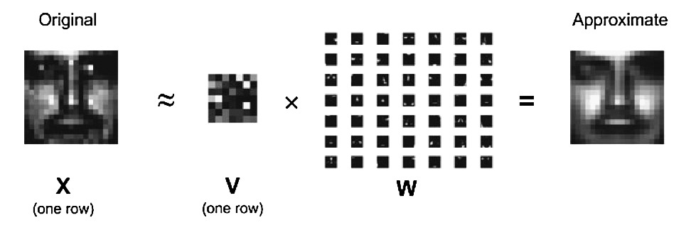

# Instructions

- This problem set contains 7 problems. Each problem must be completed for full credit.
- You are encouraged to discuss with other students. **Clearly identify your collaborators** by naming them in the `author` field in the front matter.
- This assignment will guide you in implementing NNMF, testing it, and applying it to a real dataset.
- Computational efficiency, in terms of speed and memory, is a key criterion in grading this assignment.


# Overview

Nonnegative matrix factorization (NNMF) was introduced by [Lee and Seung (1999)](https://www.nature.com/articles/44565) as an alternative to principal components and vector quantization.
This method [appeared in the past (Lawton and Sylvestre, 1971)](https://www.tandfonline.com/doi/abs/10.1080/00401706.1971.10488823) as a technique for determining the shape of two overlapping functions via additive mixtures.
Today, NNMF has applications in data compression, clustering, and deconvolution.

{#fig-nnmf fig-align="center" width=500}

In mathematical terms, the goal of NNMF is to approximate a data matrix $\mathbf{X} \in \mathbb{R}^{m \times n}$ with nonnegative entries $x_{ij}$ as a product of two *low-rank* matrices $\mathbf{V} \in \mathbb{R}^{m \times r}$ and $\mathbf{W} \in \mathbb{R}^{r \times n}$, also with nonnegative entries $v_{ik}$ and $w_{kj}$.
That is, one chooses $r < \min\{m,n\}$ so that the ranks of $\mathbf{V}$ and $\mathbf{W}$ are at most $r$.
We estimate the factors $\mathbf{V}$ and $\mathbf{W}$ by minimizing the squared Frobenius norm of the residual matrix $\mathbf{R} = \mathbf{X} - \mathbf{V} \mathbf{W}$,
$$
L(\mathbf{V}, \mathbf{W}) = \|\mathbf{X} - \mathbf{V} \mathbf{W}\|_{\text{F}}^2 = \sum_i \sum_j \left(x_{ij} - \sum_k v_{ik} w_{kj} \right)^2, \quad v_{ik} \ge 0, w_{kj} \ge 0,
$$
which should lead to a good factorization.
Lee and Seung suggest an iterative algorithm with multiplicative updates
$$
v_{ik}^{(t+1)} = v_{ik}^{(t)} \frac{\sum_j x_{ij} w_{kj}^{(t)}}{\sum_j b_{ij}^{(t)} w_{kj}^{(t)}}, \quad \text{where } b_{ij}^{(t)} = \sum_k v_{ik}^{(t)} w_{kj}^{(t)},
$$
$$
w_{kj}^{(t+1)} = w_{kj}^{(t)} \frac{\sum_i x_{ij} v_{ik}^{(t+1)}}{\sum_i b_{ij}^{(t+1/2)} v_{ik}^{(t+1)}}, \quad \text{where } b_{ij}^{(t+1/2)} = \sum_k v_{ik}^{(t+1)} w_{kj}^{(t)}
$$
that will drive the objective $L^{(t)} = L(\mathbf{V}^{(t)}, \mathbf{W}^{(t)})$ downhill.
Superscript $t$ indicates the iteration number.


# Problem 1: Check Your Understanding

Before we code anything, let's make sure we have a conceptual understanding of the method. Refer to the abstract of [Lee and Seung (1999)](https://www.nature.com/articles/44565) and @fig-nnmf. *Answer the following questions*:

1. Based on @fig-nnmf, what do the rows of $\mathbf{X}$ represent?
2. What about the columns of $\mathbf{X}$?
3. The factors $\mathbf{V}$ and $\mathbf{W}$ are rank $r$, with $r$ typically smaller than $m$ and $n$. As such, this reduces the amount memory required to store $\mathbf{X}$ albeit with a small loss of information. Based on the previous two questions, which matrix ($\mathbf{V}$ or $\mathbf{W}$) encodes the original images?
4. Using your previous answer, which matrix represents a 'dictionary', 'mapping', or 'coordinate system' that helps us approximate the original image from its compressed representation?
5. Suppose you have $50,000$ images that are each $128 \times 128$ pixels large, and you find a rank $1000$ approximation that is 'good enough'. Assuming pixels are stored as `Float64` (8 bytes), how much savings in memory is achieved with NNMF? *Justify your answer*.


# Problem 2: Implementation

Implement Lee and Seung's algorithm based on the following inputs:

- $\mathbf{X}$ (data, each row is a vectorized image)
- rank $r$,
- convergence tolerance,
- and *optional* starting point $(\mathbf{V}^{(0)}, \mathbf{W}^{(0)})$.

Use the template below to help you get started.

```{julia}
#| eval: false
function nnmf(
  # Positional arguments
  X       :: Matrix{T}, 
  r       :: Integer;
  # Keyword arguments
  maxiter :: Integer = 1000, 
  tolfun  :: Real = 1e-4,
  V       :: Matrix{T} = Random.rand!(similar(X, size(X, 1), r)),
  W       :: Matrix{T} = Random.rand!(similar(X, r, size(X, 2))),
  ) where T <: AbstractFloat
  # TODO: Implementation!!!
  # TODO: Evaluate objective at starting point
  # TODO: Loop
  for iter in 1:maxiter
    # Update V
    # Update W
    # Update objective
    # convergence check
    if abs(obj - obj_old) < tolfun * (abs(obj_old) + 1)
      niter = iter
      break
    end
  end
  # Output: Formatted as a NamedTuple
  result = (;
    V=V,
    W=W,
    r=r,
    converged=false,    # TODO: did the algorithm converge? 
    objective=zero(T),  # TODO: what is the objective at the end?
    iterations=0        # TODO: how many iterations were taken?
  )
  return result
end
```


# Problem 3: Inspecting Data

The [MIT Center for Biological and Computational Learning (CBCL)](http://cbcl.mit.edu/) used to maintain a famous datset of face images. The database reduces to a matrix $\mathbf{X}$ containing $m = 2,429$ gray-scale face images with $n = 19 \times 19 = 361$ pixels per face. Each image (row) is scaled to have mean and standard deviation 0.25.  

Read in the `nnmf-2429-by-361-face.txt` file posted on Canvas, e.g., using the [`readdlm()`](https://docs.julialang.org/en/v1/stdlib/DelimitedFiles/#Delimited-Files) function, and display a few sample images, e.g., using the [Images.jl](https://juliaimages.org/stable/) package.


# Problem 4: Correctness and Efficiency

Report the run times, using `@btime`, of your function for fitting NNMF on the MIT CBCL face data set at ranks $r=10, 20, 30, 40, 50$.
For ease of comparison and grading, please start your algorithm with the provided $\mathbf{V}^{(0)}$ (first $r$ columns of `V0.txt`) and $\mathbf{W}^{(0)}$ (first $r$ rows of `W0.txt`). Use the stopping criterion

$$
\frac{|L^{(t+1)} - L^{(t)}|}{|L^{(t)}| + 1} \le 10^{-4}.
$$

:::::::::::::::::::::::::::::::: callout-tip

### Hint

When Dr. Landeros runs the following code using his implementation of `nnmf()`

```{julia}
#| eval: false
# provided start point
V0full = readdlm("V0.txt", ' ', Float64)
W0full = readdlm("W0.txt", ' ', Float64);

# benchmarking
for r in [10, 20, 30, 40, 50]
  println("rank = $r")
  V0 = V0full[:, 1:r]
  W0 = W0full[1:r, :]
  result = nnmf(X, r, V = V0, W = W0)
  @btime nnmf($X, $r, V = V0, W = W0) setup=(
    V0 = $(V0full[:, 1:r]);
    W0 = $(W0full[1:r, :]);
  )
  print("""
          obj = $(result.objective)
        niter = $(result.iterations)
    converged = $(result.converged)
  -------------------------------------
  """)
end
```

the output is

```
rank = 10
  4.717 ms (15 allocations: 7.15 MiB)
        obj = 11730.388009854621
      niter = 239
  converged = true
-------------------------------------
rank = 20
  6.805 ms (15 allocations: 7.59 MiB)
        obj = 8497.222317849999
      niter = 394
  converged = true
-------------------------------------
rank = 30
  9.447 ms (15 allocations: 8.03 MiB)
        obj = 6621.627345485933
      niter = 482
  converged = true
-------------------------------------
rank = 40
  11.089 ms (15 allocations: 8.47 MiB)
        obj = 5256.663870564313
      niter = 581
  converged = true
-------------------------------------
rank = 50
  13.359 ms (15 allocations: 8.91 MiB)
        obj = 4430.201581697431
      niter = 698
  converged = true
-------------------------------------
```

Due to machine differences, your run times may be different, but not more than an order of magnitude longer. Your memory allocations should be less than or equal to those shown above.

::::::::::::::::::::::::::::::::


# Problem 5: (Non-)Uniqueness

Choose an $r \in \{10, 20, 30, 40, 50\}$ and start your algorithm from a different $\mathbf{V}^{(0)}$ and $\mathbf{W}^{(0)}$. Do you obtain the same objective value and $(\mathbf{V}, \mathbf{W})$? Explain what you find.


# Problem 6: A Fixed Point

For the same $r$, start your algorithm from $v_{ik}^{(0)} = w_{kj}^{(0)} = 1$ for all $i,j,k$. Do you obtain the same objective value and $(\mathbf{V}, \mathbf{W})$? Explain what you find.


# Problem 7: Interpretation

Plot the basis images (rows of $\mathbf{W}$) at rank $r=50$. What do you find?


