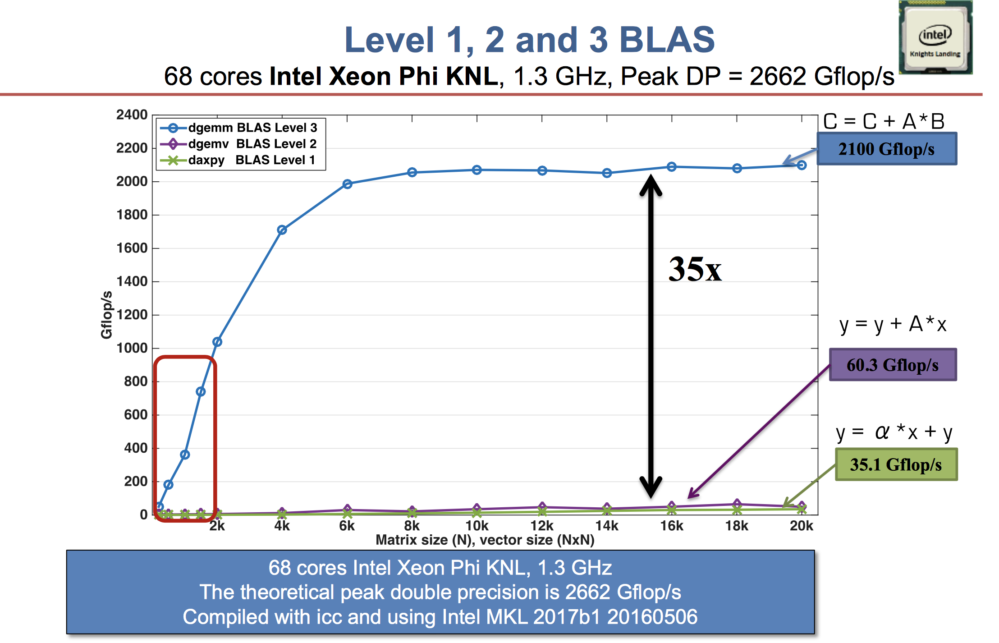
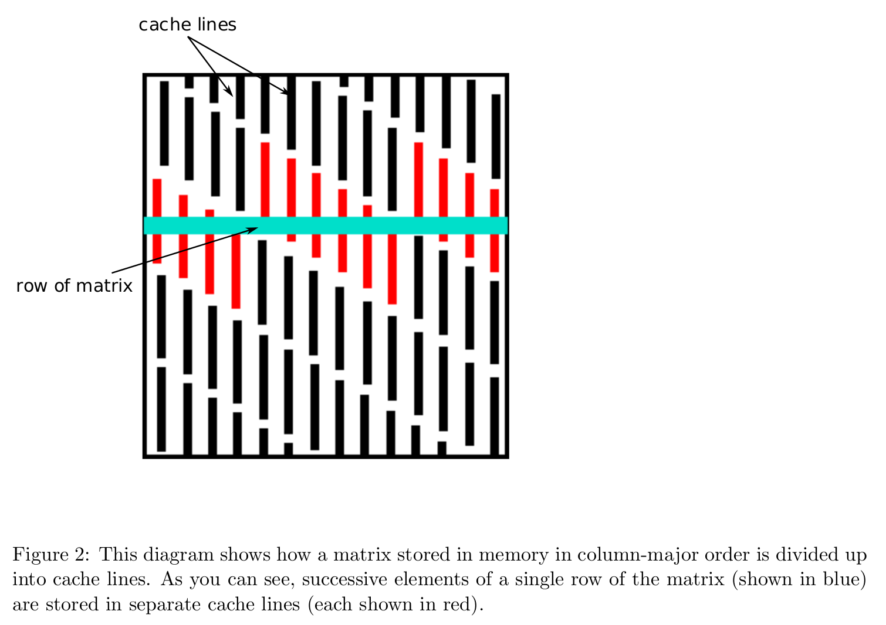

## Goals

1. Be knowledgeable about BLAS/LAPACK as a critical backend for linear algebra in Julia, Python, and R.
2. Understand BLAS Level-1, Level-2, and Level-3 operations and their performance characteristics.
3. Understand interaction between memory allocation and flop counts in BLAS operations.


## Packages

```{julia}
#| eval: true
using BenchmarkTools, Random
using LinearAlgebra
```


## Topics in numerical linear algebra
  
- solve linear equations $\mathbf{A} \mathbf{x} = \mathbf{b}$
- regression computations $\mathbf{X}^T \mathbf{X} \beta = \mathbf{X}^T \mathbf{y}$  
- eigen-problems $\mathbf{A} \mathbf{x} = \lambda \mathbf{x}$  
- generalized eigen-problems $\mathbf{A} \mathbf{x} = \lambda \mathbf{B} \mathbf{x}$  
- singular value decompositions $\mathbf{A} = \mathbf{U} \Sigma \mathbf{V}^T$  
- iterative methods for numerical linear algebra    

Except for the iterative methods, most of these numerical linear algebra tasks are implemented in the **BLAS** and **LAPACK** libraries.
They form the **building blocks** of many statistical computing tasks (optimization, MCMC).

All high-level languages (Julia, Matlab, Python, R) call BLAS and LAPACK for numerical linear algebra.
Julia offers the most flexibility by exposing interfaces to many BLAS/LAPACK subroutines directly.
See [documentation](https://docs.julialang.org/en/v1/stdlib/LinearAlgebra/#BLAS-functions-1).


## BLAS & LAPACK

BLAS stands for *basic linear algebra subprograms*.

Basic Linear Algebra Subprograms (BLAS)

- [Netlib](https://www.netlib.org/blas/) provides a *reference* implementation defining the required tasks and their interfaces.
- [Mathematical Kernel Libraries (MKL)](https://www.intel.com/content/www/us/en/developer/tools/oneapi/onemkl.html)
    - The default for MATLAB.
    - Works on Windows, MacOS, Linux.
    - Proprietary; guaranteed to work on Intel hardware only. Mixed results on AMD, but it appears [the situation has improved as of 2022](https://www.agner.org/optimize/blog/read.php?i=1043&v=t) as reported by [Agner Fog](https://en.wikipedia.org/wiki/Agner_Fog).
- [OpenBLAS](https://www.openblas.net/)
    - Free, open source, and cross-platform.
    - Default in R (except Apple silicon).
- [Accelerate](https://developer.apple.com/documentation/accelerate)
    - [BLAS information](https://developer.apple.com/documentation/accelerate/blas/); support in iOS and iPadOS.
    - Default in R for Apple silicon (at least later versions).
    - Contains additional libraries (including LAPACK).

[LAPACK](https://netlib.org/lapack/) has many important routines for solving linear systems: solving eigenvalue problems, matrix decomposition/factorizations, singular value problems, estimating condition numbers.


## Organization

There are 3 levels of BLAS functions.

- [Level 1](http://www.netlib.org/blas/#_level_1): vector-vector operation
- [Level 2](http://www.netlib.org/blas/#_level_2): matrix-vector operation
- [Level 3](http://www.netlib.org/blas/#_level_3): matrix-matrix operation

There is support for various *fields* and *precisions*:

- **S** single precision
- **D** double precision
- **C** complex
- **Z** double complex

See [Netlib's quick-reference](https://www.netlib.org/blas/blasqr.pdf) for a comprehensive list.

| Level | Example Operation                      | Name        | Dimension                                 | Flops |  
|-------|----------------------------------------|-------------|-------------------------------------------|-------|
| 1     | $\alpha \gets \mathbf{x}^T \mathbf{y}$ | dot product | $\mathbf{x}, \mathbf{y} \in \mathbb{R}^n$ | $2n$  |  
| 1 | $\mathbf{y} \gets \mathbf{y} + \alpha \mathbf{x}$ |  axpy           |  $\alpha \in \mathbb{R}$, $\mathbf{x}, \mathbf{y} \in \mathbb{R}^n$ |  $2n$    |  
| 2     | $\mathbf{y} \gets \mathbf{y} + \mathbf{A} \mathbf{x}$ |  gaxpy           |  $\mathbf{A} \in \mathbb{R}^{m \times n}$, $\mathbf{x} \in \mathbb{R}^n$, $\mathbf{y} \in \mathbb{R}^m$                                     |  $2mn$     |
| 2 | $\mathbf{A} \gets \mathbf{A} + \mathbf{y} \mathbf{x}^T$ | rank one update            |    $\mathbf{A} \in \mathbb{R}^{m \times n}$, $\mathbf{x} \in \mathbb{R}^n$, $\mathbf{y} \in \mathbb{R}^m$                                       | $2mn$      |
| 3     | $\mathbf{C} \gets \mathbf{C} + \mathbf{A} \mathbf{B}$                                       |  matrix multiplication           |  $\mathbf{A} \in \mathbb{R}^{m \times p}$, $\mathbf{B} \in \mathbb{R}^{p \times n}$, $\mathbf{C} \in \mathbb{R}^{m \times n}$                                         | $2mnp$      |

These operations allow for *evaluating* and *accumulating* results of certain operations.

>
> ... Theoretically, matrix-matrix multiplication uses O(N^3) operations on O(N^2) data, so there is lots of opportunity for data reuse, meaning that you can get lots of cache and register reuse and
> therefore a very efficient algorithm. **In fact, GEMM (General Matrix Multiply) is just about the only algorithm that gets close to peak performance of modern processors.** ...
>

--- [Victor Eijkhout](https://www.eijkhout.net/home/landing-page.html) replying to [a Quora question](https://www.quora.com/What-algorithm-does-BLAS-use-for-matrix-multiplication-Of-all-the-considerations-e-g-cache-popular-instruction-sets-Big-O-etc-which-one-turned-out-to-be-the-primary-bottleneck)

## Examples

> **The form of a mathematical expression and the way the expression should be evaluated in actual practice may be quite different.**

Some operations _appear_ as level-3 but indeed are level-2.  

### Example 1

A common operation in statistics is column scaling or row scaling

$$
\begin{eqnarray*}
    \mathbf{A} &=& \mathbf{A} \mathbf{D} \quad \text{(column scaling)} \\
    \mathbf{A} &=& \mathbf{D} \mathbf{A} \quad \text{(row scaling)},
\end{eqnarray*}
$$
where $\mathbf{D}$ is diagonal. For example, in generalized linear models (GLMs), the Fisher information matrix takes the form  
$$
\mathbf{X}^T \mathbf{W} \mathbf{X},
$$
where $\mathbf{W}$ is a diagonal matrix with observation weights on diagonal.  

  Column and row scalings are essentially level-2 operations!

```{julia}
Random.seed!(206) # seed
n = 2000
A = rand(n, n) # n-by-n matrix
d = rand(n)  # n vector
D = Diagonal(d) # diagonal matrix with d as diagonal
```

```{julia}
Dfull = diagm(d) # convert to full matrix
```

```{julia}
# this is calling BLAS routine for matrix multiplication: O(n^3) flops
# this is SLOW!
@benchmark $A * $Dfull
```

```{julia}
# dispatch to special method for diagonal matrix multiplication.
# columnwise scaling: O(n^2) flops
@benchmark $A * $D
```

```{julia}
# Or we can use broadcasting (with recycling)
@benchmark $A .* transpose($d)
```

```{julia}
# in-place: avoid allocate space for result
# rmul!: compute matrix-matrix product A*B, overwriting A, and return the result.
@benchmark rmul!($A, $D)
```

```{julia}
# In-place broadcasting 
@benchmark $A .= $A .* transpose($d)
```


### Example 2

The [inner product](https://en.wikipedia.org/wiki/Dot_product#Coordinate_definition) between two matrices $\mathbf{A}, \mathbf{B} \in \mathbb{R}^{m \times n}$ is often written as 

$$
\text{trace}(\mathbf{A}^T \mathbf{B}), \text{trace}(\mathbf{B} \mathbf{A}^T), \text{trace}(\mathbf{A} \mathbf{B}^T), \text{ or } \text{trace}(\mathbf{B}^T \mathbf{A}).
$$
They appear as level-3 operation (matrix multiplication with $O(m^2n)$ or $O(mn^2)$ flops).

```{julia}
Random.seed!(123)
n = 2000
A, B = randn(n, n), randn(n, n)

# slow way to evaluate tr(A'B): 2mn^2 flops
@benchmark tr(transpose($A) * $B)
```

But $\text{trace}(\mathbf{A}^T \mathbf{B}) = \langle\text{vec}(\mathbf{A}), \text{vec}(\mathbf{B})\rangle$. The latter is level-1 BLAS operation with $O(mn)$ flops.

```{julia}
# smarter way to evaluate tr(A'B): 2mn flops
@benchmark dot($A, $B)
```

### Example 3

Similarly $\text{diag}(\mathbf{A}^T \mathbf{B})$ can be calculated in $O(mn)$ flops.

```{julia}
# slow way to evaluate diag(A'B): O(n^3)
@benchmark diag(transpose($A) * $B)
```

```{julia}
# smarter way to evaluate diag(A'B): O(n^2)
@benchmark Diagonal(vec(sum($A .* $B, dims = 1)))
```

To get rid of allocations for intermediate arrays we can just write a double loop or use the `dot()` function.

```{julia}
function diag_matmul!(d, A, B)
    m, n = size(A)
    @assert size(B) == (m, n) "A and B should have same size"
    fill!(d, 0)
    for j in 1:n, i in 1:m
        d[j] += A[i, j] * B[i, j]
    end
    Diagonal(d)
end

d = zeros(eltype(A), size(A, 2))
@benchmark diag_matmul!($d, $A, $B)
```


## Level-3 fraction

:::: callout-tip
## Takeaway

Effective use of memory hierarchy is key to high performance. This is true on all architectures.

::::

- **Example**: Intel Xeon X5650 CPU has a theoretical throughput of 128 double-precision Gigaflops (GFlops) but a maximum memory bandwidth of 32GB/s.
- **Can we keep CPU cores busy with enough deliveries of matrix data and ship the results to memory fast enough to avoid backlog?** Only if we can use high-level BLAS!
- Higher level BLAS (3 or 2) make more effective use of arithmetic logic units (ALU) by keeping them busy. **Surface-to-volume** effect.  

| BLAS | Dimension | Mem. Refs. | Flops  | Ratio |
|--------------------------------|------------------------------------------------------------|------------|--------|-------|
| Level 1: $\mathbf{y} \gets \mathbf{y} + \alpha \mathbf{x}$     | $\mathbf{x}, \mathbf{y} \in \mathbb{R}^n$                                           | $3n$       | $2n$   | 3:2   |
| Level 2: $\mathbf{y} \gets \mathbf{y} + \mathbf{A} \mathbf{x}$ | $\mathbf{x}, \mathbf{y} \in \mathbb{R}^n$, $\mathbf{A} \in \mathbb{R}^{n \times n}$ | $n^2$      | $2n^2$ | 1:2   |
| Level 3: $\mathbf{C} \gets \mathbf{C} + \mathbf{A} \mathbf{B}$ | $\mathbf{A}, \mathbf{B}, \mathbf{C} \in\mathbb{R}^{n \times n}$                    | $4n^2$     | $2n^3$ | 2:n |  

{fig-align="center" width=500}

Source: [Jack Dongarra's slides](https://raw.githubusercontent.com/ucla-biostat-257/2023spring/master/readings/SAMSI-0217_Dongarra.pdf).

- A distinction between LAPACK and LINPACK (older version of R uses LINPACK) is that LAPACK makes use of higher level BLAS as much as possible (usually by smart partitioning) to increase the so-called level-3 fraction (ratio of data access operations to flops in level-3 algorithms).
- To appreciate the efforts in an optimized BLAS implementation such as OpenBLAS (evolved from GotoBLAS), see [this video](https://www.youtube.com/watch?v=JzNpKDW07rw).


## Respecting memory layout

Both R and Julia implement a *column-major ordering* of matrix data. *This means columns represent contiguous chunks of memory* which are easy to pack into caches.

{fig-align=center width=80%}

Whenever possible, you should access data in the format preferred by your computing language. We demonstrate this with matrix multplication:

$$
\mathbf{C} \leftarrow \mathbf{C} + \mathbf{A}\mathbf{B} \qquad \mathbf{A} \in \mathbb{R}^{m \times p}, \mathbf{B} \in \mathbb{R}^{p \times n}, \mathbf{C} \in \mathbb{R}^{m \times n}.
$$

Implementing this operation requires 3 loops. Depending on the data access pattern, there are 6 possible variants:


```{julia}
#| eval: false
# jki or kji; inner most loop
for i in 1:m
    C[i, j] = C[i, j] + A[i, k] * B[k, j]
end

# ikj or kij; inner most loop
for j in 1:n
    C[i, j] = C[i, j] + A[i, k] * B[k, j]
end

# ijk or jik; inner most loop        
for k in 1:p
    C[i, j] = C[i, j] + A[i, k] * B[k, j]
end
```

The following code implements *fast* (but not BLAS-fast) algorithms for matrix multiplication:

```{julia}
"""
    matmul_by_loop!(A, B, C, order)

Overwrite `C` by `A * B`. `order` indicates the looping order for triple loop.
"""
function matmul_by_loop!(A::Matrix, B::Matrix, C::Matrix, order::String)
    
    m = size(A, 1)
    p = size(A, 2)
    n = size(B, 2)
    fill!(C, 0)
    
    if order == "jki"
        @inbounds for j = 1:n, k = 1:p, i = 1:m
            C[i, j] += A[i, k] * B[k, j]
        end
    end

    if order == "kji"
        @inbounds for k = 1:p, j = 1:n, i = 1:m
            C[i, j] += A[i, k] * B[k, j]
        end
    end
    
    if order == "ikj"
        @inbounds for i = 1:m, k = 1:p, j = 1:n
            C[i, j] += A[i, k] * B[k, j]
        end
    end

    if order == "kij"
        @inbounds for k = 1:p, i = 1:m, j = 1:n
            C[i, j] += A[i, k] * B[k, j]
        end
    end
    
    if order == "ijk"
        @inbounds for i = 1:m, j = 1:n, k = 1:p
            C[i, j] += A[i, k] * B[k, j]
        end
    end
    
    if order == "jik"
        @inbounds for j = 1:n, i = 1:m, k = 1:p
            C[i, j] += A[i, k] * B[k, j]
        end
    end
    
end

Random.seed!(123)
m, p, n = 2000, 100, 2000
A = rand(m, p)
B = rand(p, n)
C = zeros(m, n);
```

```{julia}
@benchmark matmul_by_loop!($A, $B, $C, "jki") # best
```

```{julia}
@benchmark matmul_by_loop!($A, $B, $C, "kji") # second best
```

```{julia}
@benchmark matmul_by_loop!($A, $B, $C, "ikj")
```

```{julia}
# dispatches to BLAS
@benchmark mul!($C, $A, $B)
```

```{julia}
# call BLAS directly
@benchmark LinearAlgebra.BLAS.gemm!('N', 'N', 1.0, $A, $B, 0.0, $C) 
```


:::::::::::::::::::::::::::::::: callout-tip

### Tip for R users

The standard R distribution from CRAN tends to use a very out-dated BLAS/LAPACK library on non-Apple Silicon computers.
Check the output of `sessionInfo()` and look for BLAS/LAPACK.
There are guides for using modern backends such as this [one](https://github.com/david-cortes/R-openblas-in-windows) and this [one](https://nickpoison.github.io/mkl.html).

::::::::::::::::::::::::::::::::


## Avoiding Memory Allocation

### Transpose is an expensive memory operation

In R, the command 

```{r}
#| eval: false
t(A) %*% x
```

will first transpose `A` then perform matrix multiplication, causing unnecessary memory allocation.

```{julia}
Random.seed!(123)

n = 1000
A = rand(n, n)
x = rand(n);
```

Julia avoids transposing a matrix whenever possible. The `Transpose` type only creates a view of the transpose of matrix data.

```{julia}
typeof(transpose(A))
```

```{julia}
fieldnames(typeof(transpose(A)))
```

```{julia}
# same data in tranpose(A) and original matrix A
pointer(transpose(A).parent), pointer(A)
```

```{julia}
# dispatch to BLAS
# does *not* actually transpose the matrix
@benchmark transpose($A) * $x
```

```{julia}
# pre-allocate result
out = zeros(size(A, 2))
@benchmark mul!($out, transpose($A), $x)
```

```{julia}
# or call BLAS wrapper directly
@benchmark LinearAlgebra.BLAS.gemv!('T', 1.0, $A, $x, 0.0, $out)
```

### Broadcast (dot operation) fuses loops and avoids memory allocation

[Broadcasting](https://docs.julialang.org/en/v1.12/base/arrays/#Broadcast-and-vectorization-1) in Julia achieves vectorized code without creating intermediate arrays.

Suppose we want to calculate element-wise maximum of absolute values of two large arrays. In R or Matlab, the command

```r
max(abs(X), abs(Y))
```

creates two intermediate arrays and then a final array to store results.

```{julia}
Random.seed!(123)
X, Y = rand(1000, 1000), rand(1000, 1000);
```

In Julia, dot operations are fused. No intermediate arrays are created in many instances (but not all of them).

```{julia}
# no intermediate arrays created, only result array created
@benchmark max.(abs.($X), abs.($Y))
```

Pre-allocating a results array gets rid of memory allocations.

```{julia}
# no memory allocation at all!
Z = zeros(size(X)) # zero matrix of same size as X
@benchmark $Z .= max.(abs.($X), abs.($Y)) # .= (vs =) is important!
```


:::::::::::::::::::::::::::::::: callout-important

## Be skeptical about micro-optimization

Obsessively managing memory allocations in your code is unlikely to improve performance, and worse yet, will rob you of the benefits of working with a dynamic language like Julia.

- If your program spends most of its time doing matrix-matrix multiplication with large dimensions, pre-allocation costs may be negligible.
- If your program spends most of its time doing scalar operations or "small" matrix/vector operations, the cost of "simple" operations matters a lot.
- **If you're not sure where your code operates along these extremes, profile it!**

Chris Rackaukas has a [detailed blog post](https://www.stochasticlifestyle.com/when-do-micro-optimizations-matter-in-scientific-computing/) on this topic.

::::::::::::::::::::::::::::::::

### Views

[View](https://docs.julialang.org/en/v1/base/arrays/#Views-(SubArrays-and-other-view-types)-1) avoids creating extra copy of matrix data.

```{julia}
Random.seed!(123)
A = randn(1000, 1000)

# sum entries in a sub-matrix
@benchmark sum($A[1:2:500, 1:2:500])
```

```{julia}
# view avoids creating a separate sub-matrix
@benchmark sum(@view $A[1:2:500, 1:2:500])
```

The [`@views`](https://docs.julialang.org/en/v1/base/arrays/#Base.@views) macro can be useful in [some operations](https://discourse.julialang.org/t/why-is-a-manual-in-place-addition-so-much-faster-than-and-on-range-indexed-arrays/3302).

```{julia}
@benchmark @views sum($A[1:2:500, 1:2:500])
```

### The Pre-Allocation Pattern

Pre-allocating buffers for intermediate quantities or outputs can significantly impact performance (but not always!).
As such, it is common to see Julia functions for out-of-place and in-place implementations.

- *Out-of-Place*: Implementation has allocations *for output*. Usually just copies the input in some way.
- *In-Place*: Implementation has no allocations *for output*. Usually mutates the input in some way.
- *Allocation-Free*: No allocations whatsover. Type-stable + all required buffers are allocated *by the caller*.

See for example `sort()` vs `sort!()` in Julia.

```{julia}
#| eval: false
function f!(output, inputs...)
  # use inputs to carry out algorithm,
  # modifying output in the process
  return output
end

function f(inputs...)
  output = allocate_the_output()
  f!(output, inputs...)
end
```

## Takeaway

Use good algorithms and reuse data wherever possible!

1. When possible, frame your problem in terms of linear algebra and specifically high-level BLAS operations.
2. Good code should be mindful about algorithms; this means having some understanding of *complexity* and *interactions with hardware*.
3. In Julia: we can work very low level (e.g. `BLAS.gemm(...)`), high level (e.g. `C = A*B`), or somewhere in between (e.g. `mul!(C, A, B)`).
4. In R: No direct control over memory, have to trust the language. We can still be mindful about memory usage; e.g. reuse data and avoid allocations like `t(X)` whenever possible.
