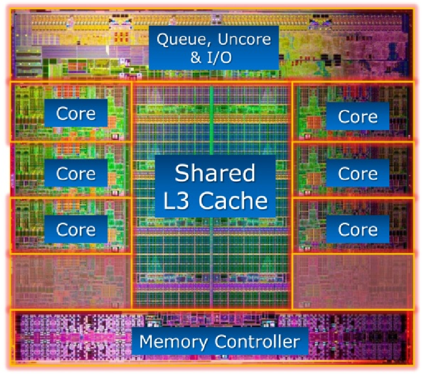
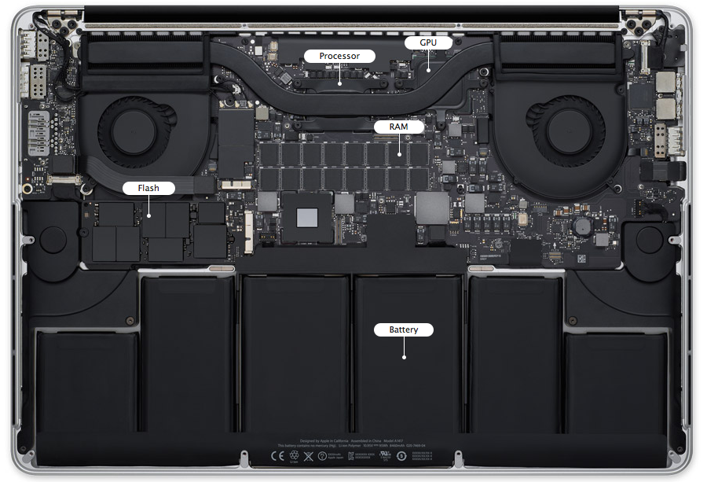
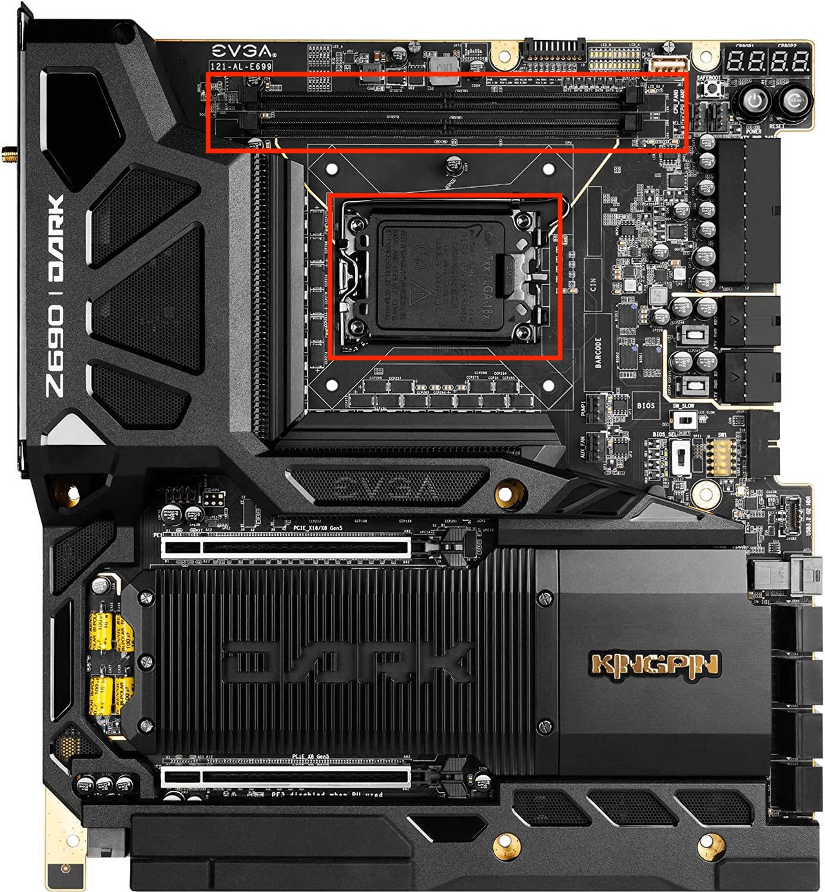
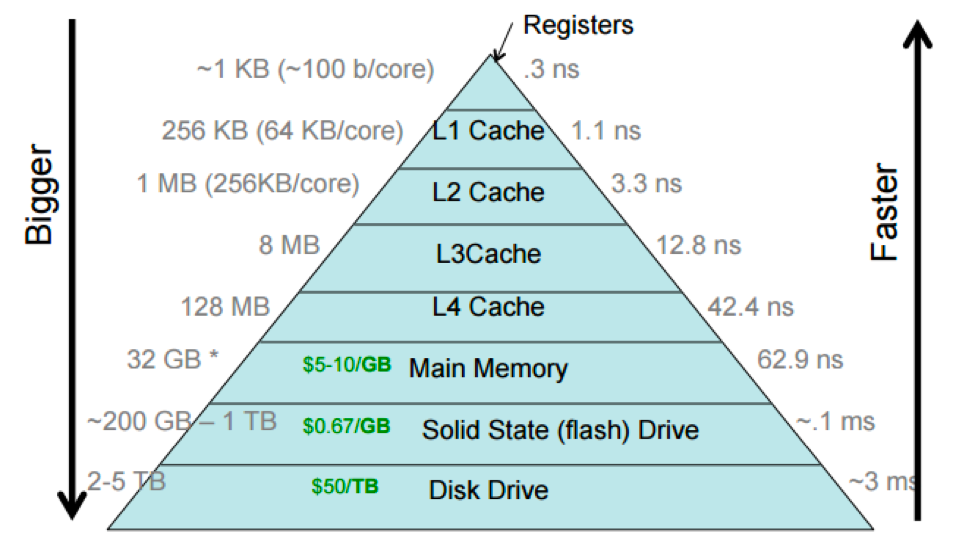

## Goals

1. Be familiar with vocabulary used to describe size of data on a computer.
2. Be familiar with basic computer hardware terminology.
3. Understand the notion of **memory-bound** or **memory-bottleneck**.

## Units of Computer Storage

- bit = binary + digit (coined by statistician [John Tukey](https://en.wikipedia.org/wiki/John_Tukey)).
- byte = $8$ bits.
- KB = kilobyte = $10^{3}$ bytes.
- MB = megabytes = $10^{6}$ bytes.
- GB = gigabytes = $10^{9}$ bytes. Typical RAM size.
- TB = terabytes = $10^{12}$ bytes. Typical hard drive size. Size of NYSE each trading session.
- PB = petabytes = $10^{15}$ bytes.
- EB = exabytes = $10^{18}$ bytes. Size of all healthcare data in 2011 is ~150 EB.
- ZB = zetabytes = $10^{21}$ bytes.

### Understanding scale

- Difference between KB and KiB: 1 KB = 1000 bytes but 1 KiB = 1024 bytes.
- Difference between TB and TiB: 1 TB = 1000 GB but 1 TiB = 1024 GB.

### Checking memory use in Julia

The `Base.summarysize()` function can be used to display the size of objects in terms of memory.

```{julia}
x = zeros(100, 100)
Base.summarysize(x)
```

```{julia}
# find out what module this is in
@__MODULE__
```

```{julia}
# need to specify module because of Quarto
varinfo(Main.Notebook, all=true, minsize=8)
```


## Crash course on hardware

### CPUs

{fig-align="center" width=400}

The image above is a typical (but evolving) schematic of the most critical parts of a **Central Processing Unit (CPU)**:

- Modern CPUs have multiple **cores**, which receive data + instructions to compute.
- Only information on a core's **registers** can be used to carry out computations. Any data on a register is being *actively used*, is extremely limited in size (a few KB at most), and is constantly changing at a nanosecond scale.
- Each core has **L1 cache** and **L2 cache** to store data + instructions that are *predicted* to be reusable. These memory stores are typically small (a few KB to a few MB).
- A significantly larger **L3 cache** provides data storage across multiple cores.
- The non-core logic (AKA Uncore in Intel hardware), I/O subsystem, and memory controller manage communication and data transfer within the CPU to external hardware resources like system RAM.


### GPUs

**Graphics Processing Units (GPUs)** were historically treated as specialized hardware for image processing and computer graphics.
Their adoption for highly parallelized mathematical calculations only emerged in the last two decades or so.
We will not delve into specifics of GPUs in this class, but we can note the following:

- Historically, CPUs prioritize designs with a few large, yet lightning fast cores. In the 2010s and early 2020s, CPUs achieved anywhere between 4 GHz to 6 GHz on consumer hardware across multiple cores. This makes them ideal for *serial execution*.
- In contrast, GPUs prioritize thousands of smaller, simpler, slow cores because computer graphics tend to rely on many small, repetitive calculations to render scenes, even as textures and lighting effects became more sophisticated. This makes them ideal for *parallel execution*, hence their adoption into machine learning and scientific computing.


### Memory hierarchy

Unfortunately, flop counts do not tell the full story.
Another important factor is *data movement* through the memory hierarchy.

{fig-align="center" width=600}

- Light travels *incredibly fast* at $299,792,458~\text{m} \cdot \text{s}^{-1}$.
- The applications and processes running on your computer tend to "live" in main memory, or **Random Access Memory (RAM)**.
- CPU/GPUs are physically separated from RAM by a few centimeters.
- Data movement between RAM and CPU/GPU has a *measurable impact* on the speed of a program, despite the seemingly small physical distances involved. This is known as **memory latency**
- **Example**:
    + At 5 GHz, a CPU completes one tick every 0.2 nanoseconds.
    + During that time, light can only travel about $6 \text{cm}$ through a vacuum; less so on copper circuit traces.
    + The distance between RAM and a CPU ranges between 5 cm to 15 cm, depending on the quality of a motherboard.

{fig-align="center" width=600}

We do not need to have fine-grained knowledge of how much data-movement operations cost, but you *should* develop a sense of scale about them.
Specifically, you should use that sense of scale to answer questions like the following:

- Does my data fit in memory?
    + Do my programs access the data in a hardware-friendly way?
        + Think row-wise vs column-wise, depending on the language.
        + Can I restructure a computation to reuse data?
- Does my data fit on my disk?
    + Can I operate on just a subset of the data at a time?
    + Can I reuse data to avoid having to reload a subset from the disk?

{fig-align="center" width=600}

Source: <https://cs.brown.edu/courses/csci1310/2020/assign/labs/lab4.html>


In Julia, we can query the CPU topology by the `Hwloc.jl` package.
This can help identify potential bottlenecks in algorithms that are **memory-bound**.

```{julia}
import Hwloc

Hwloc.topology_graphical()
```


## Memory Allocation

Computers must allocate memory to represent different objects. Depending on the specific *dynamic* programming language, the amount of memory may be known ahead of time and predictably managed with little overhead. In other instances, the amount of memory is unpredictable based on information within the language and can only be determined once a program is run. We distinguish between these concepts as follows.

### Static Memory Allocation

- This memory is predictable and determined by information encoded within the language.
- `Tuple`, `StaticArray`, type-stable scalar variables, and other objects are usually allocated statically.
- Sometimes said to "live on the stack".
- Compiled languages, Julia, and increasingly other dynamic languages allow programmers to encode this information to improve performance.

### Dynamic Memory Allocation

- This memory is not detected as predictable using information encoded within a programming language.
- `Array`, `Dict`, and type-unstable quantities are usually allocated dynamically; e.g. when a program is actually run.
- Sometimes said to "live on the heap".
