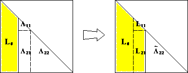

## Packages

```{julia}
using LinearAlgebra, Random
using Distributions
using BenchmarkTools
```

## Cholesky decomposition

In the normal equations for linear regression
$$
\mathbf{X}^T \mathbf{X} \beta = \mathbf{X}^T \mathbf{y},
$$

the coefficient matrix $\mathbf{X}^T \mathbf{X}$ is symmetric and positive semidefinite. **How to exploit this structure?**

**Theorem**: Let $\mathbf{A} \in \mathbb{R}^{n \times n}$ be symmetric and positive definite. Then $\mathbf{A} = \mathbf{L} \mathbf{L}^T$, where $\mathbf{L}$ is lower triangular with positive diagonal entries and is unique.

::: {.callout-note}
**Positive definite**:

- Eigenvalues of $\mathbf{A}$ are all positive
- The quadratic form $\mathbf{x}^\top \mathbf{A} \mathbf{x} > 0$.
- The matrix $\mathbf{A}$ defines an inner product.

:::

**Proof** (by induction):  

If $n=1$, then $\ell = \sqrt{a}$. For $n>1$, the block equation

\begin{eqnarray*}
\begin{pmatrix}
a_{11} & \mathbf{a}^T \\ \mathbf{a} & \mathbf{A}_{22}
\end{pmatrix} =
\begin{pmatrix}
	\ell_{11} & \mathbf{0}_{n-1}^T \\ \mathbf{l} & \mathbf{L}_{22}
\end{pmatrix}
\begin{pmatrix}
	\ell_{11} & \mathbf{l}^T \\ \mathbf{0}_{n-1} & \mathbf{L}_{22}^T
\end{pmatrix}
\end{eqnarray*}

has solution

\begin{eqnarray*}
	\ell_{11} &=& \sqrt{a_{11}} \\
	\mathbf{l} &=& \ell_{11}^{-1} \mathbf{a}	\\
	\mathbf{L}_{22} \mathbf{L}_{22}^T &=& \mathbf{A}_{22}  - \mathbf{l} \mathbf{l}^T = \mathbf{A}_{22}  - a_{11}^{-1} \mathbf{a} \mathbf{a}^T.
\end{eqnarray*}

Now $a_{11}>0$ (why?), so $\ell_{11}$ and $\mathbf{l}$ are uniquely determined. $\mathbf{A}_{22} - a_{11}^{-1} \mathbf{a} \mathbf{a}^T$ is positive definite because $\mathbf{A}$ is positive definite (why?). By induction hypothesis, $\mathbf{L}_{22}$ exists and is unique.

::: {.callout-note}
The [Sherman-Morrison](https://en.wikipedia.org/wiki/Sherman%E2%80%93Morrison_formula) formula, [Woodbury](https://en.wikipedia.org/wiki/Woodbury_matrix_identity) formula, and [Schur complement](https://en.wikipedia.org/wiki/Schur_complement) are useful in

- proving certain structured matrices are invertible, and
- reducing the complexity of solving certain linear systems.

:::

The constructive proof completely specifies the algorithm: 

{fig-align=center width=50%}

## Complexity

$$
\frac{1}{2} [2(n-1)^2 + 2(n-2)^2 + \cdots + 2 \cdot 1^2] \approx \frac{1}{3} n^3 \quad \text{flops}
$$ 

- Half the cost of LU decomposition by taking advantage of symmetry.
- In general Cholesky decomposition is very stable. Failure of the decomposition usually means $\mathbf{A}$ is not positive definite. It is an efficient way to test positive definiteness. 

:::::::::::::::: callout-note

Leading order behavior comes from cost of setting up $\mathbf{L}_{22}$ block in recursive application of the algorithm.

::::::::::::::::


## Applications

**No inversion** mentality: Whenever we see matrix inverse, we should think in terms of solving linear equations. If the matrix is positive (semi)definite, use Cholesky decomposition, which is twice cheaper than LU decomposition.

### Determinant

We should use Cholesky when computing  $\operatorname{det}(\mathbf{A})$ or $\log \operatorname{det}(\mathbf{A})$, where $\mathbf{A}$ is positive definite.

**Why?**

```{julia}
Random.seed!(206)
A = randn(10, 10)
A = 0.5 * (A + A') + 4*I # symmetrize + make PD
cholA = cholesky(A)
```

```{julia}
cholA.L
```

```{julia}
det(A)
```

```{julia}
det(cholA.L) * det(transpose(cholA.L))
```

### Multivariate normal density 

Multivariate normal density $\text{MVN}(0, \Sigma)$, where $\Sigma \in \mathbb{R}^{n \times n}_{++}$ is postive definite, is
$$
\, - \frac{n}{2} \log (2\pi) - \frac{1}{2} \log \det \Sigma - \frac{1}{2} \mathbf{y}^T \Sigma^{-1} \mathbf{y}.
$$

How can we evaluate this density?

**Method 1**:

(a) compute explicit inverse $\Sigma^{-1}$ ($2n^3$ flops),
(b) compute quadratic form ($2n^2 + 2n$ flops), and finally
(c) compute determinant ($2n^3/3$ flops).
    
**Method 2**:

(a) Cholesky decomposition $\Sigma = \mathbf{L} \mathbf{L}^T$ ($n^3/3$ flops),
(b) Solve $\mathbf{L} \mathbf{x} = \mathbf{y}$ by forward substitutions ($n^2$ flops),
(c) compute quadratic form $\mathbf{x}^T \mathbf{x}$ ($2n$ flops), and
(d) compute determinant from Cholesky factor ($n$ flops).  

**Which method is better?**

```{julia}
# this is a person w/o numerical analysis training
function logpdf_mvn_1(y::Vector, Σ::Matrix)
    n = length(y)
    - (n//2) * log(2π) - (1//2) * logdet(Symmetric(Σ)) - (1//2) * transpose(y) * inv(Σ) * y
end

# this is a computing-savvy person 
function logpdf_mvn_2(y::Vector, Σ::Matrix)
    n = length(y)
    Σchol = cholesky(Symmetric(Σ))
    - (n//2) * log(2π) - (1//2) * logdet(Σchol) - (1//2) * abs2(norm(Σchol.L \ y))
end

# better memory efficiency - input Σ is overwritten
function logpdf_mvn_3(y::Vector, Σ::Matrix)
    n = length(y)
    Σchol = cholesky!(Symmetric(Σ)) # Σ is overwritten
    - (n//2) * log(2π) - (1//2) * logdet(Σchol) - (1//2) * dot(y, Σchol \ y)
end
```

```{julia}
Random.seed!(206) # seed

n = 1000
# a pd matrix
Σ = convert(Matrix{Float64}, Symmetric([i * (n - j + 1) for i in 1:n, j in 1:n]))
y = rand(MvNormal(Σ)) # one random sample from N(0, Σ)

# at least they should give the same answer
@show logpdf_mvn_1(y, Σ)
@show logpdf_mvn_2(y, Σ)
Σc = copy(Σ)
@show logpdf_mvn_3(y, Σc);
```

```{julia}
@benchmark logpdf_mvn_1($y, $Σ)
```

```{julia}
@benchmark logpdf_mvn_2($y, $Σ)
```

```{julia}
@benchmark logpdf_mvn_3($y, $Σc) setup=(copy!(Σc, Σ)) evals=1
```

To evaluate the same multivariate normal density at many observations $y_1, y_2, \ldots$, we pre-compute the Cholesky decomposition ($n^3/3$ flops), then each evaluation only costs $n^2$ flops.

### Linear regression

Cholesky decomposition is **one** approach to solve linear regression  
$$
\widehat{\boldsymbol{\beta}} = (\mathbf{X}^T \mathbf{X})^{-1} \mathbf{X}^T \mathbf{y}.
$$

Assume $\mathbf{X} \in \mathbb{R}^{n \times p}$ and $\mathbf{y} \in \mathbb{R}^n$.  

- Compute $\mathbf{X}^T \mathbf{X}$: $np^2$ flops  
- Compute $\mathbf{X}^T \mathbf{y}$: $2np$ flops  
- Cholesky decomposition of $\mathbf{X}^T \mathbf{X}$: $\frac{1}{3} p^3$ flops  
- Solve normal equation $\mathbf{X}^T \mathbf{X} \beta = \mathbf{X}^T \mathbf{y}$: $2p^2$ flops  
- If need standard errors, another $(4/3)p^3$ flops
- Total computational cost is $np^2 + (1/3) p^3$ (without s.e.) or $np^2 + (5/3) p^3$ (with s.e.) flops.
