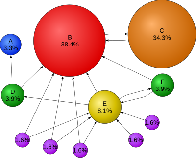
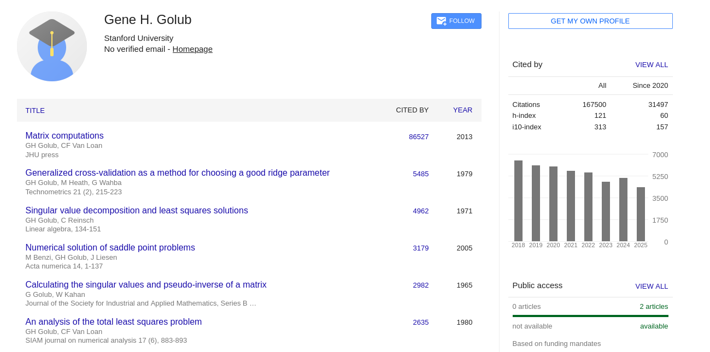
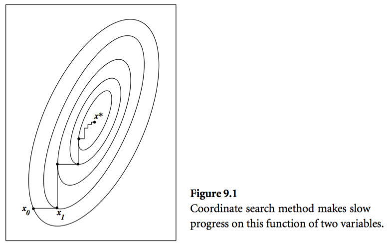
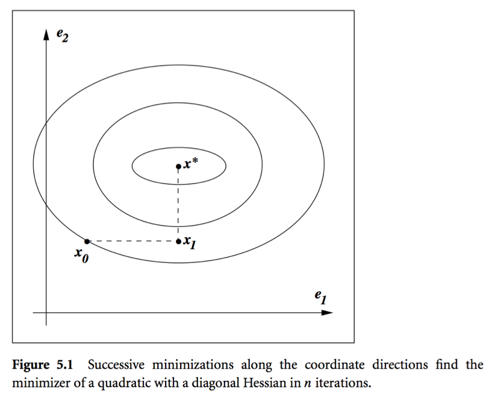

## Motivation

The two problems we've examined so far, $\mathbf{A} \mathbf{x} = \mathbf{b}$ and $\underset{\beta}{\mathrm{min}} \|\mathbf{y} - \mathbf{X}\beta\|^{2}$, both have closed form *analytic solutions* when considered over the real numbers.
As the reader is likely aware, **this is very rare in practice**.
We turn to **iterative methods** whenever neat formulas are unavailable.

|              | Direct         | Iterative       |
|:------------:|:--------------:|:---------------:|
| Flop Count   | Fixed          | Variable        |
| Problem Size | Small/Moderate | Large           |
| Structure    | Dense          | Sparse          |
| Reusability  | Usually only RHS can change | Both LHS and RHS can change |

## The PageRank Problem

### Background: Graph Theory

A **graph** is a mathematical abstraction for *networks*, which in turn model certain kinds of relations in applications (of graph theory).
A graph is defined by

- a set of *vertices* $V$ (or nodes or points or actors...), and
- a set of *edges* $E = \{(x,y) : x,y \in V\}$ (or links or arcs or...).

Graphs can be *directed* or *undirected*, depending on whether the underlying relation is asymmetric or symmetric, respectively.
As such, a graph can be specified using a (weighted) adjacency matrix $\mathbf{A}$ with entries

$$
a_{ij} = \begin{cases}
1 & \text{if $(i,j) \in E$} \\
0 & \text{otherwise}
\end{cases}.
$$

Here $(i,j)$ is a directed edge so that $a_{ij}$ indicates whether node $i$ (source) connects to node $j$ (destination).
Various important quantities can be derived from $\mathbf{A}$

- Out Degree: $d_{i}^{+} = \sum_{j} a_{ij} = [\mathbf{A} \mathbf{1}]_{i}$ (if we treat rows of $\mathbf{A}$ as the originating nodes).
- In Degree: $d_{i}^{-} = \sum_{j} a_{ji} = [\mathbf{1}^{\top}\mathbf{A}]_{i}$.
- If $\mathbf{A}$ is symmetric, the graph is undirected and so we only speak of the degree $d_{i} = d_{i}^{+} = d_{i}^{-}$.

Spectral graph theory relates eigenvalues/eigenvectors of $\mathbf{A}$ or its Laplacian to properties of graphs, and has important applications to high dimensional statistics and machine learning.

### The Problem

{fig-align="center"}

[Larry Page](https://en.wikipedia.org/wiki/PageRank) imagines a random surfer wandering on internet according to following rules:

- From page $i$ with $r_{i} > 0$:
    - With probability $1-p$ they choose a link on a page $i$ uniformly at random and follow that link to the next page.
    - With probability $p$ they choose one page from the set of all $n$ pages uniformly at random and proceed to that page.
- From a page $i$ with $r_{i} = 0$ (a dangling page), they randomly choose one page from the set of $n$ pages uniformly at random, thus avoiding getting stuck at a page without outgoing links.

Here $r_i$ is the *out-degree* of page $i$ and $\mathbf{A}  \in \{0,1\}^{n \times n}$ the connectivity matrix of webpages with entries
$$
a_{ij} = \begin{cases}
1 &  \text{if page $i$ links to page $j$} \\
0 & \text{otherwise}
\end{cases}.
$$

- $n \approx 10^9$ in May 2017.

The description above defines a Markov chain on the space of $n$ pages.
Markov chain theory tells us that the *stationary distribution* of this Markov chain gives the ranks (probabilities) of each page.

- A vector $\mathbf{x}^{\top}$ is a stationary distribution if it is a top left eigenvector of the transition matrix $\mathbf{P}$ corresponding to eigenvalue 1.
- Equivalently it can be cast as the solution to the linear equation
$$
(\mathbf{I}_{n} - \mathbf{P}^{\top}) \mathbf{x} = \mathbf{0}.
$$

- GE/LU will take $2 \times (10^9)^3/3/10^{12} \approx 6.66 \times 10^{14}$ seconds $\approx 20$ million years on a tera-flop supercomputer!
- Numerical analyst [Gene Golub](https://en.wikipedia.org/wiki/Gene_H._Golub) called this the largest matrix computation in world. 
- **Iterative methods come to the rescue**.

{fig-align="center" width=90%}

## Some Definitions

**Iterative methods** are algorithms that, starting from some initial guess, successively approximate a "good" solution to a problem.
They are defined by an algorithm map $F$ in the sense that, given $\mathbf{x}_{k}$, we compute the next *iterate* $x^{(k+1)}$ as

$$
x^{(k+1)} = F(x^{(k)}) \quad \text{for}~k \ge 0.
$$

In the context of solving linear systems, the approximate solution $\mathbf{x}^{(k)}$ is almost always distinct from the *exact* solution $\mathbf{x}^{\ast}$ giving rise to the *error*

$$
\mathbf{w}^{(k)} = \mathbf{x}^{(k)} - \mathbf{x}^{\ast} \quad \text{(to distinguish from $\mathbf{e}_{j}$ notation for standard basis vectors)}.
$$

Thus, an iterative method is said to be *linear* if there exists an *iteration matrix* $\mathbf{C}$ describing the evolution of errors; that is, if

$$
\mathbf{w}^{(k+1)} = \mathbf{C} \mathbf{w}^{(k)}
$$

- We can deduce that a linear iterative method converges if $\lim_{k\to\infty} \mathbf{C}^{k} = \mathbf{0}$ (i.e. the error eventually goes to 0).
- Alternatively, the *spectral radius* of $\mathbf{C}$ satisfies $\rho(\mathbf{C}) < 1$.

This notion shows up everywhere in applied mathematics, and thus has many interpretations and perspectives.

- **Roots**: Find the root of $G(x) = F(x) - x = 0$
- **Fixed Point**: Find $x$ such that $x = F(x)$
- **Dynamical Systems**: Find a stable steady state such that $\lim_{k \to \infty} F(x^{(k)}) \to x$.

## Stationary Methods

These methods are based on the idea of splitting $\mathbf{A}$ into $\mathbf{A} = \mathbf{D} + \mathbf{L} + \mathbf{U}$, where $\mathbf{D}$ is diagonal, $\mathbf{L}$ is lower triangular, and $\mathbf{R}$ is upper triangular. (Why is this helpful?)

### Jacobi Method
$$
x_i^{(k+1)} = \frac{b_i - \sum_{j=1}^{i-1} a_{ij} x_j^{(k)} - \sum_{j=i+1}^n a_{ij} x_j^{(k)}}{a_{ii}}.
$$

Rewrite using splitting $\mathbf{A} = \mathbf{L} + \mathbf{D} + \mathbf{U}$
$$
\mathbf{D} \mathbf{x}^{(k+1)} = - (\mathbf{L} + \mathbf{U}) \mathbf{x}^{(k)} + \mathbf{b},
$$

resulting in the iteration map  (algorithm)

$$
\mathbf{x}^{(k+1)} = - \mathbf{D}^{-1} (\mathbf{L} + \mathbf{U}) \mathbf{x}^{(k)} + \mathbf{D}^{-1} \mathbf{b} = - \mathbf{D}^{-1} \mathbf{A} \mathbf{x}^{(k)} + \mathbf{x}^{(k)} + \mathbf{D}^{-1} \mathbf{b}.
$$

* Convergence for *diagonally dominant $\mathbf{A}$*.
* One round costs $2n^2$ flops with an **unstructured** $\mathbf{A}$.
* Gain over GE/LU if it converges in $O(n)$ iterations.
* Huge savings for **sparse** or **structured** $\mathbf{A}$. By structured, we mean the matrix-vector multiplication $\mathbf{A} \mathbf{v}$ is fast ($O(n)$ or $O(n \log n)$).

### Gauss-Seidel

$$
x_i^{(k+1)} = \frac{b_i - \sum_{j=1}^{i-1} a_{ij} x_j^{(k+1)} - \sum_{j=i+1}^n a_{ij} x_j^{(k)}}{a_{ii}}.
$$

Rewrite with splitting $(\mathbf{D} + \mathbf{L}) \mathbf{x}^{(k+1)} = - \mathbf{U} \mathbf{x}^{(k)} + \mathbf{b}$, that is, 
$$
\mathbf{x}^{(k+1)} = - (\mathbf{D} + \mathbf{L})^{-1} \mathbf{U} \mathbf{x}^{(k)} + (\mathbf{D} + \mathbf{L})^{-1} \mathbf{b}.
$$

* Converges for any $\mathbf{x}^{(0)}$ for symmetric and positive definite $\mathbf{A}$.
* Convergence rate of Gauss-Seidel is the spectral radius of the $(\mathbf{D} + \mathbf{L})^{-1} \mathbf{U}$.

## Krylov Methods

- Based on theory of [Krylov subspaces](https://en.wikipedia.org/wiki/Krylov_subspace).
- **Idea**: Look at the *image* of a vector $\mathbf{b}$ under powers of a square matrix $\mathbf{A}$.
- The vectors $\mathbf{b}, \mathbf{A}\mathbf{b}, \mathbf{A}^{2}\mathbf{b}, \ldots \mathbf{A}^{k-1}\mathbf{b}$ form a subspace of rank at most $k$.
- This idea can be exploited to accelerate/explain why iterative methods for linear systems are quite fast.

### Conjugate Gradients

- Invented by [Magnus Hestenes](https://en.wikipedia.org/wiki/Magnus_Hestenes) and [Eduard Stiefel](https://en.wikipedia.org/wiki/Eduard_Stiefel) in 60s. See @hestenes1952methods for details.
- **Idea**: Solving $\mathbf{A} \mathbf{x} = \mathbf{b}$ is equivalent to minimizing the quadratic function $\frac{1}{2} \mathbf{x}^T \mathbf{A} \mathbf{x} - \mathbf{b}^T \mathbf{x}$. 
- Consider a simple idea: coordinate descent, that is to update components $x_j$ alternatingly. Same as the Gauss-Seidel iteration. Usually it takes too many iterations.

[Kershaw's results](http://www.sciencedirect.com/science/article/pii/0021999178900980?via%3Dihub) for a laser fusion problem.

| Method                                 | Number of Iterations |
|----------------------------------------|----------------------|
| Gauss-Seidel                           | 208,000              |
| Block SOR methods                      | 765                  |
| Incomplete Cholesky conjugate gradient | 25                   |

**Message**: Conjugate gradients and its variants are the top-notch iterative methods for solving huge, structured linear systems.

{fig-align="center" width=500}

**How can we avoid the issue in the picture?**

- Define the *residual* $\nabla f(\mathbf{x}) = \mathbf{A} \mathbf{x} - \mathbf{b} =: \mathbf{r}(\mathbf{x})$
- A set of vectors $\{\mathbf{p}^{(0)},\ldots,\mathbf{p}^{(t)}\}$ are said to be **conjugate with respect to $\mathbf{A}$** if
$$
\begin{eqnarray*}
	\mathbf{p}_i^T \mathbf{A} \mathbf{p}_j = 0, \quad \text{for all } i \ne j.
\end{eqnarray*}
$$
- For example, eigen-vectors of $\mathbf{A}$ are conjugate to each other. Why?

**Conjugate Direction Method**: Given a set of conjugate vectors $\{\mathbf{p}^{(0)},\ldots,\mathbf{p}^{(n-1)}\}$, at iteration $t$, we search along the conjugate direction $\mathbf{p}^{(t)}$
$$
\begin{eqnarray*}
	\mathbf{x}^{(t+1)} = \mathbf{x}^{(t)} + \alpha^{(t)} \mathbf{p}^{(t)},
\end{eqnarray*}
$$
where
$$
\begin{eqnarray*}
	\alpha^{(t)} = - \frac{\mathbf{r}^{(t)T} \mathbf{p}^{(t)}}{\mathbf{p}^{(t)T} \mathbf{A} \mathbf{p}^{(t)}}
\end{eqnarray*}
$$
is the optimal step length.

* **Theorem**: In conjugate direction method, $\mathbf{x}^{(t)}$ converges to the solution in **at most** $n$ steps.
* **Intuition**: Look at a graph.
    
{fig-align="center" width=500}

**Conjugate Gradient Method**: generate $\mathbf{p}^{(t)}$ using only $\mathbf{p}^{(t-1)}$
$$
\begin{eqnarray*}
	\mathbf{p}^{(t)} = - \mathbf{r}^{(t)} + \beta^{(t)} \mathbf{p}^{(t-1)},
\end{eqnarray*}
$$
where $\beta^{(t)}$ is determined by the conjugacy condition $\mathbf{p}^{(t-1)T} \mathbf{A} \mathbf{p}^{(t)} = 0$
$$
\begin{eqnarray*}
	\beta^{(t)} = \frac{\mathbf{r}^{(t)T} \mathbf{A} \mathbf{p}^{(t-1)}}{\mathbf{p}^{(t-1)T} \mathbf{A} \mathbf{p}^{(t-1)}}.
\end{eqnarray*}
$$

### Algorithm (preliminary version)  

Given $\mathbf{x}^{(0)}$, $\mathbf{A}$, and $\mathbf{b}$.

1. Initialize: $\mathbf{r}^{(0)} \gets \mathbf{A} \mathbf{x}^{(0)} - \mathbf{b}$, $\mathbf{p}^{(0)} \gets - \mathbf{r}^{(0)}$, $t=0$
2. While $\mathbf{r}^{(t)} \ne \mathbf{0}$
    1. $\alpha^{(t)} \gets - \frac{\mathbf{r}^{(t)T} \mathbf{p}^{(t)}}{\mathbf{p}^{(t)T} \mathbf{A} \mathbf{p}^{(t)}}$
    2. $\mathbf{x}^{(t+1)} \gets \mathbf{x}^{(t)} + \alpha^{(t)} \mathbf{p}^{(t)}$
    3. $\mathbf{r}^{(t+1)} \gets \mathbf{A} \mathbf{x}^{(t+1)} - \mathbf{b}$
    4. $\beta^{(t+1)} \gets \frac{\mathbf{r}^{(t+1)T} \mathbf{A} \mathbf{p}^{(t)}}{\mathbf{p}^{(t)T} \mathbf{A} \mathbf{p}^{(t)}}$
    5. $\mathbf{p}^{(t+1)} \gets - \mathbf{r}^{(t+1)} + \beta^{(t+1)} \mathbf{p}^{(t)}$
    6. $t \gets t+1$
        
The initial conjugate direction $\mathbf{p}^{(0)} \gets - \mathbf{r}^{(0)}$ is crucial.

### Algorithm (economical version)

Saves one matrix-vector multiplication.

Given $\mathbf{x}^{(0)}$, $\mathbf{A}$, and $\mathbf{b}$.

1. Initialize: $\mathbf{r}^{(0)} \gets \mathbf{A} \mathbf{x}^{(0)} - \mathbf{b}$, $\mathbf{p}^{(0)} \gets - \mathbf{r}^{(0)}$, $t=0$
2. While $\mathbf{r}^{(t)} \ne \mathbf{0}$
  1. $\alpha^{(t)} \gets \frac{\mathbf{r}^{(t)T} \mathbf{r}^{(t)}}{\mathbf{p}^{(t)T} \mathbf{A} \mathbf{p}^{(t)}}$
  2. $\mathbf{x}^{(t+1)} \gets \mathbf{x}^{(t)} + \alpha^{(t)} \mathbf{p}^{(t)}$
  3. $\mathbf{r}^{(t+1)} \gets \mathbf{r}^{(t)} + \alpha^{(t)} \mathbf{A} \mathbf{p}^{(t)}$
  4. $\beta^{(t+1)} \gets \frac{\mathbf{r}^{(t+1)T} \mathbf{r}^{(t+1)}}{\mathbf{r}^{(t)T} \mathbf{r}^{(t)}}$
  5. $\mathbf{p}^{(t+1)} \gets - \mathbf{r}^{(t+1)} + \beta^{(t+1)} \mathbf{p}^{(t)}$
  6. $t \gets t+1$

- Computation cost per iteration is **one** matrix vector multiplication: $\mathbf{A} \mathbf{p}^{(t)}$.  
- Consider the PageRank problem: $\mathbf{A}$ has dimension $n \approx 10^{9}$ but is highly structured (sparse + low rank). Each matrix vector multiplication should only take about $O(n)$ flops.

### Theory

1. $\mathbf{r}^{(t)}$ are mutually orthogonal. 
2. $\{\mathbf{r}^{(0)},\ldots,\mathbf{r}^{(t)}\}$ is contained in the **Krylov subspace** of degree $t$ for $\mathbf{r}^{(0)}$, denoted by
$$
\begin{eqnarray*}
    {\cal K}(\mathbf{r}^{(0)}; t) = \text{span} \{\mathbf{r}^{(0)},\mathbf{A} \mathbf{r}^{(0)}, \mathbf{A}^2 \mathbf{r}^{(0)}, \ldots, \mathbf{A}^{t} \mathbf{r}^{(0)}\}.
\end{eqnarray*}
$$
1. $\{\mathbf{p}^{(0)},\ldots,\mathbf{p}^{(t)}\}$ is contained in ${\cal K}(\mathbf{r}^{(0)}; t)$. 
2. $\mathbf{p}^{(0)}, \ldots, \mathbf{p}^{(t)}$ are conjugate with respect to $\mathbf{A}$.  

- The iterates $\mathbf{x}^{(t)}$ converge to the solution in at most $n$ steps.
- **Theorem**: If $\mathbf{A}$ has $r$ distinct eigenvalues, $\mathbf{x}^{(t)}$ converges to solution $\mathbf{x}^*$ in at most $r$ steps.

## Other Krylov subspace methods

The CG method is for solving $\mathbf{A} \mathbf{x} = \mathbf{b}$, with $\mathbf{A}$ positive definite (minimizing a quadratic).
A variety of other modern iterative methods use the same machinery of CG and extend its reach to different problems.

* **MINRES (minimum residual method)**: symmetric indefinite $\mathbf{A}$.
* **Bi-CG (bi-conjugate gradient)**: unsymmetric $\mathbf{A}$.
* **Bi-CGSTAB (Bi-CG stabilized)**: improved version of Bi-CG.
* **GMRES (generalized minimum residual method)**: current _de facto_ method for unsymmetric $\mathbf{A}$. E.g., PageRank problem.
* **Lanczos method**: top eigen-pairs of a large symmetric matrix.
* **Arnoldi method**: top eigen-pairs of a large unsymmetric matrix.
* **Lanczos bidiagonalization** algorithm: top singular triplets of large matrix.
* **LSQR**: least square problem $\min \|\mathbf{y} - \mathbf{X} \beta\|_2^2$. Algebraically equivalent to applying CG to the normal equation $(\mathbf{X}^T \mathbf{X} + \lambda^2 I) \beta = \mathbf{X}^T \mathbf{y}$.
* **LSMR**: least square problem $\min \|\mathbf{y} - \mathbf{X} \beta\|_2^2$. Algebraically equivalent to applying MINRES to the normal equation $(\mathbf{X}^T \mathbf{X} + \lambda^2 I) \beta = \mathbf{X}^T \mathbf{y}$.

## Software

In Julia, there are several options for solving linear systems efficiently.

- [IterativeSolvers](https://github.com/JuliaLinearAlgebra/IterativeSolvers.jl)
- [Krylov](https://github.com/JuliaSmoothOptimizers/Krylov.jl)
- [KrylovKit](https://github.com/Jutho/KrylovKit.jl)
- [LinearSolve](https://github.com/SciML/LinearSolve.jl)

There are also utility packages, such as [LinearMaps](https://github.com/JuliaLinearAlgebra/LinearMaps.jl), to implicitly define linear operators without the use of matrices.

## Further study

- **Preconditioning**: Applying an *invertible* transformation to $\mathbf{A}$ to improve its condition number.
- **Test Matrices**: For benchmarking/novel methods see [MatrixDepot](https://github.com/JuliaLinearAlgebra/MatrixDepot.jl). Julia interface to databases/collections of matrices for test problems.
- CG and its variants are discussed in @wright1999numerical.

## References

::: {#refs}

:::

