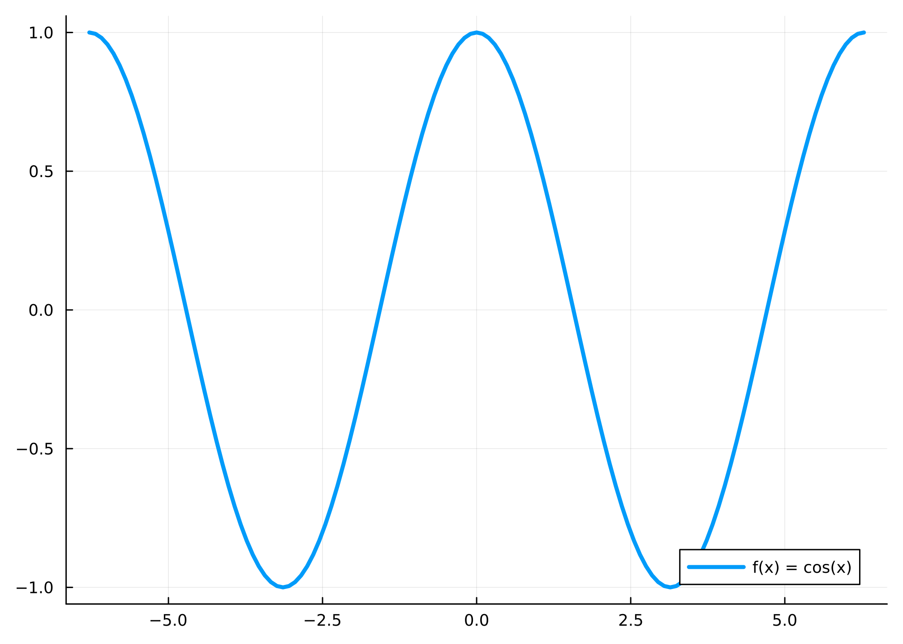
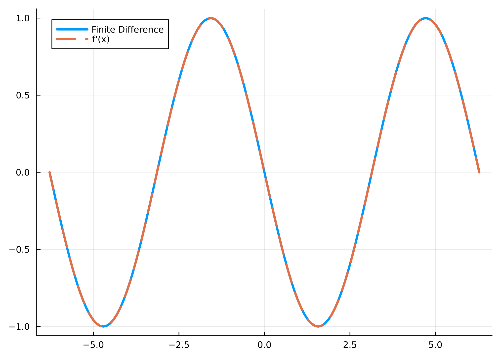
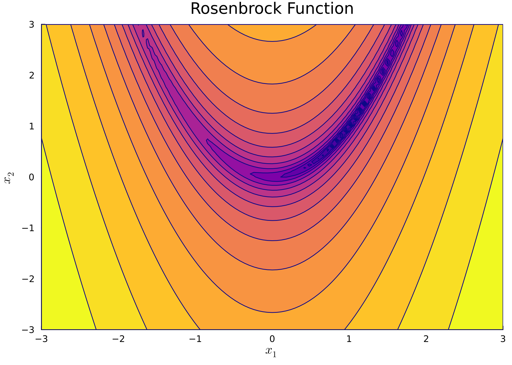

## Goals

1. Introduce various techniques to compute derivatives on computers.
2. Become familiar with forward-mode and reverse-mode automatic differentiation.
3. Recognize the trade-offs in accuracy and cost that determine which technique to use.

## Packages

```{julia}
#| echo: false
#| output: false
ENV["GKSwstype"] = "100"
```

```{julia}
using LinearAlgebra
using FiniteDifferences, DualNumbers, ForwardDiff, ReverseDiff
using Plots, LaTeXStrings
Plots.default(dpi = 300, legend = false)
```

## Overview

How can we compute derivatives on a computer?

- This is a relatively simple problem, at least conceptually.
- Unless we need to exploit structure (to design a good algorithm!), we don't want to derive derivatives by hand.
- There are many ways to do it; e.g. finite differences, symbolic manipulation, and automatic differentiation. They differ in accuracy and in cost.

Recall that the gradient of $f$ at $\boldsymbol{x}$ is

$$
\nabla f(\boldsymbol{x}) = (D_{1}f(\boldsymbol{x}), \ldots, D_{d}f(\boldsymbol{x}))^{\top},
$$

so we only need a program to compute partial derivatives.

## Finite Differences

One way to evaluate derivatives of a given function is to simply exploit the definition of differentiation

$$
f^{\prime}(x) = \lim_{h \to 0} \frac{f(x + h) - f(x)}{h},
$$

by evaluating the RHS with a "small" $h$.
This is essentially the **Finite Difference** [approach](https://en.wikipedia.org/wiki/Finite_difference) in the field of numerical differentiation.
The [FiniteDifferences.jl](https://github.com/JuliaDiff/FiniteDifferences.jl) package in Julia implements various finite difference operators.

::: {.callout-tip}
# R Users
See [numDeriv](https://cran.r-project.org/web/packages/numDeriv/index.html) for finite difference methods in the language.
:::

How well does this work in practice? Let's look at $f(x) = \cos(x)$

```{julia}
#| fig-align: center
xs = range(-2*pi, 2*pi, step = pi/32)
fig = plot(xs, cos; lw = 3, label = "f(x) = cos(x)", legend = true);
```

```{julia}
#| echo: false
#| output: false
savefig(fig, "assets/fdcos1.png")
```

{fig-align="center" width="80%"}


```{julia}
#| fig-align: center
Dx = forward_fdm(2, 1) # first derivative, using 2 grid points; forward difference
Dx_cos(x) = Dx(cos, x) # evaluate derivative of cos at x
fig = plot(xs, Dx_cos; lw = 3, label = "Finite Difference", legend = true)
plot!(xs, x -> -sin(x); lw = 3, ls = :dash, label = "f'(x)")
fig;
```

```{julia}
#| echo: false
#| output: false
savefig(fig, "assets/fdcos2.png")
```

{fig-align="center" width="80%"}

```{julia}
Dx
```

The `grid` field indicates how $f(x)$ is evaluated to approximate $f^{\prime}(x)$; look ahead 1 step.

Change the function and the program still works!

```{julia}
Dx(x -> x^2, 10) # 20
```

But now the issue becomes apparent: These are just approximations. Central differences help but we'll have to deal with both approximation error and floating point errors in our code.

```{julia}
Dx = central_fdm(5, 1) # first derivative, using 5 grid points; central difference
```

The approximation error goes down at the cost of more function evaluations.

```{julia}
Dx(x -> x^2, 10) # 20
```

In practice, we need to balance the approximation error against the cost of evaluating our loss function.

- *Accuracy*: We cannot make $h$ arbitrarily small. The approximation error shrinks with $h$, but the subtraction $f(x + h) - f(x)$ loses digits to floating point error as $h$ shrinks. The best we can do is balance the two.
- *Cost*: Each partial derivative needs its own function evaluations. A forward difference approximation to a gradient in $d$ dimensions costs $d + 1$ evaluations of $f$.

## The Problem

Finite differences are widely used in scientific computing, especially ODEs/PDEs.
Problems in this space often require higher order derivatives.
More pressing, however, is that models in applications (be it scientific computing, statistics, or machine learning) are often complex systems unto themselves.
For these models, finite differences may not be optimal in terms of computational complexity or in terms of accuracy.

Fortunately, we often do not need a derivative explicitly.
Many algorithms only need the *action* of a derivative on a vector.
Consider a function $F : \mathbb{R}^{d} \longrightarrow \mathbb{R}^{m}$ with Jacobian matrix $\boldsymbol{J}(\boldsymbol{x}) \in \mathbb{R}^{m \times d}$.

- A **Jacobian-vector product (JVP)** is $\boldsymbol{J}(\boldsymbol{x}) \boldsymbol{v}$ for a vector $\boldsymbol{v} \in \mathbb{R}^{d}$. This is the action of the differential, $dF(\boldsymbol{x})[\boldsymbol{v}]$, from our [introduction](optim.qmd); i.e. a directional derivative.
- A **vector-Jacobian product (VJP)** is $\boldsymbol{u}^{\top} \boldsymbol{J}(\boldsymbol{x})$ for a vector $\boldsymbol{u} \in \mathbb{R}^{m}$. When $m = 1$ and $u = 1$ this is the gradient of $F$ (as a row vector).
- A **Hessian-vector product (HVP)** is $\nabla^{2} f(\boldsymbol{x}) \boldsymbol{v}$ for a scalar-valued function $f$. This is a JVP applied to the gradient map $\boldsymbol{x} \mapsto \nabla f(\boldsymbol{x})$.

For example, finding a Newton direction in [second-order methods](order2.qmd) amounts to solving a linear system.
As we saw in discussing Krylov methods for solving linear systems, it is possible to work only with HVPs rather than forming the Hessian itself.

The figures below illustrate how second derivatives are handled in practice. Both come from JAX.

.](assets/JAX_2nd_derivA.jpg){fig-align="center" width="80%"}

.](assets/JAX_2nd_derivB.jpg){fig-align="center" width="80%"}

Thinking of models as computational graphs, it becomes apparent that complex models become unwieldy for differentiation; see this [JAX blog from Google](https://developers.googleblog.com/en/jax-symbolic-power-unlocks-new-frontiers-in-scientific-computing/) for an example.
So setting approximation errors aside, the computational complexity of a "differentiation program" can limit the types of applications that can be addressed. You're not going to handwrite any derivatives of a neural network, either.

Are there any alternatives to finite differences?

## Automatic Differentiation

**Automatic differentiation** is a technique used to compute exact derivatives on computers, up to machine precision. It comes in many flavors, and many important machine learning packages are built on the idea of being able to evaluate derivatives of complex objects efficiently.

The idea is simple.
A program that evaluates a function is a long composition of elementary operations ($+$, $\times$, $\exp$, $\sin$, ...).
We know the derivative of each elementary operation, and the chain rule tells us how to combine them.
AD applies the chain rule to the program itself, one operation at a time.

For example, suppose $F(\boldsymbol{x}) = F_{3}(F_{2}(F_{1}(\boldsymbol{x})))$. By the chain rule, the Jacobian of $F$ is a product of the Jacobians for each step:

$$
\boldsymbol{J} = \boldsymbol{J}_{3} \boldsymbol{J}_{2} \boldsymbol{J}_{1}.
$$

The two main flavors of AD differ in the order in which this product is evaluated.

### Forward Mode

Forward mode computes a JVP, working from right to left:

$$
\boldsymbol{J} \boldsymbol{v} = \boldsymbol{J}_{3} (\boldsymbol{J}_{2} (\boldsymbol{J}_{1} \boldsymbol{v})).
$$

- This is the same order in which the program evaluates $F$. Derivatives are carried along with function values, from inputs to outputs.
- One pass through the program yields one JVP. Taking $\boldsymbol{v} = \boldsymbol{e}_{j}$ gives the partial derivatives with respect to $x_{j}$.
- A gradient of $f : \mathbb{R}^{d} \longrightarrow \mathbb{R}$ therefore requires $d$ passes. The cost grows with the number of *inputs*.
- Nothing needs to be stored beyond the current step.

### Reverse Mode

Reverse mode computes a VJP, working from left to right:

$$
\boldsymbol{u}^{\top} \boldsymbol{J} = ((\boldsymbol{u}^{\top} \boldsymbol{J}_{3}) \boldsymbol{J}_{2}) \boldsymbol{J}_{1}.
$$

- This is the opposite of the order in which the program evaluates $F$. We must first run the program and record the intermediate values, then propagate derivatives from outputs back to inputs.
- One reverse pass yields one VJP. For a scalar-valued $f$, a single pass gives the entire gradient, no matter how large $d$ is.
- The cost grows with the number of *outputs*, but we pay in memory for the recorded values.
- In machine learning this is known as *backpropagation*.

As a rule of thumb, use forward mode for functions with few inputs and reverse mode for functions with many inputs and few outputs. A loss function with many parameters is the typical case for reverse mode.

There are many ways to implement AD and it is an active area of research.
For example, AD can be implemented with special number types, by transforming source code, or at the level of compiled code.
A few tools for computing derivatives:

- [Autograd](https://github.com/hips/autograd) in Python; reverse-mode differentiation (backpropagation)
- [ForwardDiff](https://github.com/JuliaDiff/ForwardDiff.jl); forward-mode with dual numbers
- [ReverseDiff](https://github.com/JuliaDiff/ReverseDiff.jl); reverse-mode, records operations as the program runs
- [Enzyme](https://github.com/EnzymeAD/Enzyme.jl); forward/reverse-mode at LLVM level
- [Zygote](https://github.com/FluxML/Zygote.jl); reverse-mode source-to-source
- [Symbolics](https://github.com/JuliaSymbolics/Symbolics.jl); Computer Algebra System (CAS). Derivatives are obtained by manipulating symbolic expressions. The results are exact, but this approach is slow.
- [TaylorDiff](https://github.com/JuliaDiff/TaylorDiff.jl); Taylor-mode AD similar to that which appeared in the JAX post above.

## Dual Numbers

Let's examine a curious extension of the real line $\mathbb{R}$, the **dual numbers**. This is the machinery behind forward mode.
Dual numbers define a number system with infinitesimals $\epsilon$ such that $\epsilon^{2} = 0$ *by definition*.
A dual number takes the form $a + b\epsilon$, where $a$ and $b$ are real numbers.
Given a real number $x$, we can associate it with the dual number $x + \epsilon$.
The utility of dual numbers is that evaluating functions over dual numbers immediately yields function values and derivatives simultaneously. For example, consider $f(x) = x^2$. Evaluation of $f$ over dual numbers yields

$$
f(x + \epsilon) = (x + \epsilon)^2 = x^2 + 2x\epsilon + \epsilon^2 = x^{2} + 2x\epsilon = f(x) + f^{\prime}(x)\epsilon.
$$

The *real* part of the dual number is simply the value $f(x)$, whereas the *dual* part accumulates $f^{\prime}(x)$.
The technique generalizes to more complicated functions and extends to vector-valued functions in general.
The [ForwardDiff documentation](https://juliadiff.org/ForwardDiff.jl/stable/dev/how_it_works/) has excellent explanations on the mathematical and implementation details.

The DualNumbers.jl package implements this number system.

```{julia}
z = Dual(3.0, 1.0)       # 3 + 1*epsilon
w = z^2
realpart(w), dualpart(w) # f(3) = 9, f'(3) = 6
```

Nothing is special about $x^{2}$; the same works for compositions.

```{julia}
w = sin(z^2)
dualpart(w), cos(3.0^2) * 2 * 3.0 # compare against the chain rule
```

This may sound too good to be true!
Dual numbers were introduced by [William Clifford](https://en.wikipedia.org/wiki/William_Kingdon_Clifford) in the 1870s and developed further by others. In this number system the infinitesimal is *nilpotent*; that is, $\epsilon \neq 0$ but $\epsilon^{2} = 0$.
Separately, the logician [Abraham Robinson](https://en.wikipedia.org/wiki/Abraham_Robinson) showed that calculus with infinitesimals can be made rigorous. His number system is different from the dual numbers (his infinitesimals are not nilpotent), but the lesson is the same.
Dual numbers and AD are not merely curious computational tricks.
The idea continues to be extended; for example, [hyper-dual numbers](https://arc.aiaa.org/doi/abs/10.2514/6.2011-886) use additional infinitesimals to compute exact second derivatives.

## Examples

We revisit the Rosenbrock function from [first-order methods](order1.qmd).

```{julia}
function rosenbrock(x)
  return (1 - x[1]) ^ 2 + 100 * (x[2] - x[1] ^ 2) ^ 2
end
```

```{julia}
#| fig-align: center
xs = ys = range(-3, 3, length = 101)
tv = -4:4
tl = [L"10^{%$i}" for i in tv]
fig = contourf(xs, ys, (x, y) -> log10(rosenbrock([x, y]));
  levels = 16,
  color = :plasma,
  xlabel = L"x_{1}",
  ylabel = L"x_{2}",
  colorbar_ticks = (tv, tl),
  title = "Rosenbrock Function"
);
```

```{julia}
#| echo: false
#| output: false
savefig(fig, "assets/fdrosenbrock.png")
```

{fig-align="center" width="80%"}

Forward mode, using ForwardDiff:

```{julia}
ForwardDiff.gradient(rosenbrock, Float64[1, 1]) # gradient at minimum
```

Reverse mode, using ReverseDiff:

```{julia}
ReverseDiff.gradient(rosenbrock, Float64[1, 1]) # gradient at minimum
```

With only two inputs the choice of mode hardly matters.

Second derivatives are available, too. This is what we need for the [second-order methods](order2.qmd).

```{julia}
ForwardDiff.hessian(rosenbrock, Float64[1, 1])
```

Finally, an HVP without forming the Hessian. We differentiate the function $t \mapsto \nabla f(\boldsymbol{x} + t\boldsymbol{v})$ at $t = 0$.

```{julia}
x0 = Float64[1, 1]
v = Float64[1, 0]
ForwardDiff.derivative(t -> ForwardDiff.gradient(rosenbrock, x0 + t * v), 0.0)
```

Compare the result against the first column of the Hessian.
Here we nested forward mode inside of forward mode. For large problems, the usual recipe is forward mode applied to a reverse mode gradient.
