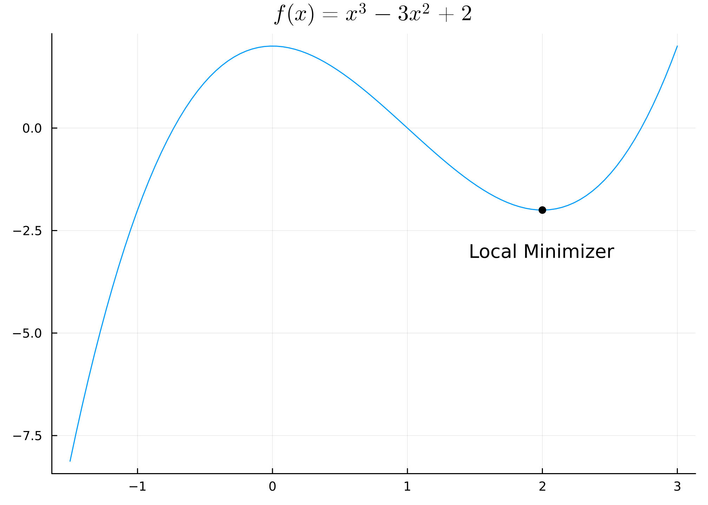
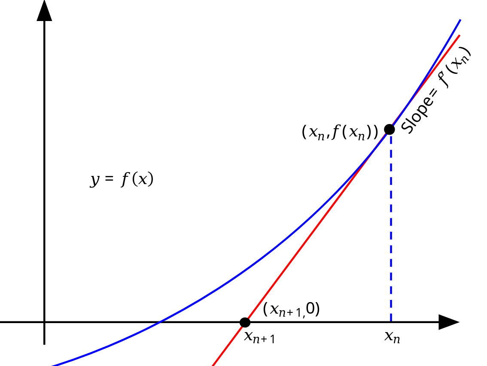

## Goals

1. Define the unconstrained optimization problem.
2. Relate root finding and optimization problems.
3. Review notions of differentiability.

## Overview

- Many problems in statistics come down to optimization (but not all of them).
- So do lots of problems in economics, physics, CS, biology, operations research ...
- *Mathematical optimization* deals in minimums $\min$ and maximums $\max$.
- Statisticians usually talk about *maximization*; the field of optimization often studies minimization. We translate one to the other with minus signs.

Lots of estimators are formulated in terms of minimization/maximization.

- Ordinary least squares (including variants with ridge, lasso, elastic net...)
- Least absolute deviations regression (LAD); regression but with $|\cdot|$ instead of $\|\cdot\|_{2}^{2}$
- Maximum likelihood estimation (MLE)
- Maximum a posteriori (MAP) estimation; Bayesian statistics
- Machine learning: loss + regularization

## Packages

```{julia}
#| echo: false
#| output: false
ENV["GKSwstype"] = "100"
```

```{julia}
using Plots, LaTeXStrings
Plots.default(dpi = 300, legend = false)
```

## Optimization Problem

An *unconstrained minimization problem* takes the form of

$$
\min_{\boldsymbol{x}}~f(\boldsymbol{x}) \qquad \qquad (P)
$$

- The underset symbol $\boldsymbol{x}$ indicates the variable(s) of the optimization problem.
- The expression $f(\boldsymbol{x})$ represents the objective function; i.e. what do we want to minimize.
- We understand $\boldsymbol{x} \in \mathbb{R}^{d}$ from context; we'll assume real-valued solutions in this class.

The Problem (P) may or may not have a solution. There may be multiple solutions.

- *No solution*: $\min_{x} \log(x)$, even when restricted to the function's domain $x > 0$.
- *Not unique*: $\min_{x} \cos(x)$, unless we specify a specific interval containing exactly one global minimizer.

As such, we may write the following when dealing with non-unique solutions

$$
\boldsymbol{x} \in \underset{\boldsymbol{y}}{\mathrm{argmin}}~f(\boldsymbol{y}) = \left\{\boldsymbol{z} : f(\boldsymbol{z}) = f_{\ast}\right\},
$$

and say $\boldsymbol{x}$ is *a solution* or *a minimizer* to Problem (P) if $f(\boldsymbol{x}) = f_{\ast}$, the minimum value of the function $f$.
When we have a guarantee that there is only one solution, we replace $\in$ with $=$.

Outside of easy textbook problems, most real-world applications do not admit closed-form solutions; i.e. in general, we cannot hope to write down an explicit formula giving solutions to Problem (P).
Thus, we need algorithms to compute solutions, often in an iterative fashion.
In many cases, algorithms may only guarantee that a solution corresponds to a *stationary point*, where $\nabla f(\boldsymbol{x}) = \boldsymbol{0}$, which may or may not be a minimum or maximum point.

### Global vs Local Minima

- A point $\boldsymbol{x}_{\ast}$ is a **local minimizer** if $f(\boldsymbol{x}_{\ast}) \le f(\boldsymbol{x})$ for any $\boldsymbol{x}$ in a neighborhood $N(\boldsymbol{x}_{\ast})$ around it. This may or may not be unique.
- A point $\boldsymbol{x}_{\ast}$ is a **global minimizer** if $f(\boldsymbol{x}_{\ast}) \le f(\boldsymbol{x})$ for any $\boldsymbol{x}$ in the domain of $f(\cdot)$. This may or may not be unique.

```{julia}
#| echo: false
#| output: false
h(x) = x^3 - 3x^2 + 2
plot(range(-1.5, 3, 101), h,
  title = L"f(x) = x^{3} - 3 x^{2} + 2"
)
scatter!((2, -2), color = "black")
annotate!(2, -3, text("Local Minimizer", 12, :black, :center))
savefig("assets/localmin.png")
```



## Optimization vs Root Finding

The problems of optimization and root finding are closely related to each other.
Depending on the application, one perspective may offer a better algorithm.
The example below was derived without any knowledge of calculus, in a historical context, but calculus features heavily in optimization algorithms.
We will see the connection between the two mathematical problems via the Newton-Raphson method.

## Example: Computing $\sqrt{c}$

### The Babylonian Method

The ancient Babylonians knew how to approximate the hypotenuse of a triangle, which involves computing the square root of a non-negative number.
The Greek mathematician Heron would later define an explicit algorithm for computing the square root of an arbitrary non-negative number $c$, which is often attributed to the Babylonians due to their geometric skills.

**Source**: [Babylonian Method (Wikipedia)](https://en.wikipedia.org/wiki/Methods_of_computing_square_roots#Heron's_method)

**Credit**: [Algorithms from THE BOOK (Chapter 1, Section 3)](https://epubs.siam.org/doi/book/10.1137/1.9781611976175)

Treating $x_{n}$ as the current estimate at *iteration* $n$, consider the following recipe

$$
x_{n+1} = \frac{1}{2} \left[x_{n}+\frac{c}{x_{n}}\right].
$$

This is an *iterative algorithm* in which the next iterate (left-hand side), $x_{n+1}$, is defined by some function of the previous iterates (just $x_{n}$ in this case) plus some additional problem data (such as the number, $c$).
This is known as the Babylonian method.

The following code implements the algorithm using the stopping condition $|x_{n+1}^{2} - c| < \epsilon$ for some tolerance parameter $\epsilon$.

```{julia}
function babylonian(c, x0; maxiter = 10, epsilon = 1e-3)
  not_converged = c != 0              # convergence check
  x = ifelse(not_converged, x0, c)    # current estimate
  n = 0                               # iteration counter
  while (not_converged && n < maxiter)
    x = 0.5 * (x + c / x)                   # update
    not_converged = abs(x^2 - c) > epsilon  # check
    n = n + 1                               # update counter
  end
  status = ifelse(not_converged, "did not", "did")
  println("The algorithm ", status, " converge after ", n, " iterations.")
  return x
end
```

```{julia}
babylonian(pi, 3.14, epsilon = 1e-6) - sqrt(pi)
```

### Solve as a Root Finding Problem

Let us formulate the problem precisely and derive the Babylonian method: Given $c > 0$, we seek a number $x$ such that $x^{2} = c$.
A little rearranging reveals the generic problem:

$$
f(x) = x^{2} - c = 0; \qquad c > 0,
$$

that is, we need to find a *root* or *zero* of the function $f(x) = x^{2} - c$.

From elementary calculus, we know $f(x)$ is differentiable and that we can approximate its value at $x$ from its properties at an anchor point $x_{0}$. To first order, Taylor's theorem states we can extrapolate from $x_{0}$ via

$$
f(x) = f(x_{0}) + f^{\prime}(x_{0})(x - x_{0}) + O(|x-x_{0}|^{2}).
$$

Assume this approximation is *good enough*, i.e. the $O(|x-x_{0}|^{2})$ term is negligible.
Focus on the linear piece only

$$
y = f(x_{0}) + f^{\prime}(x_{0})(x - x_{0}).
$$

The derivative $f^{\prime}(x_{0})$ defines its slope. To determine its $x$-intercept, we solve by finding $x_{1}$ such that $y = 0$:

$$
0 = f(x_{0}) + f^{\prime}(x_{0})(x_{1} - x_{0}),
$$

which yields

$$
x_{1} = x_{0} - \frac{f(x_{0})}{f^{\prime}(x_{0})}.
$$

This provides a generic recipe for extrapolating $x$-intercepts from $y = f(x_{n}) + f^{\prime}(x_{n})(x - x_{n})$.
Thus, iterating the *algorithm map*

$$
x_{n+1} = x_{n} - \frac{f(x_{n})}{f^{\prime}(x_{n})},
$$

should, under certain conditions, recover an estimate $x$ such that $f(x) = 0$. Filling in the details for our problem, we have

$$
x_{n+1} = x_{n} - \frac{x_{n}^{2} - c}{2 x_{n}}.
$$

This is precisely the **Newton-Raphson method** for calculating roots of functions. It requires $f(x)$ to be differentiable with respect to $x$.
Newton-Raphson can also be applied to optimization problems.

{fig-align="center" width="50%"}

Rearrangement of the algorithm map yields the Babylonian method:

$$
x_{n+1}
= \frac{1}{2} \left[2 x_{n} - x_{n} + \frac{c}{x_{n}}\right]
= \frac{1}{2} \left[x_{n} + \frac{c}{x_{n}}\right]
$$

### Solve as a Minimization Problem

Alternatively, we can cast the problem of calculating square roots as an optimization problem. That is, minimize the residual in

$$
g(x) = \frac{1}{2}(x^{2} - c)^2
$$

- Why the square? Large negative values should be penalized just as much as large positive values. Absolute values are not differentiable, but squares are.
- Want $x^{2}$ "close" to $c$; that is, in terms of squared Euclidean distance. Generalize to $d$ dimensions.
- Probably not the best idea here. The root finding problem involves a quadratic and here we increase the complexity to a quartic polynomial. This introduces an additional stationary point. We also require the underlying function to be twice-differentiable.

From calculus we know that the *stationary condition* $g^{\prime}(x) = 0$ indicates a critical point.
Thus, we might think to apply the root-finding Newton-Raphson method to the function $g^{\prime}(x)$.
This leads to the algorithm map

$$
x_{n+1} = x_{n} - \frac{g^{\prime}(x_{n})}{g^{\prime\prime}(x_{n})},
$$

which requires $g(x)$ to be twice-differentiable. Filling in the details, we have

$$
x_{n+1} = x_{n} - \frac{x_{n}(x_{n}^{2} - c)}{3 x^{2}_{n} -c}
$$

```{julia}
function newton_sqrt(c, x0; maxiter = 10, epsilon = 1e-3)
  not_converged = c != 0
  x = ifelse(not_converged, x0, c)
  n = 0
  while (not_converged && n < maxiter)
    x2 = x*x
    x = x - x * (x2 - c) / (3 * x2 - c)
    not_converged = abs(x^2 - c) > epsilon  # check
    n = n + 1
  end
  status = ifelse(not_converged, "did not", "did")
  println("The algorithm ", status, " converge after ", n, " iterations.")
  return x
end
```

```{julia}
newton_sqrt(pi, 3.14, epsilon = 1e-6) - sqrt(pi)
```

### Summary

- Here we cast the problem of evaluating a function at a specific point as both a root finding problem and a minimization problem.
- In both cases, the algorithms we derived are instances of the Newton-Raphson method.
    + Root finding on $f(x)$: Need to evaluate $f(x)$ and $f^{\prime}(x)$.
    + Minimization on $g(x)$: Need to evaluate $g^{\prime}(x)$ and $g^{\prime\prime}(x)$.
- In both cases, convergence is quite rapid.

## Multivariable Calculus

The iterative algorithms in the $\sqrt{c}$ problem each required use of calculus in one variable.
Exposure to generalizations of multivariable calculus will be fruitful in applications.

### Definitions

Functions of several variables have many notions of derivatives.

For a function $f : \mathbb{R}^{d} \longrightarrow \mathbb{R}$, define the differential operator $D_{j}$ by its action on $f$

$$
D_{j} f(\boldsymbol{x})
= \lim_{t \to 0} \frac{f(\boldsymbol{x} + t\boldsymbol{e}_{j}) - f(\boldsymbol{x})}{t} = \frac{d}{dx_{j}}f(\boldsymbol{x}),
$$

whenever the limit exists. This is the **partial derivative of $f$ with respect to $x_{j}$**.

- $D_{j}$ (or $\frac{d}{d x_{j}}$) is an operator that acts on functions,
- $\boldsymbol{e}_{j}$ is the $j$-th standard basis vector of $\mathbb{R}^{d}$, and
- $\frac{d}{dx_{j}}f(\boldsymbol{x})$ is the result, itself a function evaluated at $\boldsymbol{x}$.

Partial derivatives are thus special cases of *directional derivatives*.
The **directional derivative along direction $\boldsymbol{v}$** is defined by the limit

$$
D_{\boldsymbol{v}} f(\boldsymbol{x})
= \lim_{t \to 0} \frac{f(\boldsymbol{x} + t\boldsymbol{v}) - f(\boldsymbol{x})}{t} = df(\boldsymbol{x})[\boldsymbol{v}],
$$

where we assume $\|\boldsymbol{v}\| = 1$ and $df(\boldsymbol{x})[\boldsymbol{v}]$ denotes the *action* of the differential on a vector $\boldsymbol{v}$.
There are a few things to note here:

1. Partial derivatives depend on your basis elements. *Thus, partial derivatives depend on your choice of coordinate system*.
2. Directional derivatives are anchored to directions. *They are insensitive to coordinate systems*.
3. Both partial and directional derivatives are *scalars* representing slopes of tangent lines.
4. The object $df(\boldsymbol{x})$ is the first **differential** of $f$.

A *differential* generalizes the notion of slope to more abstract objects. Specifically, it is the best linear approximation to a function based on the Taylor-like expansion

$$
f(\boldsymbol{x} + t\boldsymbol{v}) \approx f(\boldsymbol{x}) + df(\boldsymbol{x}) [t \boldsymbol{v}].
$$

In our notation, we treat $df(\boldsymbol{x})$ as a linear map rather than a vector in a vector space.
Indeed, when $f$ is differentiable in $\boldsymbol{x}$ the differential $df(\boldsymbol{x})$ is *unique* and defines the **gradient** of $f$

$$
\nabla f(\boldsymbol{x}) = (D_{1}f(\boldsymbol{x}), D_{2}f(\boldsymbol{x}), \ldots, D_{d}f(\boldsymbol{x}))^{\top} = df(\boldsymbol{x})^{\top}.
$$

In Euclidean space, the action of the first differential takes the form

$$
df(\boldsymbol{x})[\boldsymbol{v}] = \langle \nabla f(\boldsymbol{x}), \boldsymbol{v} \rangle.
$$

### Differentiation with abstract objects

On the surface, the language in our definitions appears entirely focused on *vectors* in the sense of 1D arrays.
What we really require is some notion of *inner product*

$$
\langle\cdot,\cdot\rangle: V \times V \longrightarrow \mathbb{R}
$$

This is a map taking two elements of a vector space $V$ and assigning them a scalar from the underlying field ($\mathbb{R}$ for our purposes).
The outputs of inner products relate "magnitude" to "angles" between objects, and thus helps us define what it means to be "orthogonal".

A few examples:

- Euclidean vector space with the "dot" product serving as inner product; i.e. $\boldsymbol{x},\boldsymbol{y} \in \mathbb{R}^{d}$ and $\langle \boldsymbol{x}, \boldsymbol{y}\rangle = \boldsymbol{x} \cdot \boldsymbol{y} = \boldsymbol{x}^{\top} \boldsymbol{y}$.
- The set of $m \times n$ matrices (is a vector space) with *trace* $\mathrm{tr}(\cdot)$ serving as inner product; i.e. $\boldsymbol{A}, \boldsymbol{B} \in \mathbb{R}^{m \times n}$ and $\langle\boldsymbol{A},\boldsymbol{B}\rangle = \mathrm{tr}(\boldsymbol{A}^{\top}\boldsymbol{B})$.
- The set of square integrable functions with common domain $\Omega$; i.e. $f,g$ square integrable functions and $\langle f, g \rangle = \int_{\Omega} f(x) g(x) dx$.
- The set of real-valued random variables with $\langle X, Y \rangle = E[XY]$. See the previous example; need some measure theory to see this perspective.

### Inner Products

[**Informal definition**](https://en.wikipedia.org/wiki/Inner_product_space#Definition): An inner product must satisfy

- (conjugate) symmetry: $\langle x, y\rangle = \overline{\langle y, x\rangle}$ ($\bar{x}$ indicates the conjugate of $x \in \mathbb{C}$)
- linear in first argument: $\langle ax + by, z\rangle = a\langle x, z\rangle + b\langle y, z\rangle$
- positive definiteness: $\langle x, x\rangle > 0$ whenever $x \neq 0$.

A few consequences:

- $\langle 0, x\rangle = 0$
- $\|x\|^2 = \langle x, x\rangle \ge 0$
- $\langle x, x\rangle = 0$ if and only if $x = 0$
- linear in second argument; only true when working over real numbers!

When working over $\mathbb{R}$, binomial expansions take on the familiar form

$$
\langle x+y, x+y \rangle = \langle x, x \rangle + 2 \langle x, y \rangle + \langle y, y \rangle
$$

## Exercises

### Deriving the Normal Equations in Ordinary Regression

Compute the differentials of the following functions:

- $g(\boldsymbol{\beta}) = \boldsymbol{X} \boldsymbol{\beta}$, where $\boldsymbol{X} \in \mathbb{R}^{n \times p}$.
- $h(\boldsymbol{\beta}) = \boldsymbol{\beta}^{\top} \boldsymbol{C} \boldsymbol{\beta}$, where $\boldsymbol{C} \in \mathbb{R}^{p \times p}$
- $f(\boldsymbol{\beta}) = \|\boldsymbol{y} - \boldsymbol{X}\boldsymbol{\beta}\|^{2}$.

Use the stationary condition $\nabla f(\boldsymbol{\beta}) = \boldsymbol{0}$ to derive the normal equations.

### Normal Equations for Multivariate Regression

Now suppose you have a multivariate response $\boldsymbol{Y} \in \mathbb{R}^{n \times c}$; rows are observations and columns correspond to components of the response.
The objective function for constructing an estimator based on least squares is

$$
f(\boldsymbol{B}) = \|\boldsymbol{Y} - \boldsymbol{X}\boldsymbol{B}\|_{F}^{2},
$$

where the subscript $F$ indicates the Frobenius norm.
What is the gradient with respect to $\boldsymbol{B} \in \mathbb{R}^{p \times c}$?
Use the stationary condition $\nabla f(\boldsymbol{B}) = \boldsymbol{0}$ to derive the normal equations.

## Hierarchy of Optimization Methods

The following hierarchy illustrates how optimization methods are categorized.
The list of examples is not exhaustive.

### Zero-Order

Use only function values, $f(\boldsymbol{x})$, to solve the problem. Used if $f(\boldsymbol{x})$ does not have a sensible derivative or gradients are too costly to evaluate. Usually check $|f(\boldsymbol{x}_{k}) - f(\boldsymbol{x}_{k+1})| < \epsilon$; i.e. function values have converged.

+ Nelder-Mead
+ Approximate Gradient Descent (i.e. using finite differences)
+ (Random) Coordinate Descent (i.e. using finite differences)

### First-Order

Uses *at most* information from first derivatives, $df(\boldsymbol{x})$; i.e. directions of ascent/descent. Usually check $\|\nabla f(\boldsymbol{x}_{k+1})\| \le \epsilon$; i.e. gradient is sufficiently small.

+ Coordinate Descent, depending on how it is formulated.
+ Gradient Descent (for certain choices of step size)
+ Stochastic Gradient Descent (ditto)
+ Mirror Descent
+ ADMM (Alternating Direction Method of Multipliers)

Notion of derivative not limited to the "usual" definition; also covers [subgradient](https://en.wikipedia.org/wiki/Subgradient_method) and other weak notions of derivative.

### Second-Order

Uses *at most* information from second derivatives, or second differentials $d^{2}f(\boldsymbol{x})$; i.e. curvature.

+ Newton's Method
+ Fisher Scoring
+ Coordinate Descent, depending on how it is formulated.

Common in scientific computing, even for "large" scale problems. Conspicuously absent in (deep) machine learning. [Advances in randomized linear algebra](https://arxiv.org/abs/2406.11151) may change this.
