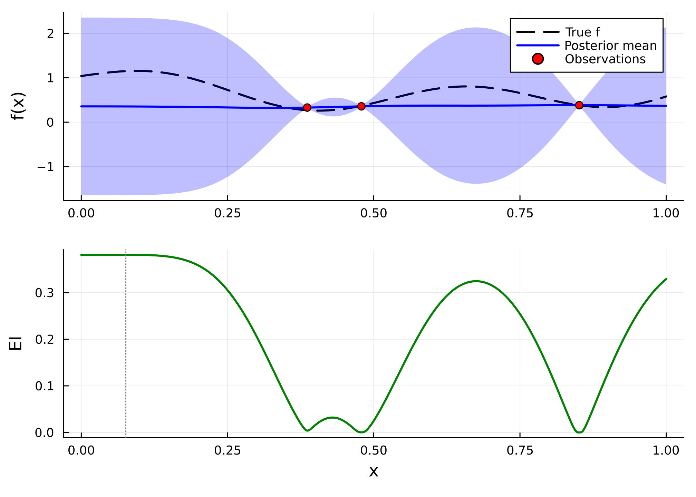
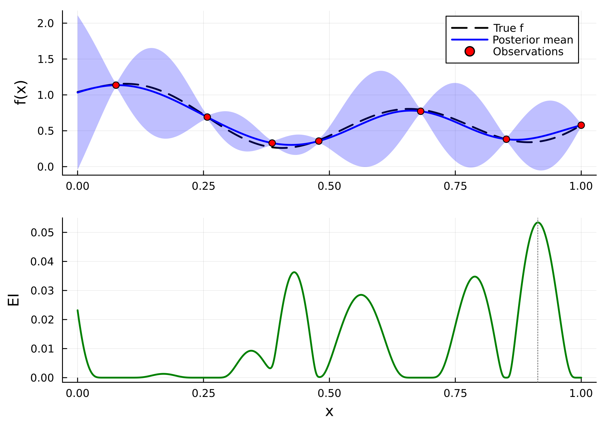
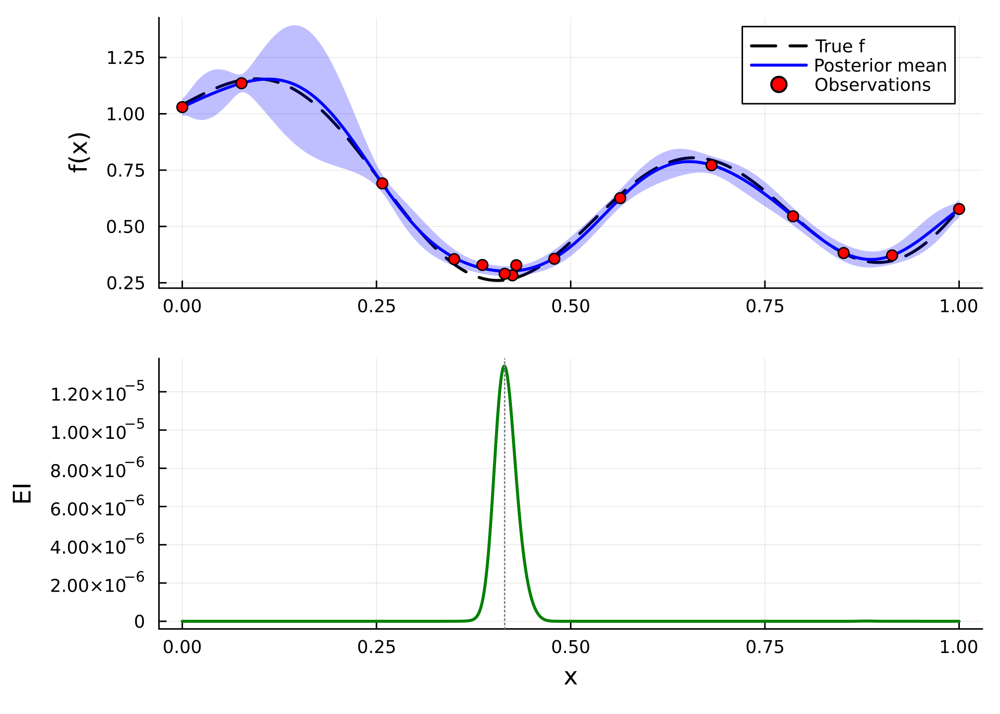

## Goals

1. Become familiar with the Nelder-Mead method as a zero-order optimization algorithm.
2. Become familiar with Bayesian optimization as a zero-order optimization algorithm.
3. Understand the advantages and disadvantages of zero-order optimization.

## Packages

```{julia}
#| echo: false
#| output: false
ENV["GKSwstype"] = "100"
```

```{julia}
using LinearAlgebra, Random, Statistics, Printf
using Distributions
using Plots
Plots.default(dpi = 300, legend = false)
```

## Overview

Zero-order methods solve

$$
\min_{\boldsymbol{x}}~f(\boldsymbol{x})
$$

using only function values $f(\boldsymbol{x})$. No gradients, no Hessians.
When would we give up derivative information?

- The objective is a *black box*; e.g. the output of a simulation or of someone else's software.
- The objective is not differentiable, or its derivatives are unreliable because evaluations are noisy.
- Each evaluation is so expensive that we can only afford a handful of them; e.g. cross-validation error as a function of a tuning parameter.
- Convenience. We only need to write code for $f$.

We look at two methods that sit at opposite ends of this list.

- **Nelder-Mead** is a cheap heuristic for problems where function evaluations are inexpensive.
- **Bayesian optimization** spends a lot of effort deciding where to evaluate next. It is meant for expensive, possibly noisy objectives.

Another option is to approximate gradients with finite differences and then apply a [first-order method](order1.qmd); see the notes on [automatic differentiation](autodiff.qmd) for the limitations of that approach.

## Nelder-Mead

The Nelder-Mead method maintains a *simplex*: a set of $d + 1$ points in $\mathbb{R}^{d}$ (a triangle when $d = 2$).
Each iteration tries to replace the *worst* vertex, the one with the largest function value, with a better point.

1. **Order** the vertices from best to worst. Compute the centroid $\boldsymbol{c}$ of all vertices except the worst, $\boldsymbol{x}_{\text{worst}}$.
2. **Reflect** the worst vertex through the centroid: $\boldsymbol{x}_{r} = \boldsymbol{c} + (\boldsymbol{c} - \boldsymbol{x}_{\text{worst}})$.
3. If the reflected point is the best so far, try to **expand** further in the same direction: $\boldsymbol{x}_{e} = \boldsymbol{c} + 2(\boldsymbol{c} - \boldsymbol{x}_{\text{worst}})$. Keep the better of the two.
4. If the reflected point is a modest improvement (better than the second-worst vertex), accept it.
5. Otherwise **contract**: try a point halfway between the centroid and the better of $\boldsymbol{x}_{r}$ and $\boldsymbol{x}_{\text{worst}}$.
6. If contraction fails, **shrink** every vertex halfway toward the best vertex.

The simplex crawls downhill, stretching along promising directions and shrinking around a minimizer.
We stop when the function values at the vertices are nearly equal.

- This is a heuristic. There is no model of $f$ and, in general, no guarantee of convergence to a stationary point.
- It tends to work well in low dimensions and degrades as $d$ grows.
- An iteration usually costs one or two function evaluations; a shrink step costs $d$.

::: {.callout-tip}
# R Users
Nelder-Mead is the default method in `optim()`.
:::

### Implementation

```{julia}
function nelder_mead(f, x0; maxiter = 500, tol = 1e-8, step = 0.5)
  d = length(x0)

  # initial simplex: x0, plus a step along each coordinate
  simplex = [copy(x0) for _ in 1:d+1]
  for j in 1:d
    simplex[j+1][j] += step
  end
  fvals = [f(x) for x in simplex]

  iter = 0
  while iter < maxiter
    # order vertices from best to worst
    p = sortperm(fvals)
    simplex, fvals = simplex[p], fvals[p]

    # stop when function values at the vertices agree
    fvals[end] - fvals[1] < tol && break
    iter += 1

    # centroid of all vertices except the worst
    c = sum(simplex[1:d]) / d
    worst = simplex[end]

    # reflect
    xr = c + (c - worst)
    fr = f(xr)

    if fr < fvals[1]
      # expand
      xe = c + 2 * (c - worst)
      fe = f(xe)
      if fe < fr
        simplex[end], fvals[end] = xe, fe
      else
        simplex[end], fvals[end] = xr, fr
      end
    elseif fr < fvals[d]
      # accept the reflected point
      simplex[end], fvals[end] = xr, fr
    else
      # contract
      xc = fr < fvals[end] ? c + 0.5 * (xr - c) : c + 0.5 * (worst - c)
      fc = f(xc)
      if fc < min(fr, fvals[end])
        simplex[end], fvals[end] = xc, fc
      else
        # shrink toward the best vertex
        for j in 2:d+1
          simplex[j] = simplex[1] + 0.5 * (simplex[j] - simplex[1])
          fvals[j] = f(simplex[j])
        end
      end
    end
  end

  best = argmin(fvals)
  return iter, simplex[best], fvals[best]
end
```

## Example: Maximum Likelihood

Suppose $y_{1}, \ldots, y_{n}$ are an independent sample from a Gamma distribution with shape $\alpha$ and scale $\theta$.
The MLE of the shape parameter has no closed form, so we need an iterative method.
As in [second-order methods](order2.qmd), we minimize the negative log-likelihood

$$
f(\alpha, \theta) = -\sum_{i=1}^{n} \log p(y_{i} \mid \alpha, \theta).
$$

- Derivatives of $f$ involve the digamma function. With Nelder-Mead we only need the density.
- Both parameters must be positive. We optimize over $(\log \alpha, \log \theta)$ instead so that the problem is unconstrained.

```{julia}
rng = MersenneTwister(206)
data = rand(rng, Gamma(3.0, 2.0), 200) # shape = 3, scale = 2

function gamma_nll(logparams, data)
  shape, scale = exp(logparams[1]), exp(logparams[2])
  return -sum(logpdf.(Gamma(shape, scale), data))
end
```

Start from $\alpha = \theta = 1$; i.e. zeros on the log scale.

```{julia}
iter, logparams, nll = nelder_mead(x -> gamma_nll(x, data), zeros(2))

println("Iterations: ", iter)
println("Negative log-likelihood: ", nll)
println("Shape and scale: ", exp.(logparams))
```

Compare against the MLE routine in Distributions.jl:

```{julia}
fit_mle(Gamma, data)
```


## Bayesian Optimization

Now suppose each evaluation of $f$ is expensive and noisy.
We cannot afford to crawl downhill; every evaluation must count.
Bayesian optimization uses two ingredients.

1. A **surrogate model**: a statistical model for $f$ based on the evaluations collected so far. It gives a prediction *and* an uncertainty at every point.
2. An **acquisition function**: a cheap criterion, computed from the surrogate, that scores how useful it would be to evaluate $f$ at a new point.

The algorithm alternates: fit the surrogate, maximize the acquisition function to choose the next point, evaluate $f$ there, and repeat.

### Surrogate: Gaussian Process

A common surrogate is a *Gaussian process* (GP).
We model the values of $f$ at any finite set of points as jointly normal, with covariance determined by a *kernel*.
Here we use the squared-exponential kernel with length scale $\ell$,

$$
k(x, x^{\prime}) = \exp\left( -\frac{(x - x^{\prime})^{2}}{2 \ell^{2}} \right),
$$

so that nearby points have highly correlated function values.
Observations are noisy, $y_{i} = f(x_{i}) + \varepsilon_{i}$ with $\varepsilon_{i} \sim N(0, \sigma^{2})$.

Given observations $\boldsymbol{y}$ at points $x_{1}, \ldots, x_{n}$, the value $f(x)$ at a new point is normal with mean and variance

$$
\begin{aligned}
\mu(x) &= m + \boldsymbol{k}(x)^{\top} (\boldsymbol{K} + \sigma^{2} \boldsymbol{I})^{-1} (\boldsymbol{y} - m \boldsymbol{1}), \\
s^{2}(x) &= k(x, x) - \boldsymbol{k}(x)^{\top} (\boldsymbol{K} + \sigma^{2} \boldsymbol{I})^{-1} \boldsymbol{k}(x),
\end{aligned}
$$

where $\boldsymbol{K}_{ij} = k(x_{i}, x_{j})$, $\boldsymbol{k}(x)_{i} = k(x, x_{i})$, and $m$ is the prior mean.

- This is just the formula for conditioning in a multivariate normal distribution.
- The matrix $\boldsymbol{K} + \sigma^{2} \boldsymbol{I}$ is positive definite. We factor it once with a Cholesky decomposition and reuse the factor for both solves.
- The cost of fitting grows like $n^{3}$ in the number of evaluations. This is fine when evaluations are scarce.

### Acquisition: Expected Improvement

Let $f_{\text{best}}$ denote the smallest value observed so far.
The *expected improvement* at $x$ is the amount by which we expect $f(x)$ to fall below $f_{\text{best}}$, under the surrogate:

$$
\mathrm{EI}(x) = E[\max\{f_{\text{best}} - \xi - f(x), 0\}] = \delta(x) \Phi(z) + s(x) \phi(z),
$$

with $\delta(x) = f_{\text{best}} - \xi - \mu(x)$ and $z = \delta(x) / s(x)$.
Here $\Phi$ and $\phi$ are the cdf and pdf of a standard normal, and $\xi \ge 0$ is a small margin.

- The first term is large where the surrogate predicts a low value; this is *exploitation*.
- The second term is large where the surrogate is uncertain; this is *exploration*.
- Maximizing the acquisition function is itself an optimization problem, but a cheap one. In one dimension we can simply evaluate it on a grid.

## Example: Tuning a Noisy Objective

The objective below is a stand-in for an expensive, noisy cross-validation error as a function of a tuning parameter $x \in [0, 1]$.


```{julia}
# Objective: two basins; stand-in for an expensive, noisy CV error.
true_f(x) = 0.3 * sin(12x) + 1.5 * (x - 0.6)^2 + 0.5
noisy_f(rng, x) = true_f(x) + 0.02 * randn(rng)
```

- There is a global minimizer near $x = 0.41$ and a local minimizer near $x = 0.90$.
- A method that only moves downhill may end in either basin, depending on where it starts.

### Step 1: Surrogate


```{julia}
# GP prior: squared-exponential kernel, unit variance
const LS = 0.12
const NOISE_VAR = 0.02^2

# Kernel matrix between vectors a (n) and b (m) -> n x m
kern(a, b) = exp.(-0.5 .* ((a .- b') ./ LS) .^ 2)

# Posterior mean and standard deviation at points Xs
function gp_posterior(X, y, Xs)
  m  = mean(y)                          # prior mean
  K  = kern(X, X) + NOISE_VAR * I
  Ks = kern(Xs, X)                      # m x n
  C  = cholesky(Symmetric(K))           # factor once, solve twice
  mu = m .+ Ks * (C \ (y .- m))
  V  = C \ Matrix(Ks')                  # n x m
  s2 = 1.0 .- vec(sum(Ks .* V', dims = 2))
  s2 = max.(s2, 1e-12)
  return mu, sqrt.(s2)
end
```

### Step 2: Acquisition

```{julia}
# Expected improvement for minimization
function expected_improvement(mu, sd, f_best; xi = 0.01)
  imp = f_best .- mu .- xi
  z   = imp ./ sd
  return imp .* cdf.(Normal(), z) .+ sd .* pdf.(Normal(), z)
end
```

### Step 3: The Loop

Each iteration fits the surrogate, picks the grid point with the largest expected improvement, and evaluates the objective there.

```{julia}
function run_bo(rng, X, y, grid, niter)
  for it in 1:niter
    mu, sd = gp_posterior(X, y, grid)
    ei = expected_improvement(mu, sd, minimum(y))
    x_next = grid[argmax(ei)]

    X = vcat(X, x_next)
    y = vcat(y, noisy_f(rng, x_next))

    @printf("probe x=%.3f  observed=%+.3f  best so far=%+.3f\n",
            x_next, y[end], minimum(y))
  end
  return X, y
end
```

The following helper plots the surrogate (top) and the acquisition function (bottom).

```{julia}
function plot_bo(X, y, grid)
  mu, sd = gp_posterior(X, y, grid)
  ei = expected_improvement(mu, sd, minimum(y))

  p1 = plot(grid, true_f.(grid); lw = 2, ls = :dash, color = :black,
    label = "True f", ylabel = "f(x)", legend = true)
  plot!(p1, grid, mu; ribbon = 2 .* sd, fillalpha = 0.25, lw = 2, color = :blue,
    label = "Posterior mean")
  scatter!(p1, X, y; color = :red, label = "Observations")

  p2 = plot(grid, ei; lw = 2, color = :green, xlabel = "x", ylabel = "EI")
  vline!(p2, [grid[argmax(ei)]]; ls = :dot, color = :gray)

  return plot(p1, p2; layout = (2, 1))
end
```

### Step 4: Test It

Start with 3 random probes.

```{julia}
rng  = MersenneTwister(2026)
grid = collect(range(0.0, 1.0, length = 801))

X = rand(rng, 3)                       # initial random probes
y = [noisy_f(rng, x) for x in X]

fig = plot_bo(X, y, grid);
```

```{julia}
#| echo: false
#| output: false
savefig(fig, "assets/bo_start.png")
```

{fig-align="center"}

The shaded band is the posterior mean plus or minus 2 standard deviations. The dotted line marks the next probe.

After 4 iterations:

```{julia}
X, y = run_bo(rng, X, y, grid, 4)
fig = plot_bo(X, y, grid);
```

```{julia}
#| echo: false
#| output: false
savefig(fig, "assets/bo_iter04.png")
```

{fig-align="center"}

After 12 iterations:

```{julia}
X, y = run_bo(rng, X, y, grid, 8)
fig = plot_bo(X, y, grid);
```

```{julia}
#| echo: false
#| output: false
savefig(fig, "assets/bo_iter12.png")
```

{fig-align="center"}

```{julia}
best = X[argmin(y)]
true_best = grid[argmin(true_f.(grid))]
@printf("Bayesian optimization best x = %.3f\n", best)
@printf("True minimizer on grid       = %.3f\n", true_best)
@printf("Total evaluations            = %d\n", length(X))
```


## Advantages and Disadvantages

Advantages:

- Only function values are required. This applies to black boxes, simulations, and objectives that are not differentiable.
- Simple to use; there are no derivatives to derive, code, or debug.
- Bayesian optimization tolerates noise and searches globally, with very few evaluations.

Disadvantages:

- Convergence is slow compared to methods that use gradients or Hessians, when those are available.
- Performance degrades quickly as the dimension grows. Both methods are best suited to a small number of parameters.
- Nelder-Mead is a local heuristic with no convergence guarantee in general.
- Bayesian optimization has substantial overhead per iteration, and it has tuning parameters of its own (the kernel, the length scale, the acquisition function).

As a rule of thumb, if derivatives are available (e.g. through [automatic differentiation](autodiff.qmd)), use them.
