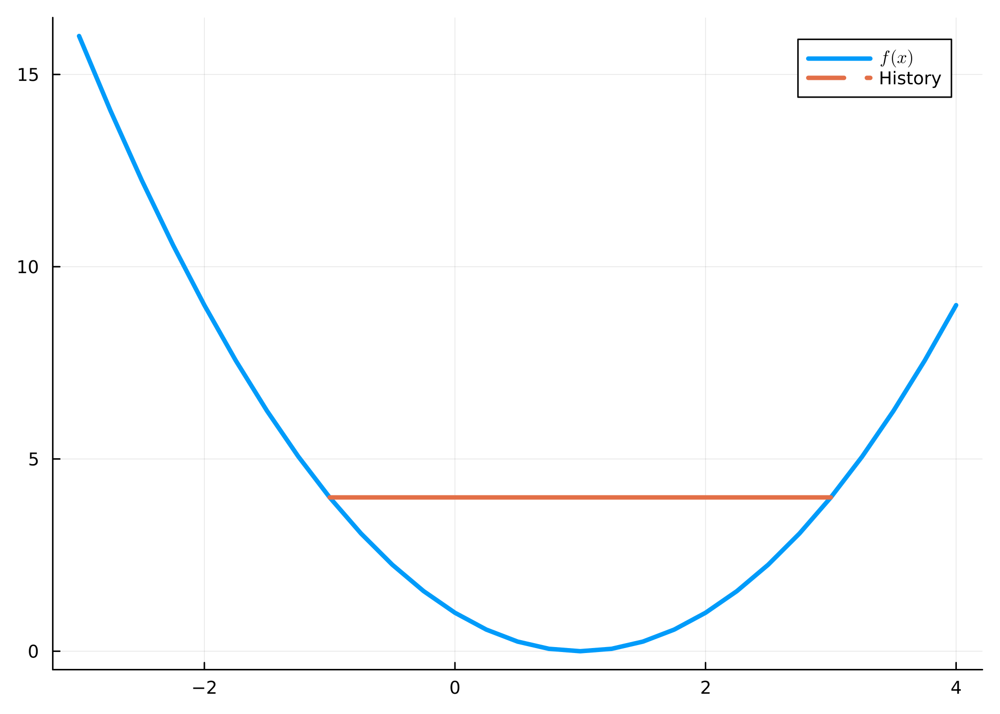
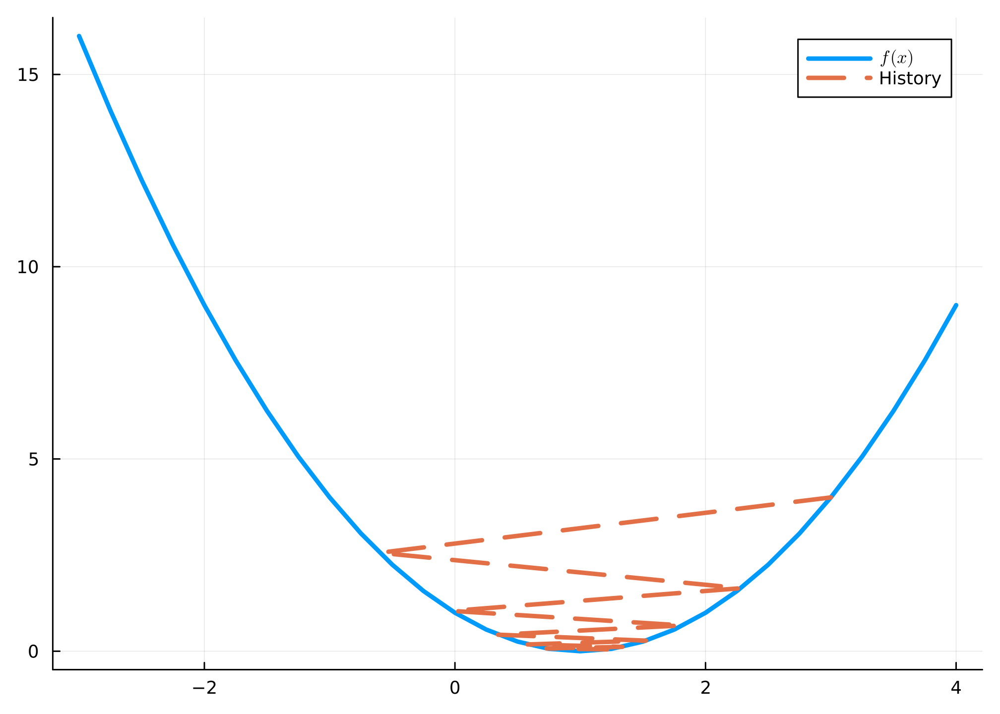
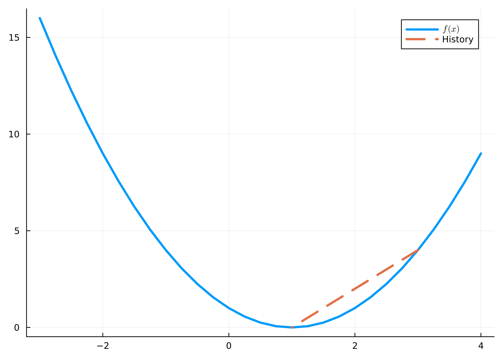
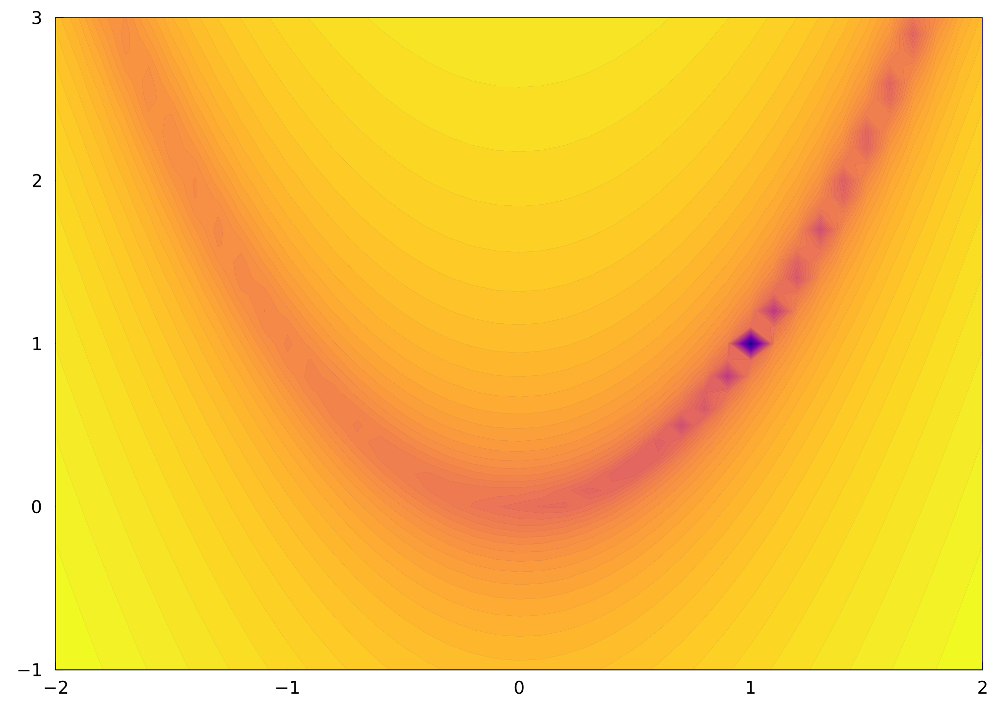
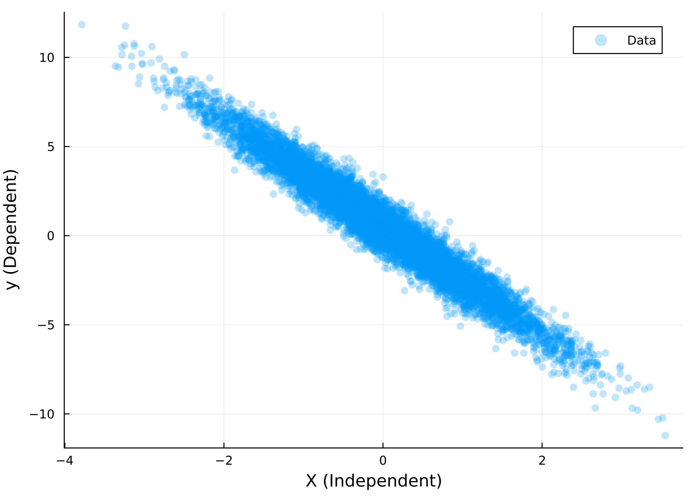
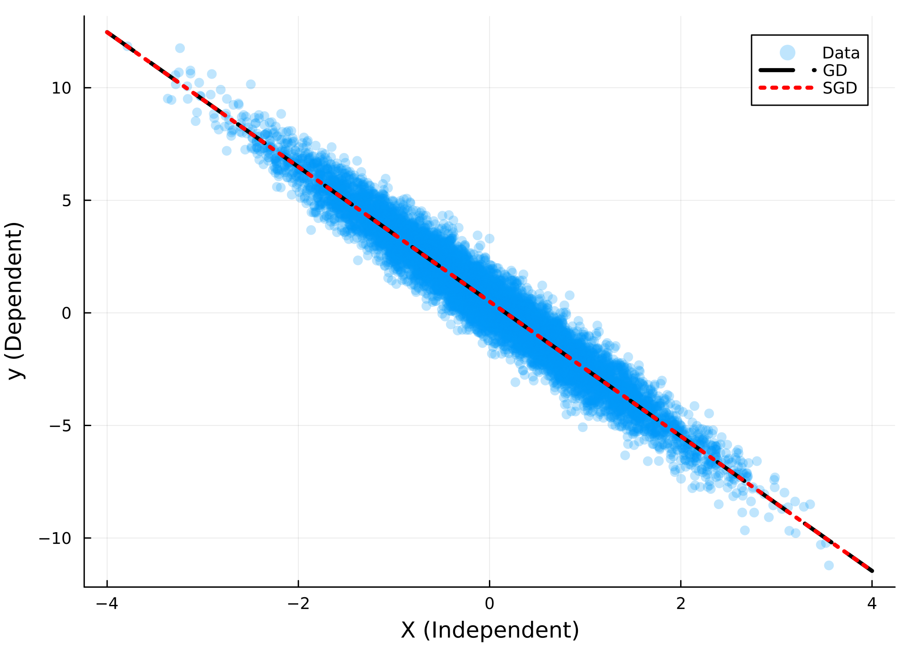

## Goals

1. Understand gradient descent as linearization of an unconstrained minimization problem.
2. Become familiar with line search techniques as a means of controlling gradient descent.
3. Examine how the stochastic generalization can be used to solve a minimization problem through batching.

## Packages

```{julia}
#| echo: false
#| output: false
ENV["GKSwstype"] = "100"
```

```{julia}
using LinearAlgebra, Random, Statistics
using ForwardDiff
using Plots, LaTeXStrings
Plots.default(dpi = 300, legend = false)
```

## Overview

One approach to solving an *unconstrained optimization problem*

$$
\min_{\boldsymbol{x}}~f(\boldsymbol{x}),
$$

is to find $\boldsymbol{x}_{\ast}$ such that the gradient vanishes; i.e. $\nabla f(\boldsymbol{x}_{\ast}) = \boldsymbol{0}$.
*This requires that the optimization model $f(\boldsymbol{x})$ is, at a minimum, once differentiable*.
We will refer to the condition above as a **stationary condition**, **first-order condition**, or **necessary condition**.

- The term *necessary condition* is a reminder. A differentiable function *must* satisfy the stationary condition $\nabla f(\boldsymbol{x}) = \boldsymbol{0}$ whenever $\boldsymbol{x}$ is a minimizer. However, not every stationary point is a minimizer.
- Some of the examples here use automatic differentiation through the ForwardDiff.jl package. We'll treat this as a black-box that evaluates a Julia function's derivative at a specific point and expand on it in the [automatic differentiation notes](autodiff.qmd).

## Gradient Descent

To minimize $f(\boldsymbol{x})$, we construct a *local* linear model to approximate the objective function near our current estimate $\boldsymbol{x}_{k}$:

$$
f(\boldsymbol{x}_{k} + \boldsymbol{d}) \approx f(\boldsymbol{x}_{k}) + df(\boldsymbol{x}_{k})[\boldsymbol{d}],
$$

where $\boldsymbol{d}$ denotes the **search direction**.
Think of the linear term as an inner product, $\langle \nabla f(\boldsymbol{x}_{k}), \boldsymbol{d} \rangle$.
We'd like for $f(\boldsymbol{x}_{k} + \boldsymbol{d}) < f(\boldsymbol{x}_{k})$; that is, the update should be an improvement.
That indicates that we should choose $\boldsymbol{d}$ to make the linear term **as negative as possible**.

Unfortunately, this formulation is ill-defined.
If $\langle \nabla f(\boldsymbol{x}_{k}), \boldsymbol{d} \rangle$ is negative, then $\langle \nabla f(\boldsymbol{x}_{k}), 2\boldsymbol{d} \rangle$ is twice as negative.

We only care about *direction*, not magnitude, so we formulate the search problem as 

$$
\min_{\boldsymbol{d} : \|\boldsymbol{d}\| \le 1}~df(\boldsymbol{x}_{k})[\boldsymbol{d}],
$$

which is a *constrained* minimization problem. We only need a *unit vector* to tell us the direction, then we can figure out how much to move in that direction.
This is the **method of steepest descent**; we seek descent directions that move along the most negative directional derivative.

- If we take $\|\cdot\|$ to mean the Euclidean norm, $\|\cdot\|_{2}$, then one can show that the best search direction is $\boldsymbol{d} \equiv -\nabla f(\boldsymbol{x}_{k})$ (unnormalized). This is the usual understanding of *gradient descent*.
- Other choices lead to interesting results. Taking $\|\cdot\|_{1}$ instead suggests $\boldsymbol{d} \equiv - D_{i} f(\boldsymbol{x}_{k}) \boldsymbol{e}_{i}$ where $|D_{i} f(\boldsymbol{x}_{k})| = \max_{j} | D_{j} f(\boldsymbol{x}_{k}) | = \|\nabla f(\boldsymbol{x}_{k})\|_{\infty}$. That is, we move in the direction with largest partial derivative (in absolute value). When applied to linear regression analysis, this happens to be [forward stagewise regression](https://jmlr.org/papers/volume16/tibshirani15a/tibshirani15a.pdf)!

Once we have a recipe for $\boldsymbol{d}$, we update our estimates via the rule

$$
\boldsymbol{x}_{k+1} = \boldsymbol{x}_{k} + \boldsymbol{d}.
$$

### Naive Approach

The (naive) gradient descent approach is simply

$$
\boldsymbol{x}_{k+1} = \boldsymbol{x}_{k} - \nabla f(\boldsymbol{x}_{k}).
$$

Without any restrictions on the step length, it becomes possible for the method to **overshoot** and thus fail to converge, even when the underlying function is *easy to minimize*.

```{julia}
myfun(x) = (x - 1)^2

function gradient_descent_example(x0, t::Real = 1.0)
  x = x0
  history_x = [x0]
  for i in 1:10
    x = x - t * ForwardDiff.derivative(myfun, x)
    push!(history_x, x)
  end

  @show history_x

  fig = plot(range(-3, 4, step = 0.25), myfun, label = L"f(x)", lw = 3, legend = true)
  plot!(history_x, myfun.(history_x), label = "History", lw = 3, ls = :dash)
  return fig
end
```

Starting from $x_{0} = 3.0$:

```{julia}
gradient_descent_example(3.0);
```

```{julia}
#| echo: false
#| output: false
savefig("assets/gd_step=1.0.png")
```

{fig-align="center"}

Using a step length $t = 1$, we see the iterates alternate between $x_{k} = -1$ and $x_{k} = 3$ without end.
The algorithm is stuck in a cycle because neither update achieves a decrease.

### Fixed Step Size

Amend the gradient descent updates with a **step size** that indicates how far along to move in the direction $\boldsymbol{d}$:

$$
\boldsymbol{x}_{k+1} = \boldsymbol{x}_{k} - t \nabla f(\boldsymbol{x}_{k}).
$$

The search direction $\boldsymbol{d}$ is determined as before; we simply take $t$ to be a fixed value.

```{julia}
gradient_descent_example(3.0, 0.9);
```

```{julia}
#| echo: false
#| output: false
savefig("assets/gd_step=0.9.png")
```



- Using a smaller step length $t = 0.9$, we see the iterates overshoot the minimum point after each iteration.
- Unlike the previous example with $t = 1$, each iterate achieves a small decrease in the objective.
- Eventually, the magnitude of overshooting becomes small and gradient descent converges to the optimal point.

```{julia}
gradient_descent_example(3.0, 0.5);
```

```{julia}
#| echo: false
#| output: false
savefig("assets/gd_step=0.5.png")
```



- Why does the choice $t = 0.5$ lead to an algorithm that converges in one step?

### Lipschitz Continuity and Smoothness

#### Lipschitz Continuity

There exists $L > 0$ such that for every $\boldsymbol{x},\boldsymbol{y}$ the following inequality holds:

$$
\|f(\boldsymbol{x}) - f(\boldsymbol{y})\| \le L \|\boldsymbol{x} - \boldsymbol{y}\|.
$$

This is a statement about *how large derivatives can become* and defines a *global* property of a function. To see this, rearrange:

$$
\frac{\|f(\boldsymbol{x}) - f(\boldsymbol{y})\|}{\|\boldsymbol{x} - \boldsymbol{y}\|} \le L
$$

#### Lipschitz Smoothness

This is an application of Lipschitz continuity to *gradients* of functions.

$$
\|\nabla f(\boldsymbol{x}) - \nabla f(\boldsymbol{y})\| \le L \|\boldsymbol{x} - \boldsymbol{y}\|
$$

The gradient of a Lipschitz smooth function cannot change faster than the rate $L$.
This property illuminates why gradient descent succeeds or fails.

- Choosing a step length $t \le 1 / L$ guarantees a decrease in objective values after a gradient descent update.
- If a function has a small Lipschitz constant $L$, then its gradient changes slowly as one moves across the optimization landscape defined by $f(\boldsymbol{x})$. The step length can be relatively large.
- On the other hand, if $L$ is large then the gradient changes rapidly even for small perturbations within a local neighborhood. Safe step lengths must be kept relatively small.


## Line Searches

Once we've fixed the search direction $\boldsymbol{d}$, we might ask, "How should we choose the step size, $t$?"
This motivates the notion of *line searches*.

### Exact

The *exact line search* problem is

$$
\min_{t,~t \ge 0}~f(\boldsymbol{x} + t \boldsymbol{d}),
$$

where $\boldsymbol{x}$ and $\boldsymbol{d}$ are fixed beforehand. The goal is to have $f(\boldsymbol{x} + t \boldsymbol{d}) < f(\boldsymbol{x})$.
This problem is intractable except in the simplest of problems; e.g. for a quadratic.


### Backtracking

Exact line searches rarely have closed form solutions. Even when the problem is tractable, it may be expensive to compute the step size exactly.

What is done in practice is a **backtracking line search**. The idea is simple:

1. Propose an initial step size $t \leftarrow 1$.
2. Propose a candidate point using a gradient descent update, $\boldsymbol{x}_{\text{new}} \leftarrow \boldsymbol{x} + t\boldsymbol{d}$.
3. Check that a *descent condition* holds; for example, $f(\boldsymbol{x}_{\text{new}}) < f(\boldsymbol{x})$.
    - If the descent condition fails, reject the candidate and set $t \leftarrow \alpha t$ for $\alpha \in (0, 1)$. Go back to Step 2 with the new step size.
4. Accept the candidate, $\boldsymbol{x} \leftarrow \boldsymbol{x}_{\text{new}}$, and continue with gradient descent.

A common choice for $\alpha$ is $\alpha = \frac{1}{2}$. This flavor of backtracking is known as *step halving*.

### Other Descent Conditions

Knowledge of more complex descent conditions can improve convergence behavior of a first-order method.
Requires some additional background to understand.

- [Armijo](https://en.wikipedia.org/wiki/Backtracking_line_search#Algorithm): Defines *sufficient decrease*.
- [Wolfe](https://en.wikipedia.org/wiki/Wolfe_conditions#Armijo_rule_and_curvature): Armijo + *curvature* condition.


## Example: Gradient Descent + Backtracking

The Rosenbrock function is a classic test problem for optimization algorithms:

$$
f(x_{1}, x_{2}) = (1 - x_{1})^{2} + 100 (x_{2} - x_{1}^{2})^{2}.
$$

- The unique minimizer is $\boldsymbol{x}_{\ast} = (1, 1)$ with $f(\boldsymbol{x}_{\ast}) = 0$.
- The minimizer sits inside a long, narrow, curved valley.
- The contour plot below shows $\log_{10} f(\boldsymbol{x})$.

```{julia}
function rosenbrock(x)
  return (1 - x[1]) ^ 2 + 100 * (x[2] - x[1] ^ 2) ^ 2
end
```

```{julia}
#| output: false
xs = range(-2, 2, step = 0.1)
ys = range(-1, 3, step = 0.1)
contourf(xs, ys, (x, y) -> log10(1e-6 + rosenbrock([x,y])), color = :plasma, levels = 64, lw = 0)
```

```{julia}
#| echo: false
#| output: false
savefig("assets/rosenbrock.png")
```



```{julia}
function gradient_descent(f, x0; maxiter::Int = 10, tol::Real = 1e-3, backtracking::Bool = false, t::Real = 0.1)
  # initialize our workspace
  x = copy(x0)
  ∇f = similar(x)

  # initial function + gradient values
  f_old = f(x)
  ForwardDiff.gradient!(∇f, f, x)

  # start the minimization loop
  not_converged = norm(∇f) > tol
  iter = 0
  while not_converged && iter < maxiter
    iter += 1
    if backtracking
      # try a full step
      t = 1.0
      @. x = x - t * ∇f
      while f(x) >= f_old && t > eps() # backtracking; give up once t is negligible
        @. x = x + t * ∇f
        t = t / 2
        @. x = x - t * ∇f
      end
      f_old = f(x)
    else # fixed step size
      @. x = x - t * ∇f
    end
    # check convergence
    ForwardDiff.gradient!(∇f, f, x)
    not_converged = norm(∇f) > tol
  end
  return iter, x, f(x), norm(∇f)
end
```

```{julia}
gradient_descent(rosenbrock, [1.5, 1.5], maxiter = 10^4, backtracking = false)
```

```{julia}
gradient_descent(rosenbrock, [1.5, 1.5], maxiter = 10^4, backtracking = true)
```

- This is a difficult function to minimize. Without backtracking, gradient descent diverges after 6 iterations.
- Backtracking improves convergence, albeit in a slow fashion.

## Stochastic Gradient Descent

Problems in modern statistics and machine learning heavily favor *stochastic algorithms* due to

1. the problem's training data being "big", and
2. function evaluation (and therefore gradient evaluation) being "expensive".

In this setting, it is enough to approximate gradients with batches of the data. *However, this requires that the batches be representative of the full data!*

Specifically, suppose the objective is an average over $n$ observations, where $f_{i}$ is the loss on observation $i$:

$$
f(\boldsymbol{x}) = \frac{1}{n} \sum_{i=1}^{n} f_{i}(\boldsymbol{x}).
$$

A batch $B \subset \{1, \ldots, n\}$ of size $m$ gives the approximation

$$
\nabla f(\boldsymbol{x}) \approx \frac{1}{m} \sum_{i \in B} \nabla f_{i}(\boldsymbol{x}).
$$

- Each gradient evaluation costs $m$ observations instead of $n$.
- If batches are sampled uniformly at random, then the approximation is *unbiased*; i.e. it equals $\nabla f(\boldsymbol{x})$ on average. This is what we mean by "representative".

### Implementation

- `f(params, data)`: Assumed to be a function-like object that accepts two arguments: a vector of parameters `params` and `data`, a batch returned by `batchfun`.
- `x0`: Starting estimate.
- `batchfun(batchsize)`: A one-argument function that returns a random batch of the given size from the problem's training data.

```{julia}
function sgd(f, x0, batchfun; maxiter::Int = 10, tol::Real = 1e-3, batchsize::Int = 10)
  # initialize our workspace
  x = copy(x0)
  ∇f = similar(x)

  # helper function to evaluate gradient on mini-batch
  # note the variables folded into the function definition
  function eval_gradient!(x, batch)
    ForwardDiff.gradient!(∇f, params -> f(params, batch), x)
    return ∇f
  end

  # initial batch + gradient values
  batch = batchfun(batchsize)
  eval_gradient!(x, batch)

  # start the minimization loop
  not_converged = norm(∇f) > tol
  iter = 0
  while not_converged && iter < maxiter
    iter += 1
    t = 1 / iter
    @. x = x - t * ∇f

    # draw a new batch and evaluate the gradient at the new point
    batch = batchfun(batchsize)
    eval_gradient!(x, batch)

    # check convergence
    not_converged = norm(∇f) > tol
  end
  return iter, x, f(x, batch), norm(∇f)
end
```

::: {.callout-note}
### Choosing the Step Size

This implementation uses *diminishing step sizes*, $1 / k$. Lots of other schemes in literature; fixed step sizes only converge to a neighborhood of the solution.

- The scale matters. A schedule $a / k$ may stall if $a$ is too small.
- The stopping rule checks the gradient on a batch, which is noisy. Expect the algorithm to run until `maxiter`.
:::

## Example: Linear Regression

We simulate $n = 10^{4}$ observations from a simple linear regression model with intercept $0.5$, slope $-3$, and noise standard deviation $1/\sqrt{2}$.

```{julia}
function simulate_linreg_problem(n, β0, σ; rng = Random.default_rng())
  X = Matrix{Float64}(undef, n, 2)
  @views begin
    fill!(X[:, 1], 1)
    randn!(rng, X[:, 2])
  end
  y = X * β0 .+ σ * randn(rng, n)
  return y, X
end
```


```{julia}
y, X = simulate_linreg_problem(10 ^ 4, [0.5, -3.0], 1/sqrt(2));

fig = scatter(X[:, 2], y,
  xlabel = "X (Independent)",
  ylabel = "y (Dependent)",
  label = "Data",
  legend = true,
  alpha = 0.25,
  markerstrokewidth = 0
);
```

```{julia}
#| echo: false
#| output: false
savefig(fig, "assets/linreg_data.png")
```



### Step 1: Define the Loss

ForwardDiff asks that the functions we differentiate only have one argument.
If we have multiple parameters, they must be packed into a `Vector`.

With this in mind, let's make the coefficients `b` the first argument below.

```{julia}
function linreg_loss(b, y, X::AbstractMatrix)
  r = y - X*b
  return 1/2 * mean(abs2, r)
end
```


```{julia}
linreg_loss([0.0, 0.0], y, X) # make sure it works!
```


```{julia}
linreg_loss([0.5, -3.0], y, X)
```

For compatibility with ForwardDiff, we just use an anonymous function

```{julia}
ForwardDiff.gradient(b -> linreg_loss(b, y, X), zeros(2))
```

### Step 2: Define the Sampling Procedure

Let's use a batch of fixed size. The following function explicitly requires 3 arguments to sample from `(y, X)`.

```{julia}
function mybatchfun(y, X, batchsize)
  idx = rand(1:length(y), batchsize)
  return y[idx], X[idx, :]
end
```

```{julia}
yb, Xb = mybatchfun(y, X, 10)
display(yb)
display(Xb)
```

Other possible schemes:

- Sample a single observation
- Cyclic: Shuffle data, then iterate over data using a fixed sized window.

### Step 3: Ensure compatibility

To make the output of `batchfun()` compatible with our loss function, add a *method* that expands the second argument to `y` and `X`.

```{julia}
linreg_loss(b, data::Tuple) = linreg_loss(b, data[1], data[2])
```

Make sure it works:

```{julia}
linreg_loss(zeros(2), mybatchfun(y, X, 10))
```

Need compatibility with `ForwardDiff.gradient()`, too:

```{julia}
abatch = mybatchfun(y, X, 10)
ForwardDiff.gradient(b -> linreg_loss(b, abatch), zeros(2))
```

### Step 4: Test It

```{julia}
iter, β, loss, grad = @time gradient_descent(
  b -> linreg_loss(b, y, X), # function of parameters; using full data
  zeros(2);
  maxiter = 10^3,
  tol = 1e-6,
  backtracking = true
)
println("""
Gradient Descent
  - Iterations: $(iter)
  - Estimate: $(β)
  - Loss: $(loss)
  - Gradient Norm: $(grad)
""")
plot!(fig, range(-4, 4), x -> β[1] + x*β[2], color = :black, label = "GD", lw = 3, ls = :dash);
```

```{julia}
Random.seed!(206)
iter, β, loss, grad = @time sgd(
  linreg_loss,              # function of parameters + data
  zeros(2),
  b -> mybatchfun(y, X, b); # function of batch size
  maxiter = 10^4,
  tol = 1e-3,
  batchsize = 50
)
println("""
Stochastic Gradient Descent
  - Iterations: $(iter)
  - Estimate: $(β)
  - Loss: $(loss)
  - Gradient Norm: $(grad)
""")
plot!(fig, range(-4, 4), x -> β[1] + x*β[2], color = :red, label = "SGD", lw = 3, ls = :dot);
```


```{julia}
#| echo: false
#| output: false
savefig(fig, "assets/linreg_fit.png")
```




The loss and gradient norm reported by `sgd` are based on the last batch. Evaluate both on the full data at the SGD estimate:

```{julia}
linreg_loss(β, y, X) # full data
```

```{julia}
ForwardDiff.gradient(b -> linreg_loss(b, y, X), β) |> norm
```

- Both estimates are close to the true coefficients $(0.5, -3)$.
- SGD is less accurate than gradient descent on the full data, but each iteration is much cheaper.

## Summary

- Gradient descent moves along the direction of steepest descent of a local linear model.
- Fixed step sizes work when they are small relative to $1/L$; otherwise the iterates may cycle or diverge.
- Backtracking chooses the step size adaptively by checking a descent condition.
- Stochastic gradient descent approximates gradients with batches of the data; it requires diminishing step sizes.
