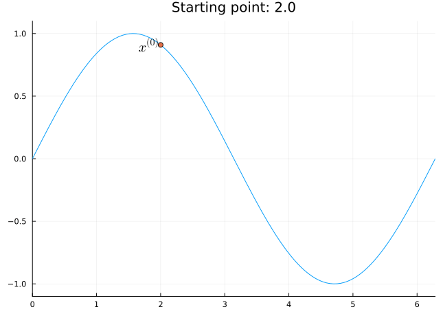
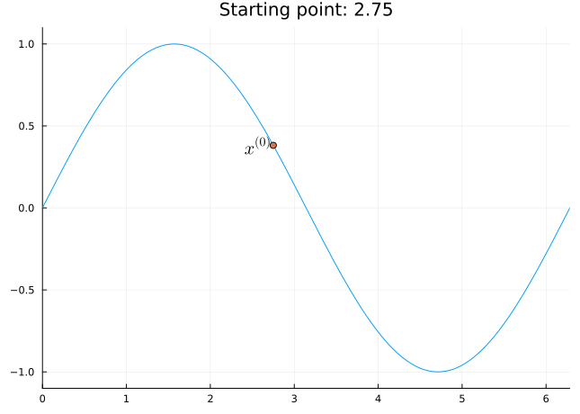
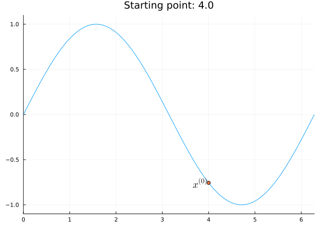
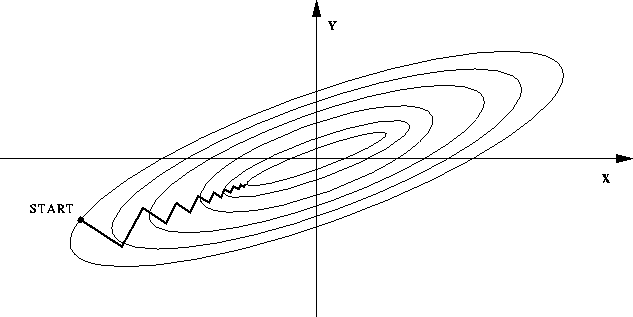
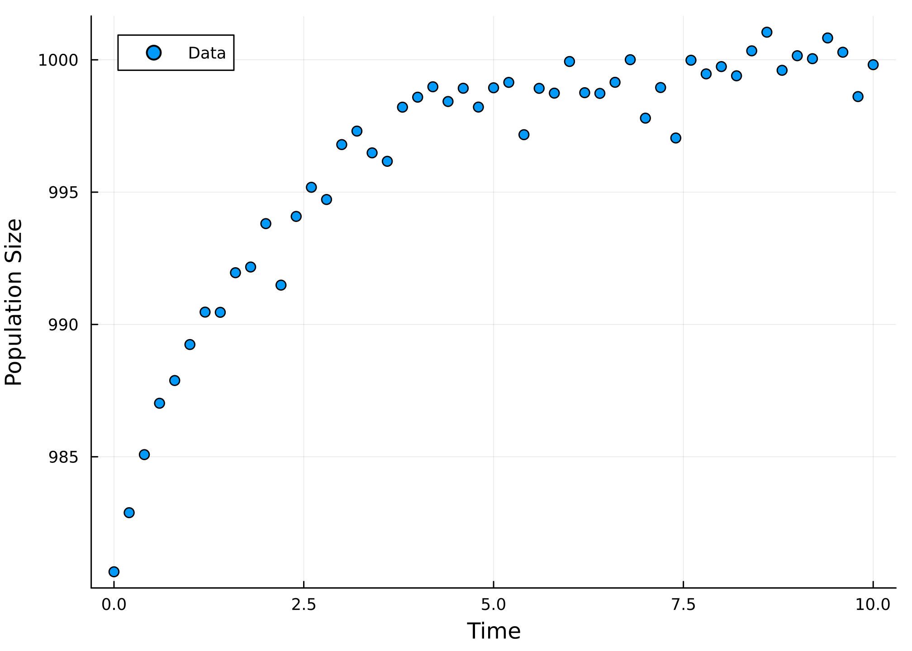
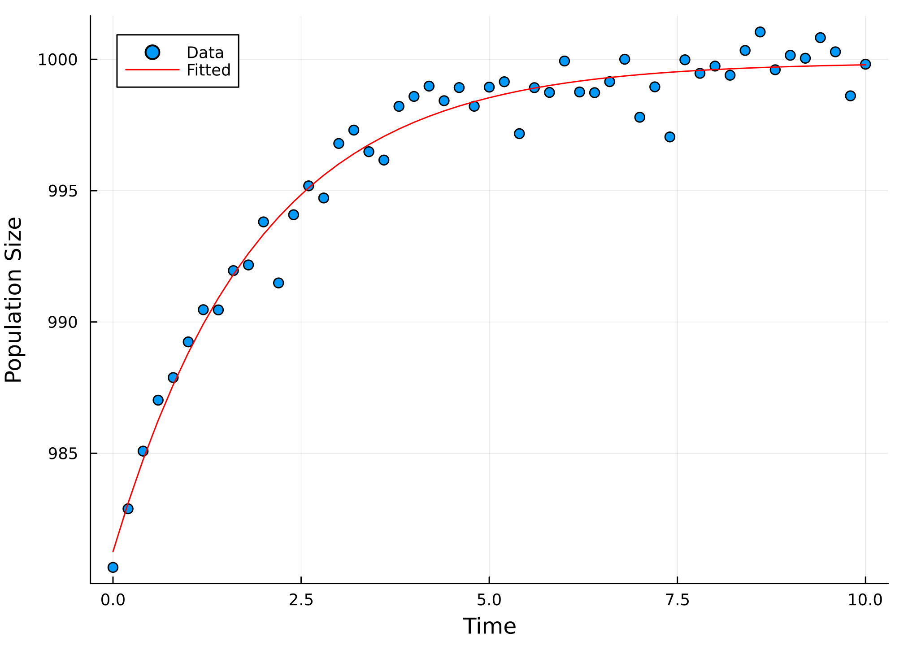

## Goals

1. Understand Newton-Raphson as a local quadratic approximation to a minimization problem.
2. Connect Fisher scoring to the Newton-Raphson method.
3. Examine applications of second-order methods to the iteratively reweighted least squares problem and generalized linear models.

## Packages

```{julia}
#| echo: false
#| output: false
ENV["GKSwstype"] = "100"
```

```{julia}
using LinearAlgebra, Random
using ForwardDiff
using Plots
Plots.default(dpi = 300, legend = false)
```

## Overview

Consider maximizing a log-likelihood function $\ell(\boldsymbol{\theta})$, $\boldsymbol{\theta} \in \Theta \subset \mathbb{R}^p$.
View it as a *parameterized function* in the sense that it depends on data/parameters that are given or fixed.
For *maximum likelihood estimation* we are interested in how the log-likelihood quantifies the plausibility of specific parameter values $\boldsymbol{\theta}$

$$
\ell(\boldsymbol{\theta}) = \ell(\boldsymbol{\theta} \mid Y, X, \ldots) = \log \prod_{i} p(y_{i} \mid x_{i}, \boldsymbol{\theta}) = \sum_{i} \log p(y_{i} \mid x_{i}, \boldsymbol{\theta})
$$

Our previous notes are written in terms of minimization.
To stay consistent, we work with the *negative log-likelihood*

$$
f(\boldsymbol{\theta}) = -\ell(\boldsymbol{\theta}).
$$

Maximizing $\ell$ is the same as minimizing $f$.
Keep the sign change in mind when comparing these notes against other references; many of them state the algorithms below in terms of $\ell$.

**Gradient** of $f$ (the negative **score**):
$$
  \nabla f(\boldsymbol{\theta}) = -\nabla \ell(\boldsymbol{\theta}) = \begin{pmatrix}
  D_{1} f(\boldsymbol{\theta}) \\
  \vdots \\
  D_{p} f(\boldsymbol{\theta})
  \end{pmatrix}
$$

**Hessian** of $f$:
$$
  \nabla^2 f(\boldsymbol{\theta}) = -\nabla^2 \ell(\boldsymbol{\theta}) = \begin{pmatrix}
  D_{1} D_{1} f(\boldsymbol{\theta}) & \dots & D_{1} D_{p} f(\boldsymbol{\theta}) \\
  \vdots & \ddots & \vdots \\
  D_{p} D_{1} f(\boldsymbol{\theta}) & \dots & D_{p} D_{p} f(\boldsymbol{\theta})
  \end{pmatrix}
$$

**Observed information matrix** (Hessian of the negative log-likelihood):

$$
  \nabla^2 f(\boldsymbol{\theta})
$$

**Expected (Fisher) information matrix**:
$$
  \mathbb{E}[\nabla^2 f(\boldsymbol{\theta})].
$$

The expectation is taken with respect to the distribution of the $Y$; whatever is an argument to the common density $p(y \mid \boldsymbol{\theta})$.

::: {.callout-note}
### Notation

- In these notes we write iterates as $\boldsymbol{\theta}^{(k)}$, with the iteration number $k$ as a superscript. Subscripts are already in use for observations ($y_{i}$, $\boldsymbol{x}_{i}$) and for components of a vector, so the superscript avoids ambiguity with the subscript $i$.
- As before, $t$ denotes a step size.
:::

## Newton's Method

- Originally developed for finding roots of nonlinear equations $h(\boldsymbol{x}) = \boldsymbol{0}$.
- Newton's method, aka **Newton-Raphson method**, is considered the gold standard for its fast (quadratic) convergence. Once the iterates are close enough to a solution $\boldsymbol{\theta}_{\ast}$,

  $$
  \frac{\|\boldsymbol{\theta}^{(k+1)} - \boldsymbol{\theta}_{\ast}\|}{\|\boldsymbol{\theta}^{(k)} - \boldsymbol{\theta}_{\ast}\|^2} \to \text{constant}.
  $$

- Idea: iterative quadratic approximation.

Taylor expansion around the current iterate $\boldsymbol{\theta}^{(k)}$

$$
  f(\boldsymbol{\theta}) \approx f(\boldsymbol{\theta}^{(k)}) + \nabla f(\boldsymbol{\theta}^{(k)})^{\top} (\boldsymbol{\theta} - \boldsymbol{\theta}^{(k)}) + \frac 12 (\boldsymbol{\theta} - \boldsymbol{\theta}^{(k)})^{\top} [\nabla^2 f(\boldsymbol{\theta}^{(k)})] (\boldsymbol{\theta} - \boldsymbol{\theta}^{(k)})
$$

and then minimize the quadratic approximation.
To minimize the quadratic function, we set its gradient to zero

$$
  \nabla f(\boldsymbol{\theta}^{(k)}) + [\nabla^2 f(\boldsymbol{\theta}^{(k)})] (\boldsymbol{\theta} - \boldsymbol{\theta}^{(k)}) = \boldsymbol{0}_p,
$$

which suggests the next iterate
$$
\begin{eqnarray*}
  \boldsymbol{\theta}^{(k+1)} &=& \boldsymbol{\theta}^{(k)} - [\nabla^2 f(\boldsymbol{\theta}^{(k)})]^{-1} \nabla f(\boldsymbol{\theta}^{(k)}) \\
  &=& \boldsymbol{\theta}^{(k)} + [-\nabla^2 \ell(\boldsymbol{\theta}^{(k)})]^{-1} \nabla \ell(\boldsymbol{\theta}^{(k)}).
\end{eqnarray*}
$$

This is a **naive Newton's method**, because as we saw with [gradient descent](order1.qmd), the search direction $-[\nabla^2 f(\boldsymbol{\theta}^{(k)})]^{-1} \nabla f(\boldsymbol{\theta}^{(k)})$ may overshoot.

There is also a **stability issue**.
Naive Newton's iterate is **not** guaranteed to be a descent algorithm.
It's equally happy to head uphill or downhill.
The following example shows that the Newton iterate converges to a local maximum, converges to a local minimum, or diverges depending on starting points.

```{julia}
#| eval: false
using Plots; gr()
using LaTeXStrings, ForwardDiff

f(x) = sin(x)
df  = x -> ForwardDiff.derivative(f, x) # gradient
d2f = x -> ForwardDiff.derivative(df, x) # hessian
x = 2.0 # start point: 2.0 (local maximum), 2.75 (diverge), 4.0 (local minimum)
titletext = "Starting point: $x"
anim = @animate for iter in 0:10
    iter > 0 && (global x = x - d2f(x) \ df(x))
    p = Plots.plot(f, 0, 2π, xlim=(0, 2π), ylim=(-1.1, 1.1), legend=nothing, title=titletext)
    Plots.plot!(p, [x], [f(x)], shape=:circle)
    Plots.annotate!(p, x, f(x), text(latexstring("x^{($iter)}"), :right))
end
gif(anim, "./tmp.gif", fps = 1);
```

{fig-align="center"}
{fig-align="center"}
{fig-align="center"}

Remedies for the instability issue:

1. approximate $\nabla^2 f(\boldsymbol{\theta}^{(k)})$ by a positive definite $\boldsymbol{A}$ (if it's not), **and**
2. line search (backtracking).

Why do we insist on a _positive definite_ approximation of Hessian?
Recall from [first-order methods](order1.qmd) that we want the search direction to be a *descent direction*; that is, a direction $\Delta \boldsymbol{\theta}^{(k)}$ with a negative directional derivative, $\nabla f(\boldsymbol{\theta}^{(k)})^{\top} \Delta \boldsymbol{\theta}^{(k)} < 0$.
Take $\Delta \boldsymbol{\theta}^{(k)} = -[\boldsymbol{A}^{(k)}]^{-1} \nabla f(\boldsymbol{\theta}^{(k)})$. By first-order Taylor expansion,

$$
\begin{eqnarray*}
    & & f(\boldsymbol{\theta}^{(k)} + t \Delta \boldsymbol{\theta}^{(k)}) - f(\boldsymbol{\theta}^{(k)}) \\
    &=& f(\boldsymbol{\theta}^{(k)}) + t \cdot \nabla f(\boldsymbol{\theta}^{(k)})^{\top} \Delta \boldsymbol{\theta}^{(k)} + o(t) - f(\boldsymbol{\theta}^{(k)}) \\
    &=& t \cdot \nabla f(\boldsymbol{\theta}^{(k)})^{\top} \Delta \boldsymbol{\theta}^{(k)} + o(t) \\
    &=& - t \cdot \nabla f(\boldsymbol{\theta}^{(k)})^{\top} [\boldsymbol{A}^{(k)}]^{-1} \nabla f(\boldsymbol{\theta}^{(k)}) + o(t).
\end{eqnarray*}
$$

For $t$ sufficiently small, the right-hand side is strictly negative when $\boldsymbol{A}^{(k)}$ is positive definite.
The reason is that the inverse of a positive definite matrix is also positive definite, so the quadratic form $\nabla f(\boldsymbol{\theta}^{(k)})^{\top} [\boldsymbol{A}^{(k)}]^{-1} \nabla f(\boldsymbol{\theta}^{(k)})$ is positive whenever the gradient is nonzero.
In other words, positive definiteness of $\boldsymbol{A}^{(k)}$ is what makes the Newton direction a descent direction.
The quantity $\{\nabla f(\boldsymbol{\theta}^{(k)})^{\top} [\boldsymbol{A}^{(k)}]^{-1} \nabla f(\boldsymbol{\theta}^{(k)})\}^{1/2}$ is termed the **Newton decrement**.

We abbreviate positive definite as pd, and positive semidefinite as psd (or PSD).
A psd matrix is not enough here; the quadratic form above may be zero, and the matrix may fail to be invertible.

In summary, a **practical Newton-type algorithm** iterates according to

$$
  \boxed{ \boldsymbol{\theta}^{(k+1)} = \boldsymbol{\theta}^{(k)} - t [\boldsymbol{A}^{(k)}]^{-1} \nabla f(\boldsymbol{\theta}^{(k)})
  = \boldsymbol{\theta}^{(k)} + t \Delta \boldsymbol{\theta}^{(k)} }
$$
where $\boldsymbol{A}^{(k)}$ is a pd approximation of $\nabla^2 f(\boldsymbol{\theta}^{(k)})$ and $t$ is a step length.

- If $\nabla^2 f(\boldsymbol{\theta})$ is positive definite for every $\boldsymbol{\theta}$, then $f$ is strictly convex and we can use the Hessian itself. Line search is still needed to guarantee convergence.
- Line search strategy: step-halving ($t=1,1/2,\ldots$), golden section search, cubic interpolation, Armijo rule, ... Note the **Newton direction**

$$
\Delta \boldsymbol{\theta}^{(k)} = -[\boldsymbol{A}^{(k)}]^{-1} \nabla f(\boldsymbol{\theta}^{(k)})
$$

only needs to be calculated once.
The cost of the line search mainly lies in objective function evaluation.

- The inverse in the Newton direction is only notation. Finding the Newton direction amounts to solving the linear system $\boldsymbol{A}^{(k)} \Delta \boldsymbol{\theta}^{(k)} = -\nabla f(\boldsymbol{\theta}^{(k)})$ rather than inverting a matrix. Because $\boldsymbol{A}^{(k)}$ is pd, we can use a Cholesky decomposition as in our earlier material on linear systems.
- How to approximate $\nabla^2 f(\boldsymbol{\theta})$? More of an art than science. Often requires problem specific analysis.
- Taking $\boldsymbol{A} = \boldsymbol{I}$ leads to the method of **steepest descent**, also known as **gradient descent**.

{fig-align="center"}

## Fisher Scoring

**Fisher's scoring method**: replace $\nabla^2 f(\boldsymbol{\theta})$ by the expected Fisher information matrix
$$
  \mathbf{FIM}(\boldsymbol{\theta}) = \mathbb{E}[\nabla^2 f(\boldsymbol{\theta})] = \mathbb{E}[\nabla f(\boldsymbol{\theta}) \nabla f(\boldsymbol{\theta})^{\top}] \succeq \boldsymbol{0}_{p \times p}.
$$
The second equality holds under exchangeability of expectation and differentiation.
The matrix is psd because it is an expectation of outer products.

Therefore the Fisher's scoring algorithm iterates according to
$$
  \boxed{ \boldsymbol{\theta}^{(k+1)} = \boldsymbol{\theta}^{(k)} - t [\mathbf{FIM}(\boldsymbol{\theta}^{(k)})]^{-1} \nabla f(\boldsymbol{\theta}^{(k)})}.
$$

## Generalized Linear Models

### Logistic regression

Let's consider a concrete example: logistic regression.

- The goal is to predict whether a credit card transaction is fraud ($y_i=1$) or not ($y_i=0$). Predictors ($\boldsymbol{x}_i$) include: time of transaction, last location, merchant, ...
- $y_i \in \{0,1\}$, $\boldsymbol{x}_i \in \mathbb{R}^{p}$. Model $y_i \sim \text{Bernoulli}(p_i)$.

The relevant probability mass function is based on a binomial/Bernoulli model:

$$
\begin{eqnarray*}
  \Pr(Y_i = y_i) &=& p_i^{y_i} (1-p_i)^{1-y_i} \\
  &=& e^{y_i \ln p_i + (1-y_i) \ln (1-p_i)} \\
  &=& e^{y_i \ln \frac{p_i}{1-p_i} + \ln (1-p_i)},
\end{eqnarray*}
$$

where
$$
\begin{eqnarray*}
  \mathbb{E} (y_i) = p_i &=& \frac{e^{\eta_i}}{1+ e^{\eta_i}} \quad \text{(mean function, inverse link function)} \\
  \eta_i = \boldsymbol{x}_i^{\top} \boldsymbol{\beta} &=& \ln \left( \frac{p_i}{1-p_i} \right) \quad \text{(logit link function)}.
\end{eqnarray*}
$$

Given data $(y_i,\boldsymbol{x}_i)$, $i=1,\ldots,n$,

$$
\begin{eqnarray*}
  \ell_n(\boldsymbol{\beta}) &=& \sum_{i=1}^n \left[ y_i \ln p_i + (1-y_i) \ln (1-p_i) \right] \\
  &=& \sum_{i=1}^n \left[ y_i \boldsymbol{x}_i^{\top} \boldsymbol{\beta} - \ln (1 + e^{\boldsymbol{x}_i^{\top} \boldsymbol{\beta}}) \right] \\
  f_n(\boldsymbol{\beta}) &=& -\ell_n(\boldsymbol{\beta}) = \sum_{i=1}^n \left[ \ln (1 + e^{\boldsymbol{x}_i^{\top} \boldsymbol{\beta}}) - y_i \boldsymbol{x}_i^{\top} \boldsymbol{\beta} \right] \\
  \nabla f_n(\boldsymbol{\beta}) &=& -\sum_{i=1}^n \left( y_i \boldsymbol{x}_i - \frac{e^{\boldsymbol{x}_i^{\top} \boldsymbol{\beta}}}{1+e^{\boldsymbol{x}_i^{\top} \boldsymbol{\beta}}} \boldsymbol{x}_i \right) \\
  &=& -\sum_{i=1}^n (y_i - p_i) \boldsymbol{x}_i = -\boldsymbol{X}^{\top} (\boldsymbol{y} - \boldsymbol{p})  \\
  \nabla^2 f_n(\boldsymbol{\beta}) &=& \sum_{i=1}^n p_i(1-p_i) \boldsymbol{x}_i \boldsymbol{x}_i^{\top} = \boldsymbol{X}^{\top} \boldsymbol{W} \boldsymbol{X}, \quad
  \text{where } \boldsymbol{W} &=& \text{diag}(w_1,\ldots,w_n), w_i = p_i (1-p_i) \\
  \mathbf{FIM}_n(\boldsymbol{\beta}) &=& \mathbb{E} [\nabla^2 f_n(\boldsymbol{\beta})] = \nabla^2 f_n(\boldsymbol{\beta}).
\end{eqnarray*}
$$

In this case, it happens to be that Newton's method is equivalent to Fisher scoring iteration:
$$
\begin{eqnarray*}
  \boldsymbol{\beta}^{(k+1)} &=& \boldsymbol{\beta}^{(k)} - t[\nabla^2 f_n(\boldsymbol{\beta}^{(k)})]^{-1} \nabla f_n(\boldsymbol{\beta}^{(k)})  \\
  &=& \boldsymbol{\beta}^{(k)} + t(\boldsymbol{X}^{\top} \boldsymbol{W}^{(k)} \boldsymbol{X})^{-1} \boldsymbol{X}^{\top} (\boldsymbol{y} - \boldsymbol{p}^{(k)}) \\
  &=& (\boldsymbol{X}^{\top} \boldsymbol{W}^{(k)} \boldsymbol{X})^{-1} \boldsymbol{X}^{\top} \boldsymbol{W}^{(k)} \left[ \boldsymbol{X} \boldsymbol{\beta}^{(k)} + t(\boldsymbol{W}^{(k)})^{-1} (\boldsymbol{y} - \boldsymbol{p}^{(k)}) \right] \\
  &=& (\boldsymbol{X}^{\top} \boldsymbol{W}^{(k)} \boldsymbol{X})^{-1} \boldsymbol{X}^{\top} \boldsymbol{W}^{(k)} \boldsymbol{z}^{(k)},
\end{eqnarray*}
$$

where
$$
  \boldsymbol{z}^{(k)} = \boldsymbol{X} \boldsymbol{\beta}^{(k)} + t(\boldsymbol{W}^{(k)})^{-1} (\boldsymbol{y} - \boldsymbol{p}^{(k)})
$$

are the working responses.
A Newton's iteration is equivalent to solving a weighted least squares problem $\sum_{i=1}^n w_i (z_i - \boldsymbol{x}_i^{\top} \boldsymbol{\beta})^2$.
Thus the name **IRWLS (iteratively re-weighted least squares)**.

### Other GLMs

Let's consider the more general class of generalized linear models (GLM).

| Family           | Canonical Link                          | Variance Function |
|------------------|-------------------------------|-------------------|
| Normal           | $\eta=\mu$                    | 1                 |
| Poisson          | $\eta=\log \mu$               | $\mu$             |
| Binomial         | $\eta=\log \left( \frac{\mu}{1 - \mu} \right)$ | $\mu (1 - \mu)$   |
| Gamma            | $\eta = \mu^{-1}$             | $\mu^2$           |
| Inverse Gaussian | $\eta = \mu^{-2}$             | $\mu^3$           |

Under the assumption that $Y$ belongs to an exponential family with density
$$
  p(y|\theta,\phi) = \exp \left\{ \frac{y\theta - b(\theta)}{a(\phi)} + c(y,\phi) \right\}.
$$

+ $\theta$: natural parameter.
+ $\phi>0$: dispersion parameter.

A GLM relates the conditional mean $\mu(\boldsymbol{\beta}) \equiv \mu = \mathbb{E}(Y|\boldsymbol{x})$ via a strictly monotone link function

$$
g(\mu) = \eta = \boldsymbol{x}^{\top} \boldsymbol{\beta}, \quad \mu = g^{-1}(\eta)
$$

Its gradient, Hessian, and Fisher information are

\begin{eqnarray*}
  \nabla f_n(\boldsymbol{\beta}) &=& -\sum_{i=1}^n \frac{(y_i-\mu_i) \mu_i'(\eta_i)}{\sigma_i^2} \boldsymbol{x}_i \\
  \nabla^2 f_n(\boldsymbol{\beta}) &=& \sum_{i=1}^n \frac{[\mu_i'(\eta_i)]^2}{\sigma_i^2} \boldsymbol{x}_i \boldsymbol{x}_i^{\top} - \sum_{i=1}^n \frac{(y_i - \mu_i) \mu_i''(\eta_i)}{\sigma_i^2} \boldsymbol{x}_i \boldsymbol{x}_i^{\top} \\
  & & + \sum_{i=1}^n \frac{(y_i - \mu_i) [\mu_i'(\eta_i)]^2 (d \sigma_i^{2} / d\mu_i)}{\sigma_i^4} \boldsymbol{x}_i \boldsymbol{x}_i^{\top} \\
  \mathbf{FIM}_n(\boldsymbol{\beta}) &=& \mathbb{E} [\nabla^2 f_n(\boldsymbol{\beta})] = \sum_{i=1}^n \frac{[\mu_i^{\prime}(\eta_i)]^2}{\sigma_i^2} \boldsymbol{x}_i \boldsymbol{x}_i^{\top} = \boldsymbol{X}^{\top} \boldsymbol{W} \boldsymbol{X},
\end{eqnarray*}

where $\sigma_i^2$ denotes the variance of $y_i$.

Thus, a general Fisher scoring method for GLMs takes the form of
$$
  \boldsymbol{\beta}^{(k+1)} = \boldsymbol{\beta}^{(k)} - t [\mathbf{FIM}_n(\boldsymbol{\beta}^{(k)})]^{-1} \nabla f_n(\boldsymbol{\beta}^{(k)})
$$

This algorithm map can be related back to IRWLS with weights $w_i = [\mu_i^{\prime}(\eta_i)]^2/\sigma_i^2$ and some working responses $z_i$.

### Canonical vs non-canonical links

For a **canonical link**, $\theta = \eta$, the second and third terms of Hessian cancel and Hessian coincides with Fisher information matrix. This is a convex problem 😄!
$$
  \text{Fisher's scoring == Newton's method}.
$$


On the other hand, for a non-canonical link the Hessian and Fisher information matrix differ, and the problem is not guaranteed to be convex 😞:
$$
  \text{Fisher's scoring algorithm} \ne \text{Newton's method}.
$$

### Example: Probit regression (binary response with probit link).
$$
\begin{eqnarray*}
    y_i &\sim& \text{Bernoulli}(p_i) \\
    p_i &=& \Phi(\boldsymbol{x}_i^{\top} \boldsymbol{\beta})  \\
    \eta_i &=& \boldsymbol{x}_i^{\top} \boldsymbol{\beta} = \Phi^{-1}(p_i).
\end{eqnarray*}
$$
where $\Phi(\cdot)$ is the cdf of a standard normal.

+ The probit link is not canonical, so Fisher scoring and Newton's method differ. This particular problem happens to remain convex.
+ Julia, R and Matlab implement the Fisher scoring method, aka IRWLS, for GLMs.
+ See the [GLM.jl](https://github.com/JuliaStats/GLM.jl) package.

## Nonlinear Regression

Consider the curve fitting problem, formulated as nonlinear least squares:

$$
\min~f(\boldsymbol{\beta}) = \frac{1}{2} \sum_{i=1}^{n} (y_{i} - \mu(\boldsymbol{x}_{i}, \boldsymbol{\beta}))^2
$$

If we assume independent Gaussian errors with unit variance, then $f$ is the negative log-likelihood up to an additive constant.

### Gradient + Information

Gradient (negative score):

$$
\nabla f(\boldsymbol{\beta}) = - \sum_{i=1}^{n} (y_{i} - \mu(\boldsymbol{x}_{i}, \boldsymbol{\beta})) \nabla \mu(\boldsymbol{x}_{i}, \boldsymbol{\beta})
$$

Hessian:

$$
\nabla^{2}f(\boldsymbol{\beta}) = \sum_{i=1}^{n} \nabla \mu(\boldsymbol{x}_{i},\boldsymbol{\beta}) \nabla \mu(\boldsymbol{x}_{i}, \boldsymbol{\beta})^{\top}
-
\sum_{i=1}^{n} (y_{i} - \mu(\boldsymbol{x}_{i}, \boldsymbol{\beta})) \nabla^{2} \mu(\boldsymbol{x}_{i},\boldsymbol{\beta})
$$

Fisher Information:

$$
\mathbf{FIM}(\boldsymbol{\beta}) = \sum_{i=1}^{n} \nabla \mu(\boldsymbol{x}_{i},\boldsymbol{\beta}) \nabla \mu(\boldsymbol{x}_{i}, \boldsymbol{\beta})^{\top} = \boldsymbol{J}(\boldsymbol{\beta})^{\top}\boldsymbol{J}(\boldsymbol{\beta}),
$$

with $\boldsymbol{J}(\boldsymbol{\beta})^{\top} = [\nabla \mu(\boldsymbol{x}_{1},\boldsymbol{\beta}), \ldots, \nabla \mu(\boldsymbol{x}_{n}, \boldsymbol{\beta})] \in \mathbb{R}^{p \times n}$.
Fisher scoring applied to nonlinear least squares is known as the **Gauss-Newton method**.

## Example: Curve Fitting

For an example, consider the [logistic growth model](https://en.wikipedia.org/wiki/Logistic_function) used and studied in the sciences:

$$
\mu(x,\beta_{1},\beta_{2},\beta_{3}) = \frac{\beta_{3}}{1 + e^{-\beta_{1} - \beta_{2}x}}
$$

```{julia}
logistic_growth(b, x) = b[3] / (1 + exp(-b[1] - b[2]*x))
```

```{julia}
Random.seed!(206)

b0 = [4.0, 0.5, 1e3]
x = range(0, 10, step = 0.2)
y = map(xi -> logistic_growth(b0, xi) + randn(), x)

fig = scatter(x, y; label = "Data", xlabel = "Time", ylabel = "Population Size", legend = true);
```

```{julia}
#| echo: false
#| output: false
savefig(fig, "assets/growth_data.png")
```



```{julia}
function nonlin_reg_loss(f, b, y, x)
  yhat = map(xi -> f(b, xi), x)
  return 1 / 2 * sum((y - yhat) .^ 2)
end
```

```{julia}
nonlin_reg_loss(logistic_growth, ones(3), y, x)
```

The code below implements Fisher scoring (Gauss-Newton) with step-halving.
Note that we add a small multiple of the identity, `damping*I`, to $\boldsymbol{J}^{\top}\boldsymbol{J}$ before solving for the search direction.
This is the damping used in the [Levenberg-Marquardt algorithm](https://en.wikipedia.org/wiki/Levenberg%E2%80%93Marquardt_algorithm).
The matrix $\boldsymbol{J}^{\top}\boldsymbol{J}$ is only psd, and it can be close to singular when the current estimate is far from a solution.
Damping makes the matrix pd, so the search direction is a descent direction.
We need this to ensure convergence.
The algorithm stops when the change in the objective between iterations is small relative to its size, or after `maxiter` iterations.


```{julia}
function fit_nonlin_reg(g, binit, y, x; maxiter = 10^3, tol = 1e-8, damping = 1e-3)
  b = copy(binit)
  f = params -> nonlin_reg_loss(g, params, y, x)
  f_old = f(b)
  Jt = zeros(length(b), length(y))

  iter = 0
  not_converged = true
  while not_converged && iter < maxiter
    iter += 1

    # gradient of the objective and Jacobian of the mean function
    grad = ForwardDiff.gradient(f, b)
    @views for i in axes(Jt, 2)
      ForwardDiff.gradient!(Jt[:, i], params -> g(params, x[i]), b)
    end

    # damped Gauss-Newton direction
    H = Jt * transpose(Jt) + damping*I
    d = H \ grad

    # step-halving; give up once t is negligible
    t = 1.0
    while f(b - t * d) > f_old && t > eps()
      t = t / 2
    end
    @. b = b - t * d

    # check convergence: change in objective, relative to its size
    f_new = f(b)
    not_converged = abs(f_old - f_new) > tol * (abs(f_old) + 1)
    f_old = f_new
  end
  return iter, b, f_old
end
```

The starting point `binit = 10*rand(3)` used below is fragile.

- Each coordinate starts in $[0, 10]$, but the data were generated with $\beta_{3} = 10^{3}$. Depending on the random draw, the algorithm may stall or produce `NaN` values.
- A better heuristic uses the structure of the model. The parameter $\beta_{3}$ is the upper limit of the curve, so start it slightly above the largest observed $y_{i}$.
- With $\beta_{3}$ fixed, the model is linear after a transformation: $\log \left( \frac{\mu}{\beta_{3} - \mu} \right) = \beta_{1} + \beta_{2} x$. Regress $\log \left( \frac{y_{i}}{\beta_{3} - y_{i}} \right)$ on $x_{i}$ with ordinary least squares to obtain starting values for $\beta_{1}$ and $\beta_{2}$.

```{julia}
binit = 10*rand(3)
iter, b, loss = fit_nonlin_reg(logistic_growth, binit, y, x)

println("Iterations: ", iter)
println("Loss: ", loss)
display(b)
```

```{julia}
plot!(fig, x, x -> logistic_growth(b, x), label = "Fitted", color = :red);
```

```{julia}
#| echo: false
#| output: false
savefig(fig, "assets/growth_fit.png")
```


