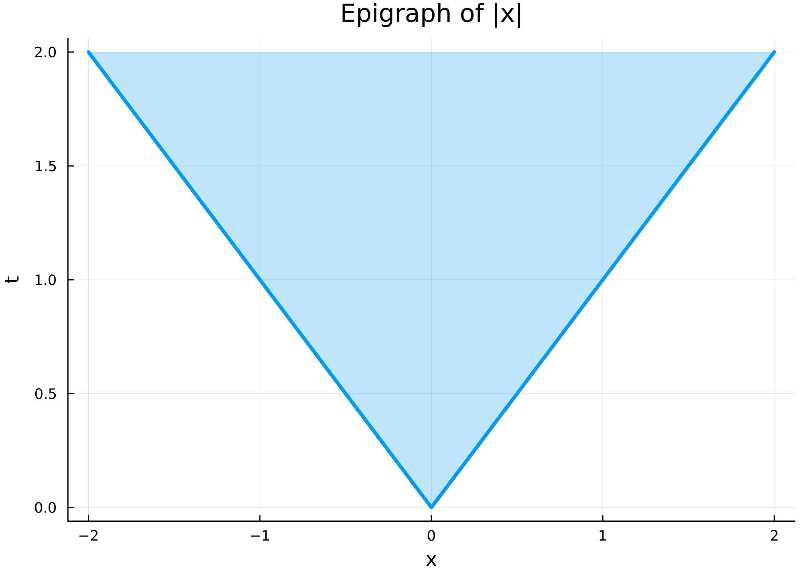

## Goals

1. Appreciate convex optimization as a technology for understanding and solving various optimization problems.
2. Become familiar with different problem classes in optimization that are related to statistical models and methodologies.

## Packages

```{julia}
#| echo: false
#| output: false
ENV["GKSwstype"] = "100"
```

```{julia}
using Plots
Plots.default(dpi = 300, legend = false)
```

## Convexity

Our previous notes dealt with unconstrained problems, and the algorithms there could only promise stationary points.
Convexity is the property that lets us say more.

### Convex Sets

A set $C \subset \mathbb{R}^{d}$ is **convex** if it contains the line segment between any two of its points; that is,

$$
\lambda \boldsymbol{x} + (1 - \lambda) \boldsymbol{y} \in C
\quad \text{for all}~\boldsymbol{x}, \boldsymbol{y} \in C~\text{and}~\lambda \in [0, 1].
$$

A few examples:

- A halfspace, $\{\boldsymbol{x} : \boldsymbol{a}^{\top} \boldsymbol{x} \le b\}$.
- A Euclidean ball, $\{\boldsymbol{x} : \|\boldsymbol{x}\|_{2} \le r\}$.
- The set of positive semidefinite (psd) matrices.
- The intersection of convex sets is convex.

### Convex Functions

The **epigraph** of a function $f : \mathbb{R}^{d} \longrightarrow \mathbb{R}$ is the set of points on or above its graph,

$$
\mathrm{epi}(f) = \{(\boldsymbol{x}, t) : f(\boldsymbol{x}) \le t\} \subset \mathbb{R}^{d+1}.
$$

A function is **convex** if its epigraph is a convex set.

You may know convexity from calculus: a twice differentiable function is convex when $f^{\prime\prime}(x) \ge 0$ everywhere (in several variables, when the Hessian is psd everywhere).
The definition in terms of the epigraph is more general because it does not require derivatives.

### Example: Absolute Value

Consider $f(x) = |x|$.
This function is not differentiable at $x = 0$, so we cannot verify convexity with the second derivative.
Its epigraph is

$$
\{(x, t) : |x| \le t\} = \{(x, t) : x \le t\} \cap \{(x, t) : -x \le t\},
$$

the intersection of two halfspaces. Halfspaces are convex and intersections preserve convexity, so $|x|$ is convex.

```{julia}
#| echo: false
#| output: false
xs = range(-2, 2, length = 201)
plot(xs, abs; fillrange = 2, fillalpha = 0.25, lw = 3,
  xlabel = "x", ylabel = "t", title = "Epigraph of |x|")
savefig("assets/epigraph_abs.png")
```

{fig-align="center" width="60%"}

### Closure Properties

We rarely check the definition directly. Instead, we build convex functions from simple pieces using operations that preserve convexity.

- If $f$ and $g$ are convex, then $f + g$ is convex.
- If $f$ is convex and $a \ge 0$, then $a f$ is convex.
- If $f$ and $g$ are convex, then the pointwise maximum $\max\{f, g\}$ is convex. Its epigraph is the intersection of the two epigraphs. For example, $|x| = \max\{x, -x\}$.
- If $f$ is convex, then so is $f(\boldsymbol{A}\boldsymbol{x} + \boldsymbol{b})$.
- Every norm is convex.

For example, the lasso objective $\frac{1}{2}\|\boldsymbol{y} - \boldsymbol{X}\boldsymbol{\beta}\|_{2}^{2} + \lambda \|\boldsymbol{\beta}\|_{1}$ is convex by these rules, even though it is not differentiable.

### Jensen's Inequality

An equivalent definition: $f$ is convex if and only if

$$
f(\lambda \boldsymbol{x} + (1 - \lambda) \boldsymbol{y}) \le \lambda f(\boldsymbol{x}) + (1 - \lambda) f(\boldsymbol{y})
\quad \text{for all}~\boldsymbol{x}, \boldsymbol{y}~\text{and}~\lambda \in [0, 1].
$$

The chord between two points on the graph lies on or above the graph.

- For $|x|$ this is just the triangle inequality.
- You have seen the general form in probability. If $f$ is convex and $X$ is a random variable, then $f(E[X]) \le E[f(X)]$. The inequality above is the special case in which $X$ takes two values.

### Why Convexity Matters

Recall the distinction between local and global minimizers from the [introduction](optim.qmd).

- If $f$ is convex, then every local minimizer is a global minimizer.
- If $f$ is convex and differentiable, then every stationary point is a global minimizer.

The algorithms we have studied only search locally. For a convex problem that is enough.

### Convex Optimization Problems

A constrained optimization problem takes the form

$$
\begin{aligned}
\min_{\boldsymbol{x}}~& f_{0}(\boldsymbol{x}) \\
\text{subject to}~& f_{i}(\boldsymbol{x}) \le 0, \quad i = 1, \ldots, m, \\
& \boldsymbol{A}\boldsymbol{x} = \boldsymbol{b}.
\end{aligned}
$$

- A point is *feasible* if it satisfies the constraints.
- This is a **convex optimization problem** when $f_{0}, f_{1}, \ldots, f_{m}$ are convex. The feasible set is then a convex set.

The rest of these notes tour four classes of convex problems. Each class contains the previous one:

$$
\text{LP} \subset \text{QP} \subset \text{SOCP} \subset \text{SDP}.
$$

Problems in these classes can be solved reliably with general-purpose software.
Often the work lies in recognizing that a problem belongs to one of these classes, sometimes after a reformulation.

## Linear Programs

A **linear program (LP)** has a linear objective and linear constraints:

$$
\begin{aligned}
\min_{\boldsymbol{x}}~& \boldsymbol{c}^{\top}\boldsymbol{x} \\
\text{subject to}~& \boldsymbol{G}\boldsymbol{x} \le \boldsymbol{h}, \\
& \boldsymbol{A}\boldsymbol{x} = \boldsymbol{b}.
\end{aligned}
$$

- Inequalities between vectors hold componentwise.
- The feasible set is an intersection of halfspaces; i.e. a polyhedron.
- Solvers: the simplex method, interior point methods.

### Application: Least Absolute Deviations

Least absolute deviations (LAD) regression replaces squared residuals with absolute residuals,

$$
\min_{\boldsymbol{\beta}}~\sum_{i=1}^{n} |y_{i} - \boldsymbol{x}_{i}^{\top}\boldsymbol{\beta}|.
$$

It estimates the conditional *median* instead of the conditional mean and is less sensitive to outliers.
The objective is convex but not differentiable, so the methods from our earlier notes do not apply directly.

The trick is to introduce a new variable $t_{i}$ that bounds each absolute residual:

$$
\begin{aligned}
\min_{\boldsymbol{\beta}, \boldsymbol{t}}~& \sum_{i=1}^{n} t_{i} \\
\text{subject to}~& -t_{i} \le y_{i} - \boldsymbol{x}_{i}^{\top}\boldsymbol{\beta} \le t_{i}, \quad i = 1, \ldots, n.
\end{aligned}
$$

- The objective and constraints are linear in $(\boldsymbol{\beta}, \boldsymbol{t})$. This is an LP.
- At a solution each $t_{i}$ equals $|y_{i} - \boldsymbol{x}_{i}^{\top}\boldsymbol{\beta}|$; otherwise we could decrease it.
- This is the epigraph at work: the constraint says that $(y_{i} - \boldsymbol{x}_{i}^{\top}\boldsymbol{\beta}, t_{i})$ lies in the epigraph of the absolute value.
- Quantile regression at other quantiles is an LP by a similar argument.

## Quadratic Programs

A **quadratic program (QP)** has a convex quadratic objective and linear constraints:

$$
\begin{aligned}
\min_{\boldsymbol{x}}~& \frac{1}{2}\boldsymbol{x}^{\top}\boldsymbol{P}\boldsymbol{x} + \boldsymbol{q}^{\top}\boldsymbol{x} \\
\text{subject to}~& \boldsymbol{G}\boldsymbol{x} \le \boldsymbol{h}, \\
& \boldsymbol{A}\boldsymbol{x} = \boldsymbol{b},
\end{aligned}
$$

where $\boldsymbol{P}$ is psd.

- Taking $\boldsymbol{P} = \boldsymbol{0}$ recovers an LP.
- Without constraints, and with $\boldsymbol{P}$ positive definite, the solution solves the linear system $\boldsymbol{P}\boldsymbol{x} = -\boldsymbol{q}$. Ordinary least squares is the familiar example.
- Solvers: active set methods, interior point methods.

### Application: Nonnegative Least Squares

Nonnegative least squares (NNLS) is least squares with sign constraints on the coefficients,

$$
\begin{aligned}
\min_{\boldsymbol{\beta}}~& \frac{1}{2}\|\boldsymbol{y} - \boldsymbol{X}\boldsymbol{\beta}\|_{2}^{2} \\
\text{subject to}~& \boldsymbol{\beta} \ge \boldsymbol{0}.
\end{aligned}
$$

Expanding the objective,

$$
\frac{1}{2}\|\boldsymbol{y} - \boldsymbol{X}\boldsymbol{\beta}\|_{2}^{2}
= \frac{1}{2}\boldsymbol{\beta}^{\top}\boldsymbol{X}^{\top}\boldsymbol{X}\boldsymbol{\beta} - \boldsymbol{y}^{\top}\boldsymbol{X}\boldsymbol{\beta} + \frac{1}{2}\boldsymbol{y}^{\top}\boldsymbol{y},
$$

we recognize a QP with $\boldsymbol{P} = \boldsymbol{X}^{\top}\boldsymbol{X}$ (which is psd), $\boldsymbol{q} = -\boldsymbol{X}^{\top}\boldsymbol{y}$, $\boldsymbol{G} = -\boldsymbol{I}$, and $\boldsymbol{h} = \boldsymbol{0}$.

- Nonnegativity is natural when coefficients represent amounts; e.g. concentrations, intensities, or mixing proportions.
- NNLS is a building block for *nonnegative matrix factorization* (NMF), which approximates a nonnegative data matrix as $\boldsymbol{X} \approx \boldsymbol{W}\boldsymbol{H}$ with $\boldsymbol{W}, \boldsymbol{H} \ge \boldsymbol{0}$. With $\boldsymbol{W}$ fixed, solving for $\boldsymbol{H}$ is a collection of NNLS problems, and vice versa. Alternating between the two is a standard algorithm.
- NMF itself is *not* a convex problem in $(\boldsymbol{W}, \boldsymbol{H})$ jointly. Only the subproblems are.

## Second-Order Cone Programs

A **second-order cone program (SOCP)** has a linear objective and constraints that bound a Euclidean norm by a linear function:

$$
\begin{aligned}
\min_{\boldsymbol{x}}~& \boldsymbol{c}^{\top}\boldsymbol{x} \\
\text{subject to}~& \|\boldsymbol{A}_{i}\boldsymbol{x} + \boldsymbol{b}_{i}\|_{2} \le \boldsymbol{c}_{i}^{\top}\boldsymbol{x} + d_{i}, \quad i = 1, \ldots, m, \\
& \boldsymbol{F}\boldsymbol{x} = \boldsymbol{g}.
\end{aligned}
$$

- The set $\{(\boldsymbol{u}, t) : \|\boldsymbol{u}\|_{2} \le t\}$ is called the *second-order cone*. It is the epigraph of the Euclidean norm.
- Taking $\boldsymbol{A}_{i} = \boldsymbol{0}$ gives linear inequalities, so every LP is an SOCP.
- Every QP can be rewritten as an SOCP as well.
- Solvers: interior point methods.

### Application: Group Lasso

Suppose the predictors are partitioned into groups $g = 1, \ldots, G$; e.g. the dummy variables that encode a single categorical predictor.
The **group lasso** selects or removes entire groups at once:

$$
\min_{\boldsymbol{\beta}}~\frac{1}{2}\|\boldsymbol{y} - \boldsymbol{X}\boldsymbol{\beta}\|_{2}^{2} + \lambda \sum_{g=1}^{G} w_{g} \|\boldsymbol{\beta}_{g}\|_{2},
$$

where $\boldsymbol{\beta}_{g}$ collects the coefficients in group $g$ and $w_{g} > 0$ are weights (a common choice is the square root of the group size).

- The penalty uses the Euclidean norm of each group, *not* its square. It is not differentiable at $\boldsymbol{\beta}_{g} = \boldsymbol{0}$, which is what sets entire groups to zero.
- When every group has size 1 we recover the lasso.

To reformulate, introduce a variable $t_{g}$ that bounds each group norm and a variable $s$ that bounds the loss:

$$
\begin{aligned}
\min_{\boldsymbol{\beta}, \boldsymbol{t}, s}~& s + \lambda \sum_{g=1}^{G} w_{g} t_{g} \\
\text{subject to}~& \|\boldsymbol{\beta}_{g}\|_{2} \le t_{g}, \quad g = 1, \ldots, G, \\
& \frac{1}{2}\|\boldsymbol{y} - \boldsymbol{X}\boldsymbol{\beta}\|_{2}^{2} \le s.
\end{aligned}
$$

- The objective is linear and the first set of constraints are second-order cone constraints.
- The last constraint is also a second-order cone constraint in disguise. With $\boldsymbol{r} = \boldsymbol{y} - \boldsymbol{X}\boldsymbol{\beta}$, one can check that $\frac{1}{2}\|\boldsymbol{r}\|_{2}^{2} \le s$ is equivalent to

$$
\left\| \begin{pmatrix} \boldsymbol{r} \\ s - \frac{1}{2} \end{pmatrix} \right\|_{2} \le s + \frac{1}{2}.
$$

- In practice, specialized algorithms are often used for the group lasso on large problems. The SOCP formulation shows that the problem is tractable and gives a reliable baseline.

## Semidefinite Programs

A **semidefinite program (SDP)** optimizes a linear objective subject to a constraint that a matrix, depending linearly on the variables, is psd:

$$
\begin{aligned}
\min_{\boldsymbol{x}}~& \boldsymbol{c}^{\top}\boldsymbol{x} \\
\text{subject to}~& x_{1}\boldsymbol{F}_{1} + \cdots + x_{d}\boldsymbol{F}_{d} + \boldsymbol{F}_{0} \succeq \boldsymbol{0}, \\
& \boldsymbol{A}\boldsymbol{x} = \boldsymbol{b},
\end{aligned}
$$

where $\boldsymbol{F}_{0}, \ldots, \boldsymbol{F}_{d}$ are symmetric matrices.

- We write $\boldsymbol{A} \succeq \boldsymbol{0}$ when $\boldsymbol{A}$ is psd, and $\boldsymbol{A} \succeq \boldsymbol{B}$ when $\boldsymbol{A} - \boldsymbol{B}$ is psd.
- The set of psd matrices is convex, so this is a convex problem.
- When the matrices $\boldsymbol{F}_{j}$ are diagonal, the constraint reduces to linear inequalities and we recover an LP. Second-order cone constraints can also be written as psd constraints.
- Solvers: interior point methods. These become expensive as the size of the matrix grows.

### Application: Knockoffs

Consider variable selection with predictors $X_{1}, \ldots, X_{p}$.
We would like to select important predictors while controlling the *false discovery rate* (FDR).
The **knockoff filter** of [Barber and Candes](https://arxiv.org/abs/1404.5609) does this by manufacturing a fake copy $\tilde{X}_{j}$ of each predictor.

- The knockoffs $\tilde{X}_{1}, \ldots, \tilde{X}_{p}$ mimic the correlation structure of the original predictors.
- They are constructed without looking at the response, so they are known to be unimportant.
- A predictor is selected only if it looks clearly more important than its own knockoff. The knockoffs serve as negative controls.

Suppose the predictors have covariance matrix $\boldsymbol{\Sigma}$, scaled so that $\Sigma_{jj} = 1$.
In the [model-X](https://arxiv.org/abs/1610.02351) version of the method with Gaussian predictors, the joint covariance of the originals and the knockoffs is required to be

$$
\boldsymbol{G} =
\begin{pmatrix}
\boldsymbol{\Sigma} & \boldsymbol{\Sigma} - \mathrm{diag}(\boldsymbol{s}) \\
\boldsymbol{\Sigma} - \mathrm{diag}(\boldsymbol{s}) & \boldsymbol{\Sigma}
\end{pmatrix}.
$$

- The correlation between $X_{j}$ and its own knockoff is $1 - s_{j}$.
- We want $s_{j}$ to be large. If a knockoff is nearly identical to its original, we cannot tell them apart and the method has no power.
- But $\boldsymbol{s}$ cannot be arbitrary: $\boldsymbol{G}$ must be a valid covariance matrix; i.e. psd. This holds exactly when $\boldsymbol{s} \ge \boldsymbol{0}$ and $\mathrm{diag}(\boldsymbol{s}) \preceq 2\boldsymbol{\Sigma}$.

This leads to the optimization problem

$$
\begin{aligned}
\min_{\boldsymbol{s}}~& \sum_{j=1}^{p} |1 - s_{j}| \\
\text{subject to}~& \boldsymbol{s} \ge \boldsymbol{0}, \\
& 2\boldsymbol{\Sigma} - \mathrm{diag}(\boldsymbol{s}) \succeq \boldsymbol{0}.
\end{aligned}
$$

- The matrix $2\boldsymbol{\Sigma} - \mathrm{diag}(\boldsymbol{s})$ depends linearly on $\boldsymbol{s}$, so the last constraint is exactly the kind of constraint allowed in an SDP.
- The absolute values in the objective are handled with the same trick we used for LAD.
- A simpler alternative sets every $s_{j}$ to the same value, $\min\{2\lambda_{\min}(\boldsymbol{\Sigma}), 1\}$. This only requires an eigenvalue computation, but typically yields less power.
- Solving the SDP is the computational bottleneck of the method when $p$ is large.

## Takeaway Message

- Convex optimization is a technology in the present day. It provides a foundation for solving various problems within and beyond statistics.
- In Julia, [JuMP.jl](https://jump.dev/) and [Convex.jl](https://jump.dev/Convex.jl/stable/) let us state a problem in a form close to the mathematics and pass it to a solver.
- Boyd and Vandenberghe have an excellent textbook on convex optimization: [https://stanford.edu/~boyd/cvxbook/](https://stanford.edu/~boyd/cvxbook/).


